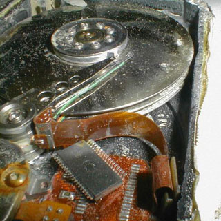

Although I've never had to use their services (fortunately), I've heard good things about [Kepler](http://www.kepler.cl/), a Chilean company that specializes in data recovery, particularly from damaged hard drives.

Well, it turns out that a company doing the same kind of work in the United States ([OnTrackDataRecovery](http://www.ontrackdatarecovery.com/)) has recovered the information from a hard drive that survived among the debris of the space shuttle Columbia.

If you remember, in February 2003 Columbia disintegrated on reentry, the result of damage to its heat shield during launch. NASA's second space shuttle tragedy.

The recovered information made it possible to [solve a physics problem](http://www.sciam.com/article.cfm?id=hard-drive-recovered-from-columbia), since the drive held data from an experiment studying how xenon flows in microgravity (no idea what that's good for).
