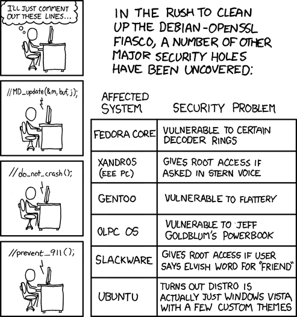

Now that I have your attention, dear reader, let me tell you that this
is not about the Luciano Bello in the photo, who, despite his attempts
to look intelligent, I don't think works in computing.

No, the [Luciano Bello](http://lbello.livejournal.com/) in question is
an Argentine hacker who took the time to read the code of Debian's
OpenSSL implementation and found a
[pretty serious flaw](http://www.debian.org/security/2008/dsa-1571) ([Debian](http://www.debian.org/es) is
the base of the [Ubuntu](http://www.ubuntu.com/) distribution) and
others.

The [bug had been there since 2006](http://www.kriptopolis.org/chapuza-en-debian) and it shows,
once again, that free software is not more secure "per se".

It also shows that the misnamed Linus's Law isn't true either, the one
coined by Eric Raymond, who claims that with many eyes looking at the
code, all bugs are obvious.

The truth is that even with enough eyes, bugs still slip right between
the developers' legs.

The best thing about this whole incident is today's
[XKCD](http://xkcd.com/424/) strip:

[
