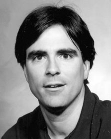

[Randy Pausch](http://download.srv.cs.cmu.edu/~pausch/Randy/oldRandyPage.html) is a virtual reality pioneer, a former professor at [Carnegie Mellon University](http://www.cmu.edu/), and the founder of the [Alice](http://www.alice.org/) project, one of the most interesting educational computing projects out there. He has consulted for Disney and for Google on human-computer interface design.

Randy has received two awards from the [ACM](http://www.acm.org/) for his work in computing education.

Although I knew the [Alice](http://www.alice.org/) project, I didn't know much about Randy Pausch until I saw the link at [Kimniekan](http://www.ricardodiaz.org/) to a talk Pausch gave on the famous Oprah Winfrey show in the United States. The original lecture Randy gave in September 2007 at CMU is longer, but the message is the same.

Here is the condensed talk, 10 minutes long, which I hope you can take the time to enjoy.
