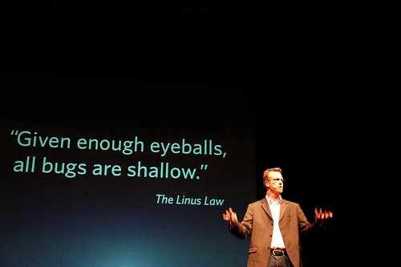
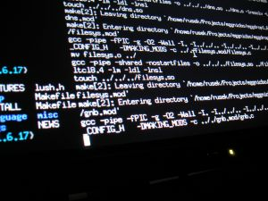

I'm battling my blog's spam filter, and I've realized it has been hiding several interesting comments from me.

One of the ones I rescued was sent by [Micronauta](http://twitter.com/micronauta), and since he writes one of my [favorite blogs](http://blog.canal.cl/), I think he deserves a featured reply (and I'm taking the chance to apologize to him for not having published his comment).

Let's see, the comment is on my article about the [flaw in Debian, found by Luciano Bello :wink:](/en/blog/lnds/2008/05/16/luciano-bello-finds-security-flaw-in-debian-ubuntu/) I have to confess I wasn't satisfied with the very short, pseudo-humorous note I wrote, and I think at some point I'll write about the lessons that case leaves us, but let's get to [Ignacio's comment](/en/blog/lnds/2008/05/16/luciano-bello-finds-security-flaw-in-debian-ubuntu/#comment-65935).

The first part of the comment says:

> Your sentence "it also shows that the misnamed Linus's Law isn't true either" would have to be backed up with statistics. I hold the hypothesis that Torvalds is right. Just because somebody out there caught a bug doesn't prove that the law isn't true.

Well, first we need to make clear that Linus's Law was formulated by [Eric Raymond](http://catb.org/~esr/), in his classic essay [The Cathedral and the Bazaar](http://biblioweb.sindominio.net/telematica/catedral.html), and it goes like this:

> "given enough eyeballs, all bugs are shallow"

There is even a more formal version of this law:

> "Given a large enough beta-tester and co-developer base, almost every problem will be characterized quickly and the fix will be obvious to someone."

A single counterexample is enough to bring down Raymond's statement, and many criticisms of it start from that fact.

One counterexample is the Debian flaw, because the consequences of removing one line were not obvious in the code, even though the case was submitted to and discussed by the community before making the change that led to the disaster.

I insist that the subject deserves a deeper analysis, enough for an essay on software engineering, but I think it's clear that, as stated, Linus's Law cannot be considered a law, and is at most a statement of intent.

But there's more: Raymond himself acknowledges the error in his original formulation, in a reply on the e-mac-devel list to a message from Stephen J. Turnbull, which says:

> It is not true that to "many eyes, all bugs are shallow". What is true is that (1) with many eyes, shallow bugs get caught very quickly, and (2) that the more eyes there are, the more likely it is that some member of the group has sufficiently penetrating vision to catch the deeper-swimming bugs.

To which Eric Raymond replies:

> As I observed recently on the Open-Source list, one of the advantages of being me is that I'm not required to believe the popular oversimplifications of my thinking. Congratulations: you have captured my **actual** view of the many-eyeballs effect rather exactly!

Unfortunately, it's the original formulation that stuck, and nobody takes into account that it is a mistaken law, one that leads to disastrous consequences, as several authors more authoritative than me have written.

Now, the second paragraph of Ignacio's comment:

> It must be more likely for bugs to get caught in open source software than in closed source software, simple economics of attention, so as a result it must be statistically safer to use solutions based on open source. Common sense.

This deserves more attention, and I doubt anyone has the figures to prove it one way or the other, but let's attempt an answer using common sense, which is what my commenter appeals to.

We know that the observation of a bug, by a user or a beta tester, is not enough to determine the cause of the bug. In fact, the cause of a bug is often the least obvious thing, and it can originate in a very deep component of the system, or be the result of a side effect that is not a direct consequence of the code.

So having a large user base lets us find bugs faster, because that user base contributes data, and information is the best tool we have for finding a flaw. But this advantage applies to both open and closed source, and in fact we know that Microsoft collects vast amounts of information on errors generated by millions of users in thousands of different configurations.

Then there's the matter of the many eyes. Well, those eyes not only have to be looking at the code, they have to be motivated, trained and prepared to look at that code.

Having a proper development environment to compile and debug the OpenSSL code takes no small amount of preparation (in fact, the Debian bug was born from the needs of one of these development environments).

The consequence of what I'm saying is that there aren't enough eyes looking at the code, and of the eyes that are looking, not all are prepared. In fact, they make catastrophic decisions that take years to correct (the Debian case is not the only one).

The law of large numbers, one of the foundations of statistical analysis, requires, well, large numbers, and Linus's Law is a law of that kind.

Those large numbers do show up in some projects, where there are also big investors paying the eyes to pay attention to the code, but that doesn't happen in most of them, and it's precisely what happens in OpenSSL, whose own developers admit there is neither the time nor the resources to maintain that code properly.

Closed software, on the other hand, has the number of eyes it needs: eyes that are prepared, motivated (we hope) and paid to look at that code.

The fundamental difference is that, in the case of open source, once a flaw has been identified, an outsider can come in and make the fix.

The advantage of open source is that the response time is many times better than that of closed source, because "**once a bug has been identified, many eyes turn their attention to the code**", and that really would be a beautiful law, more precise and realistic, and one that applies to open and closed source alike. The corollary is obvious: the number of eyes that turn to open source code is greater, and so the odds of finding the solution in less time go up.

(Original photograph [from Flickr](http://www.flickr.com/photos/maqroll/243526959/) taken by [maqroll](http://www.flickr.com/photos/maqroll/), under a CC license)
