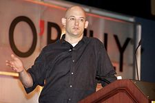

I don't know whether Jung is right and
[synchronicity](http://es.wikipedia.org/wiki/Principio_de_sincronicidad) exists,
but my head sometimes connects topics that seem to have no causal
relationship. It happened to me today, and it's so interesting that it
moved me to translate an article, which I'm sharing with you.

It goes like this. Going through my feed reader I had read
a [father's plea on the net](http://blog.maz.cl/2008/05/pap-en-red-pide-ayuda.html), and I made
a note to think about an answer later. Then I ran into [micronauta's
indignant reply](http://blog.canal.cl/2008/05/homo-tecnotronicus-responde.html) to
[Collyer's critique of the supposed homo technotronicus](http://larepublicablog.bligoo.com/content/view/196023/El_homo_tecnotronicus_sus_rasgos_tentativos_por_Jaime_Collyer.html),
a rather prejudiced and idiotic piece, I must say. So I made a note
that I had to respond to that too.

I remembered that [Jeff Atwood](http://www.codinghorror.com/blog/) had
pointed to [this article](http://www.shirky.com/herecomeseverybody/2008/04/looking-for-the-mouse.html) by [Clay Shirky](http://www.shirky.com/), and I decided to read it, calmly, and bingo!
The two answers I wanted to give are implicit in this article, and in a
talk by Shirky.

So I decided to apply a little cognitive surplus (a term that will be
clearer once you've read what follows) to translate what I think is one
of the best articles I've read in a long time. Here is how it begins:

**Gin, Television, and Social Surplus**

By Clay Shirky

> I was recently reminded of some reading I did in college, way back in
> the last century, by a British historian arguing that the critical
> technology, for the early phase of the industrial revolution, was
> [gin](http://es.wikipedia.org/wiki/Gin). The transformation from rural
> to urban life was so sudden, and so wrenching, that the only thing
> society could do to manage was to drink itself into a stupor for a
> generation. The stories from that era are amazing-- there were gin
> pushcarts working their way through the streets of London.

From there Shirky argues that the sitcom was the gin of the 20th
century, the heat sink for all the free time society suddenly had to
manage, and that we are only now waking up from that second collective
bender.

His unit of measure for that cognitive surplus is Wikipedia, and it
answers the question a TV producer asked him: "Where do people find the
time?"

> The whole Wikipedia project amounts to a hundred million hours of human
> thought.

Americans alone watch two hundred billion hours of television every
year. Doing something beats doing nothing, he says, and even a
[lolcat](/en/blog/lnds/2007/08/26/lolcats/) is an invitation to participate: **I
can do that too**.

The talk closes with the story of a four-year-old girl who gets up in
the middle of a DVD and goes rummaging behind the screen, looking for
the mouse.

> From now on, that's what I'm going to tell them: **We're looking for
> the mouse.**

The full text is in [Shirky's original article](http://www.shirky.com/herecomeseverybody/2008/04/looking-for-the-mouse.html).

(The original article is a transcription of a talk given by Clay Shirky
at the Web 2.0 conference)
