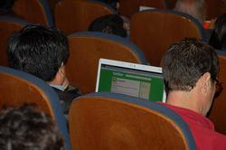

Yesterday I had the pleasure of attending BlogPower 2. The event was brilliantly organized, entertaining and very informative.

Brilliant, too, was [Fernando Paulsen's presentation](http://www.blogpower.cl/2008/06/07/fernando-paulse-y-su-mirada-sobre-las-primarias-en-estados-unidos/), with his view of how Barack Obama will make history not so much for the color of his skin as for his use of electronic media. Consider that Obama raised some 200 million dollars in campaign support over the internet. People are already used to buying things online, so backing a campaign with money over the internet was the natural next step, and Obama was the first to capitalize on it.

Paulsen also showed us the level of information technology use in the US government, with two interesting examples: the blog of [Michael Chertoff](http://www.dhs.gov/journal/leadership/), Secretary of Homeland Security, and that of [Mike Leavitt,](http://secretarysblog.hhs.gov/) Secretary of Health and Human Services, both members of Bush's cabinet. Put that in your pipe and smoke it, ministers of our government.

Consider that the US government will spend **65 billion dollars** of its budget on e-government.

For my part, I ran into the kids organizing the [ONI](http://www.oni.cl/), the first National Informatics Olympiad, an initiative I'll write about at length in a later article. We took the chance to promote it among some of the guests. I invite you to read up on this initiative and spread the word.

Once again, congratulations to the organizers of [Blogpower](http://www.blogpower.cl/) for such a well-run event. Just one detail, a pretty minor one really: the Blogpower T-shirt has the date of the event wrong (written gringo-style, with the month first). ;)

(Photograph taken by [Roberto Arancibia](http://www.flickr.com/photos/robertoarancibia/), caught twittering during the event)
