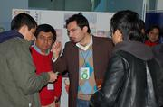
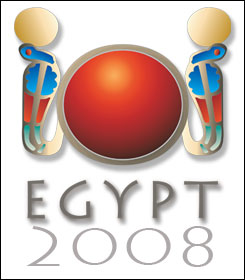

In September 2005 [I wrote for the first time](/en/blog/lnds/2005/09/02/cuba-the-best-at-computing/) about the [IOI](http://www.ioinformatics.org/index.shtml) (International Olympiad in Informatics), and later I commented on [my doubts about Chile's participation in IOI 2006](/en/blog/lnds/2006/09/02/chile-at-ioi-2006/).

The truth is that Chile's participation in this international event has always been semi-official (and pretty murky, in my opinion).

But that's history now. At last we're going to have a proper [national informatics olympiad](http://www.oni.cl/), which will let us pick the team that will represent us in Egypt at IOI 2008. Thanks to the efforts of brothers Israel and Cristobal Leiva, who have mobilized organizations and secured the official support of the Ministry of Education, this year for the first time we'll have this event the way it should be.

At last we'll have the chance to select our best young people in computing to take part in this event, which offers the young people who compete in it many opportunities to study (in the form of scholarships and job opportunities).

I met Israel and Cristobal in Buin last year, before they left to represent our country at IOI 2007. The experience wasn't the best, largely because the event was being handled inadequately. We met again at BlogPower, where we compared notes and took the chance to promote this event in other spaces, which [has been well received](http://ucpn.cl/2008/06/13/se-vienen-las-primeras-olimpiadas-nacionales-de-informatica-para-chile/).

I asked them to answer a few questions about their experience with all this and about organizing the olympiad. Here is that exchange with the organizers of the ONI, an example of enterprising young people who should make us proud:

**Question: How old are you guys?**

Answer: We're 18, about to turn 19.

**Q: Where do you live?**

A: We live on Avenida Manuel Rodríguez in the city of Buin.

**Q: How did you get interested in computing?**

Our interest in computing came after we got internet access on the computer at home, since before that we only used it to play games. The internet was, in a way, the gateway to an enormous amount of information and possibilities.

**Q: What was your experience at IOI 2007 like?**

A: Our experience in Croatia was, above all, very enriching in many ways: the cultural exchange, seeing other realities, and obviously the computing side. It was an exceptional opportunity to see the great potential software development has worldwide and how it is being encouraged among young people.

But it wasn't all rosy. Since Chile had no informatics olympiad of any kind for high school students, none of the four young Chileans who took part were selected through an institutional process; we were picked directly by the Chilean "representative" (who is Bulgarian) to the IOI. Well, I won't go into details, but our relationship with him (all four of us) at the IOI was not good; we had several heated run-ins with him.

We also realized that all the countries taking part in the IOI run a whole selection process beforehand at the national level, and even at regional and provincial levels. All of this is driven by the governments (Ministries of Education) of those countries, where the processes are carried out by accredited people.

**Q: Why is it good for us to have an ONI in Chile? Why is it important to take part in the IOI?**

A: As I mentioned before, the fundamental point of holding an ONI in Chile is to be able to regularize our participation in the IOI and really send the young people who stand out from the rest, who master the subject.

The IOI is an incentive for those young scientists of tomorrow who see how relevant software development, and new technologies in general, are in today's world. It is a motivation and a support for young people who want to develop their abilities further in higher education, since many of the young people who compete and win medals at the IOI manage to get scholarships at universities around the world.

**Q: Who has supported you in making this happen?**

A: To hold the first National Informatics Olympiad in Chile we have had the support of the Municipality of Buin (the Municipal Administrator and the IT Department) together with councilman Ramón Calderón, who believed in our project and gave it the green light.

Also, once the project took shape we were able to get the support of the Ministry of Education, without which it would not have been possible to secure Chile's participation in the IOI. Not to mention my family, who have supported me through all of this so I would never give up and always keep going. Many thanks to all of them.

**Q: What is the competition like? Can you tell us a bit about how the online phase will be evaluated?**

The ONI follows the same criteria as the IOI on technical matters.

It will be held in two phases, one online and one in person, the final. The online phase will take place on June 21, that is, this coming Saturday, and from it the top twelve will be selected to come to Buin for the in-person final, which will be held on July 19. The four winners will represent Chile at the IOI, which will take place from August 16 to 23 in Cairo, Egypt.

For the online phase, everyone interested in competing can go to www.oni.cl, where they can register and access a web platform that explains how the system works and offers some practice problems so that those already registered can try the system out.

Basically, what the system (an online judge) does is receive the solution each competitor submits (written in C, C++ or Pascal), compile it and run it. Depending on the results that solution produces, it checks whether that output is what the system expects and assigns a score relative to the number of correct answers.

**Q: Where is there material to study?**

A: On www.oni.cl there is a section called Material. It has a variety of links about the content of the olympiads and others about the tools used for judging, such as the compilers.

**Q: What would be a sign, for you, that your venture has succeeded?**

A: We believe the fundamental thing for this project to have succeeded is, on the one hand, to establish continuity in Chile's participation in the IOI.

On the other hand, most young Chileans who know the subject got there on their own initiative, so an important goal is to bring computing education into Chile's schools at a level good enough to train computing professionals, specifically in software development, and so make the most of the potential of our young people and of new technologies.

**Q: What are the plans for ONI 2009 and the ones after that?**

A: Our goals are to consolidate Chile's participation in the IOI, as I already mentioned, in a constant and regular way, and also to run some kind of training or preparation (in programming) for interested young people, since the level the IOI demands is high.

**Q: How have your parents supported you?**

A: Nothing to add, they've always been there supporting us in everything, in good times and bad. Without them we couldn't have achieved everything we've done so far.

How is your parents' support?  
Nothing to add, they've always been there supporting us in everything, in good times and bad. Without them we couldn't have achieved everything we've done so far.

**Q: What would you like to do in the future?**

A: I (Israel) would personally like to study and earn a degree in Computer Engineering, preferably at the University of Chile. After that, besides working, I'd like to devote myself to developing projects that are innovative and promote the ideal pairing of education and new technologies. As for my brother, his plans are to study computing abroad and, once established, return to Chile and contribute to the country's technology and education community.

I invite you to support [ONI 2008](http://www.oni.cl/), and if you meet the requirements, to sign up and take part; there's still time.

(image credits: photograph at BlogPower by [Roberto Arancibia](http://www.flickr.com/photos/robertoarancibia/), students competing taken from the [IOI2008](http://www.ioi2008.org/) site, official IOI 2008 logo).
