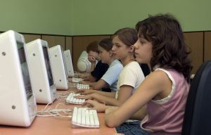
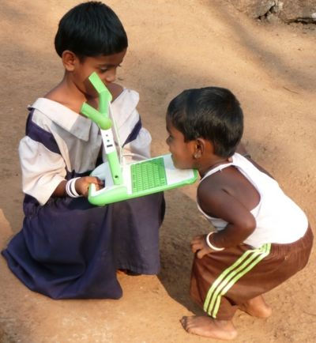

[View image](625016_mac.jpg)

A [new study](http://www.columbia.edu/~cp2124/papers/computer.pdf), backed by fairly respectable credentials, "proves" that home computers for children have negative effects on their education, and that large-scale efforts to give computer access to disadvantaged children are of questionable value unless attention is paid to how parents control the use of the computer.

The story goes like this: in 2005 the Romanian government decided to hand out a voucher so that low-income children and teenagers could buy a computer for the home. As part of the program, the Romanian government made more than 500 educational packages available to those interested, which were to be installed at no cost by the retailers selling the computers.

In 2007 a survey was run to look into the impact of this measure in Romania, and it found that very few computers had the educational packages installed and that the results were negative in terms of school performance. In the end the only thing that went down was the number of hours spent watching television, which were replaced by hours on the computer, and in general the children with a computer did worse at school. Only where there was an authority figure at home (usually the mother) keeping an eye on how the PC was used did the kids do better.

But what happened? What went wrong with the Romanian project?

  
First, it seems that in their eagerness to prove that giving computers to children is bad, these researchers got seriously careless with their math. The proposed model is misapplied, as [Tony Forster shows](http://tonyforster.blogspot.com/2008/06/home-pcs-lower-education-results.html).

But the truth is that they ignore several common-sense facts, which Ivan Krstic [takes care of clearing up.](http://radian.org/notebook/distraction-machine)

First, the voucher only covered the purchase of a computer; there was no incentive to cover the cost of internet access. In essence, most of the computers were offline.

Second, the choice of hardware isn't the right one. As Krstic points out, the hardware used in this kind of program must have the following characteristics:

**Ownership**: it has to be something the children can own, because a shared computer in the classroom only works in class, when there are teachers around, and when there are no other kids competing for time on the computer.

**Portability**: the kids must be able to carry the device with them, because in many cases devices like this will replace books. The idea is to have a device that lets them always be learning, becoming an extension of their mind and letting them experiment whenever something interests them, so it has to be a device that is with them a considerable amount of time. Desktop computers are heavy and immobile; they are no good for developing that potential.

**Appropriate human interaction**: the device must allow rich, prolonged interaction. It needs responsive input devices, which rules out most cell phones, because imagine what would happen when the kids want to write an essay or a story. Even the iPhone's screen falls short for writing, reading books or browsing the web. As Krstic says, "anything with a screen under 6-8 inches diagonally is suspect", something to keep in mind when considering alternatives like [having Sugar run on iPhones](http://luisramirez.cl/blog/?p=1135).

**Compatibility with infrastructure and external conditions**: the device needs to be compatible with the realities of the infrastructure available in each country. In many countries there is no drinking water, let alone electricity or wireless networks. You have to deal with hostile conditions, like desert sand, places with endless rain like the Peruvian jungle, or the extreme heat of many African countries. It also has to survive the (ab)use kids will put it through; it has to be a tough machine.

Clearly, given all this, choosing desktop PCs and handing out a voucher is a recipe for disaster. Even supplying optional educational software achieves nothing. Because do you know a kid who will voluntarily use his computer, in his free time, for anything other than having fun?

As I said before, if we hand computers to children and don't build them into the educational process, then we'd be better off handing out vouchers to buy a PlayStation.

The Romanian government, and the researchers, expected that by magic, just by having a computer at home, the kids would devote themselves to doing more homework.

Let's hope these lessons serve us as a country when we think about how to implement a program of the [one computer per child](http://www.ucpn.cl/) kind.

