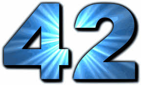

This year I turn 42, and 42 is an "extraordinary number". As everyone knows (or should know), 42 is [the answer to the question of life, the universe and everything](/en/blog/lnds/2006/10/15/solving-problems-1/).

So I'm going to allow myself a bit of [apophenia](http://es.wikipedia.org/wiki/Apofenia) during the months left until my birthday, just because it's fun, not because I'm going crazy or surrendering to innumeracy, so don't worry.

Because it turns out that 42 Turing Awards have been given out, because Alan Turing himself died at 42, because 42 is probably the key to understanding the distribution of prime numbers, and because the [8 digits of PI](http://www.eveandersson.com/pi/digits/1000000.txt) starting at position **242,422** are **42 42 42 42**, and of course because 42 is one of [the numbers](http://lostpedia.com/wiki/The_Numbers).

Douglas Adams probably made an important revelation to us, who knows? So I've created the 42 category for this blog, home to these crackpot ramblings, which I promise will be entertaining.
