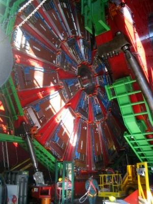
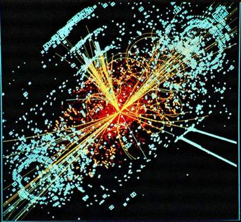
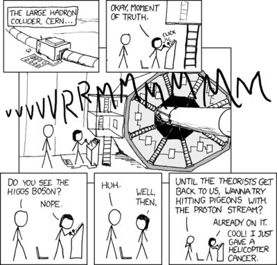

The world ends this year (again).

Well, we've already talked about [the end of the world](/en/blog/lnds/2006/04/16/the-doomsday-machines/) at the hands of technology. But this new "threat" is quite interesting.

The cause would be the switching on of the Large Hadron Collider, the largest particle accelerator built so far. The LHC is the most important project of the European Organization for Nuclear Research (CERN).

CERN is where the Web was born, a project proposed by Tim Berners-Lee in order to share researchers' work around the world over the internet, but that's another story.

CERN is the largest nuclear physics research center in the world, and the LHC is the most important experiment running right now.

In essence the LHC is a very cold tunnel (at 2 kelvin, 271 degrees Celsius below zero) some 27 kilometers in circumference, where protons will collide at very high energies.

## **What for?**

To find and observe for the first time a particle predicted, but not yet observed, by the standard model of elementary particles. It's the **"[Higgs boson](http://es.wikipedia.org/wiki/Bos%C3%B3n_de_Higgs)".**

The experiment will confirm the existence of this elementary particle, and with that tell us why all bodies have mass. Because we know that all bodies have mass, and that it is equivalent to energy, but we don't really know what mass is, or how bodies acquire it.

That is why a Nobel laureate even went so far as to call it the "God Particle".

The LHC really is an extraordinary machine, and a dangerous one, but not in the sense of being able to destroy the world. The energy inside is indeed enormous, and if something fails there could be an explosion that would probably destroy the laboratory, but that isn't the kind of catastrophe some people are going around announcing.

Whenever man has faced this kind of experiment, the most catastrophic fears come up. When the first nuclear device was tested, some speculated that the explosion of the first atomic bomb would set the atmosphere on fire. In fact, when the sound barrier was about to be broken there was also talk of the destruction of the atmosphere.

In this case the speculation is that the experiment could form stable black holes that would swallow our planet. Or that exotic matter could arise and vaporize the Earth in seconds.

Scientists have measured the likely risks and have done two studies, the first in 2003 and one very recent, that rule out these catastrophic scenarios.

The truth is that cosmic rays [have been observed](http://en.wikipedia.org/wiki/Ultra-high-energy_cosmic_ray) falling in nature with 100 million times more energy than the LHC generates, and nobody has ever seen black holes form, nor has our planet burned up so far.

Well, this must be something like the tenth end of the world I've had to witness, so I'm not too worried. It may end up going something like [what xkcd describes](http://xkcd.com/401/):

transcript

* The Large Hadron Collider, CERN
* Okay, moment of truth
* VVVVVRRRRMMMMMMM
* Did you see the Higgs boson?
* NOPE
* Uh...
* Well then...
* Until the theorists get back to us, how about we hit some pigeons with the proton beam?
* Already on it. Cool! I just gave a helicopter cancer.
