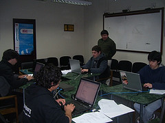
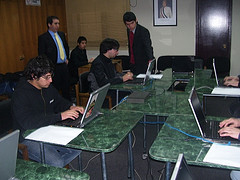
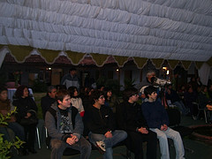

To prepare a [piece Fayerwayer asked me for](http://www.fayerwayer.com/2008/07/olimpiadas-internacionales-de-informatica/), I put a few questions to the kids who won the final stage of the [Olimpiada Nacional de Informática](http://www.oni.cl/) (ONI, Chile's National Olympiad in Informatics).

These are their answers, and I'm sharing them with you so you can get to know these kids a little better. (photographs [courtesy of the ONI on Flickr](http://www.flickr.com/photos/27507638@N08/))

**What is your name, your age, what grade are you in, and at what school and in what city do you study?**

CS: My name is: cristian andres silva lara, my grade: senior year, class I, at Liceo José Victorino Lastarria, I study in: Santiago, Providencia

NL: Nicolas Emilio Lehmann Melendez, 17 years old, senior year at the german school of san felipe

VI: My name is Vicente Iglesias, I'm 16, and I'm a sophomore at Colegio San Ignacio El Bosque in Santiago.

JP: Juan Manuel Parraguez, I'm 17 and I'm a senior at instituto san martín in curico.

**How did you find out about the ONI?**

CS: because I read fayerwayer every day, and since on mondays canal 13 cable airs fayerwayertv on Estamos Conectados, I watch it on tuesdays online, and one of the news items on the estamos conectados page was the info about the ONI.

NL: An announcement was posted on Fmat (a forum about math).

VI: I found out about the ONI by reading the UCPN.cl blog (the address is this one). From there I went to the ONI website and signed up...

JP: I read about it by chance on a web page.

**Have you had support from your school to take part in this event?**

CS: No, everything I did was on my own, I don't think the school even found out that I took part, or at least that a contest like this for students existed.

NL: Not at all, I've done everything together with my family.

VI: At my school there's a group called MediaLab, where students are encouraged to develop their projects. We get together every Friday and at almost every recess, so in that space I was able to practice a bit for the contest. There's a teacher assigned almost exclusively to helping and guiding us in this kind of initiative, which is, for me, incredible support from the school. In that sense I'm very grateful.

JP: Yes, the school has given me the support and the means to take part in the ONI.

**What has your family's support been like?**

CS: Total, here my whole family backed me, from my grandma who didn't understand much, to my brother who was practically my teacher in this programming thing.

NL: Very good. They support me in everything. (As long as I don't stop studying for the PSU, the university entrance exam.)

VI: My family's help has been immense! For starters, my parents have always supported me, and they quickly understood that I wasn't like most kids, who enjoy playing ball, but on the contrary liked reading books and asking lots of questions about the most varied subjects (almost always aimed at them), so I'll be grateful to them forever. My brothers and sisters too, even though they're younger, support me in everything I do, which is very nice. My family is very close, so I credit them with much of what I've learned; it's this peace that lets me want to learn and to know.

JP: Unconditional, they've always been behind me in everything I decide to do.

**What did you think of the organization of the event? What surprised you most? Do you have any criticism or suggestion?**

CS: I found the organization of the event spectacular, they left no detail to chance, from when they came to pick me up in santiago until they dropped me off, they offered us every possible comfort, and the municipality treated us great. What surprised me most was the technological level buin is at, and the safety the city offers, I remember I was leaving the municipal building and the first thing I see in the main square is a guy with a macbook air sitting on a bench, as if it were the most normal thing in the world, that really left me impressed. I have no criticism of the event, as a suggestion, well simply that they keep doing it and keep on the right path, selecting the best computer people in the country.

NL: For a first edition I thought it was very well organized. The way they treated us was spectacular and my only suggestion would be that it needs better publicity, since I feel I found out by pure chance.

VI: I thought the organization of the event was incredible. Everything was very well prepared and planned. I think the ONI organizing committee and the municipality of Buin deserve a round of applause.
I was surprised, when I signed up, that it was the Municipality of Buin organizing the event, but later, at the competition, I realized why: Buin is a town living in the 21st century, where there's Wifi in the squares, a great website (except for the home page, which doesn't work), and it's a place where its residents' initiatives are really taken into account and carried out.
My only suggestion would be that it was a bit short on publicity, so that more people would take part.

JP: I really liked the organization and above all the welcome they gave us, maybe one of the oni's problems was publicity, I hope they improve it for the next olympiad.

**How long have you been using computers? At what age did you start browsing the internet?**

CS: I got my first computer in 2000 (people here were afraid of y2k, if I'm not mistaken that's the virus that did I don't remember what when the pc reached the year 2000) at the age of 10, and well I had that pc connected to the internet but over the phone line.

NL: Phew, computers since I was very little, I must have been about 8, I don't remember what machine it was, but the OS was windows 3.1, though I used D.O.S. more. On the internet I started with a 56k dial-up connection, the kind where you had to connect after eight so it came out cheaper, I don't remember how old I was, but it was when internet use started to go mainstream in our country.

VI: I've used computers since I was seven, more or less, and I've been browsing the Internet since I was nine.

JP: I got my first computer when I was 8, and Internet at 13.

**What language do you program in, and since when?**

CS: I've been programming in .c since 2 days before the first stage of the oni (june 21) and 1 week before the on-site stage, which was when I was on winter break (**july** 19), that is, I learned c in 7 days, though I'd had run-ins with the .c language in 8th grade when I was 13.

NL: I program in C++ and my story is a bit anecdotal. When I was a kid I had a vision and wanted to learn to program in order to make games, I must have spent a week learning pascal but then I got discouraged when I couldn't use the graphics packages. So I went a while without doing anything, until I learned HTML and then javascript, I think that was the period when I learned the most. I was hooked on that for about six months or maybe a little more. After that I got bored, because I couldn't come up with a theme for my site, and last year I took up programming again, studied a bit of C for a weekend, then got bored. And this year when I heard about the competition I got fired up again. I got hold of a c++ book on the internet and hit it hard for a week. And that would be my story.

VI: I started "programming" in Flash 4 at nine, in third grade. In fourth grade (at ten) I asked my dad to buy me a Visual Basic book. The man at the bookstore told him he didn't think it was a book for my age, but he answered "let's see what happens", and bought it for me. At recess I'd spend half the time reading the book, half playing with my friends. Then I started helping my dad with some ASP websites he had built, and that's when I learned HTML and was automatically drawn to web design. Bored with ASP by then, I started looking for a more powerful language and "fell in love" with Ruby on Rails. In eighth grade I learned C, because I always had the dream of someday programming an Operating System. I looked into the fundamentals of Assembly, but couldn't learn anything, and, for the competition, I set out to learn C++.

JP: Pascal, for 1 year.

**What do your parents think about your passion for computers?**

CS: They think it's fine, that it's the tool of my future, although they also get mad because I come home from school straight to the pc, or I get up and turn it on, and sometimes I stay on the computer until the small hours.

NL: Sometimes they don't like it much, because they say I spend too much time glued to the computer when I could be doing something more productive or healthy (and it's true), but deep down they like that I know my way around this little world, especially when I have to help them solve problems.

VI: They think that, as long as it's not the only thing I do, it's fine.

JP: That sometimes I'm a bit obsessive with the computer and neglect my duties.

**Is it important for all children and young people to have access to IT?**

CS: I think everyone has to have access to information technologies, but at the right time and with the right maturity, let's remember it's a double-edged sword.

NL: Of course. I see IT as a tool to make our lives easier and anyone should have access to it.

VI: I think it's extremely important that all children and young people have access to information technologies, because they let them be connected to the world. We have to get it into our heads that the Internet isn't just a place to upload photos and chat, it's also the largest source of information that has ever existed on Earth.

JP: Yes, information technologies help improve learning.

**How was the level of the questions and problems you faced at the ONI?**

CS: I have to admit there were some pretty hard exercises, but I think that comes down to the fact that I learned the basics of programming in 2 days, and during the week of vacation I learned the rest, so since I was racing against the clock learning c, I think I didn't learn enough and maybe that's why the exercises were more complicated for me.

NL: Although they were quite hard for me, I don't think the level is very high, rather it's a gap in my knowledge. I haven't been at this programming thing for long and I have a lot left to learn, besides the fact that I don't devote much of my day to it.

VI: The competition had a bit of everything. We had to solve one relatively easy one, and two more complex ones.

JP: I found them a little hard, but if I had prepared better they would have been easier for me.

**What would you ask the ONI organizers?**

CS: whether they'll hold them again, and if so, that they can count on all my support!

NL: How were you supposed to solve the Petrobuin problem?

VI: More than asking them something, I'd just like to express my enormous gratitude for their work on these first informatics olympics. But a good question, half joking, half serious, could be: when do we start?

JP: what did you think of the contestants' level, what expectations did you have?

