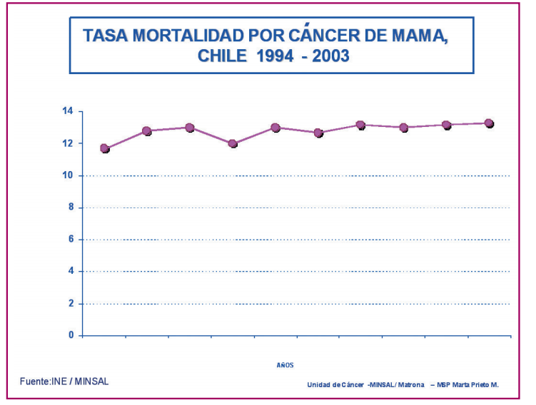
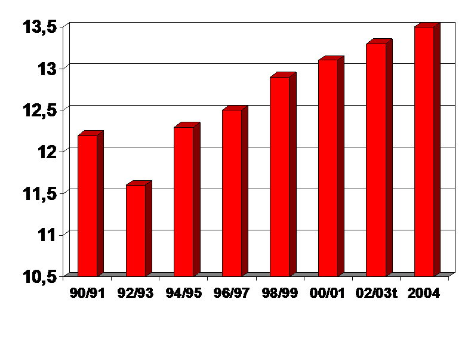
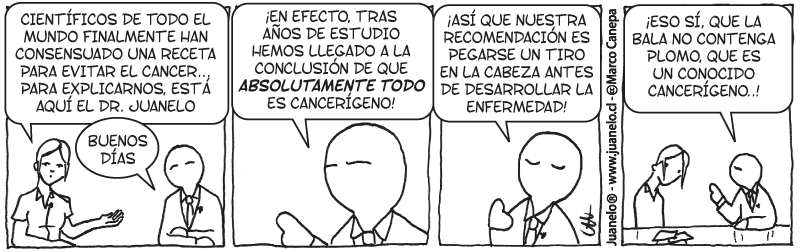

If I show you this chart and tell you it represents the rise in the
breast cancer mortality rate in Chile, how would you react?

And if I add that dioxins cause breast and prostate cancer, then you'll
probably panic, given [the latest
news](http://noticias.terra.com/articulo/html/act1355727.htm), and
swear never to eat another pork chop in your life.

But you shouldn't react that way, because this is a very bad chart. In
fact you should at least ask for some labels on it, so we know what
we're talking about.

Well, here's the chart, somewhat better:

Ah, but that's a different story! I mean, for starters we're talking
about data from 5 years ago. Besides, I don't know if you noticed that
the chart's scale is distorted. There's a joke that says "for
journalists, three data points of anything make a trend", but this data
doesn't represent any trend at all. What has this data looked like
historically? And what happens from 2004 onward?

According to the Ministry of Health and the National Statistics
Institute
([source](http://replay.waybackmachine.org/20080806113042/http://www.clinicalascondes.cl/area-academica/pdf/MED_17_4/SituacionEpidemiologicap_142.pdf)), the mortality rate has gone like this:

I ask you to compare it with the chart presented by Senator Girardi,
which represents the same data but presented in a different way (with a
distorted scale):

Unfortunately we have no data from 2004 onward, but the interesting
thing is that the Ministry of Health's projections point downward.

The subject is a delicate one, certainly, and our industry will probably
have to raise its quality standards, but there's no need to panic and
think we're going to have a cancer epidemic from eating pork.

I don't know how much this kind of news affects the pork market, but
consider that lately, with food prices going up, pork has become a
cheaper alternative to the cost of beef. So you have to be clear and
precise about these matters, because they affect a lot of people
(producers and consumers).

Ignorance kills, and it kills by fright. An ignorant person is a fearful
one, and innumeracy is a form of ignorance. A person who knows how to
handle numbers won't be scared so easily by this kind of news, and won't
swallow alarmist stories so easily.

Dioxins have been with us since we learned to use fire, and they are
suspected of being a carcinogen. In fact, it's likely that when we heat
food in plastic containers in our microwave we're releasing dioxins.

But what is the probability of dying of cancer from eating pork
poisoned with dioxin?

I have no idea, but neither does Senator Girardi, because the studies he
shows are studies of dioxin contamination from direct exposure, from
handling pesticides, and other causes. We can't draw conclusions about
dioxin-contaminated pork.

Besides, the effect is cumulative, but you can be exposed to dioxins in
various ways, not just by eating contaminated pork.

Are you going to live in fear, and not eat pork, because someone showed
you a badly made chart?

Better to relax, and stop heating your food in plastic containers in the
microwave. That seems to be more dangerous.
