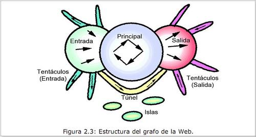

I'm continuing my reading of the book [Cómo Funciona la Web](http://www.ciw.cl/libroWeb-NV.pdf) (How the Web Works), published by the [Centro de Investigación de la Web](http://www.ciw.cl/) (Center for Web Research) at the Universidad de Chile.

This time I'm going to focus on the part of the book written by Ricardo Baeza, "La Anatomía de la Web" (The Anatomy of the Web), a very good chapter with lots of interesting information and statistics, especially where it describes the structure of the Chilean web.

Although there are some minor errors in the chapter (for example, a terabyte is defined as a trillion megabytes, when a terabyte is actually a trillion bytes), the results presented are very interesting.

Baeza discusses the various experimental analyses that have been done to try to discover the structure of the web.

If we consider that the structure of the web takes the form of a graph, it represents a structure summed up in the following figure:

This structure was drawn from the first study, carried out by Altavista in 1999, covering some 200 million pages and some 1.5 billion links, which amounted to 25% of the web at the time. We have no newer studies, because processing and storing a graph of this size is actually a formidable task in computational terms. Consider that by 2006 the web had more than 20 billion pages.

The pages on the left (in) are those that link to pages inside the core but are not linked back. Those on the right are pages linked from the core, but with no links back to the core.

There are islands, that is, pages isolated from the rest. The tentacles are dead-end paths that lead out from the pages at the ends. And we have tunnels that connect pages on the left with pages on the right.

The core is made up of some 56 million pages; on the left there are 43 million pages, the same as on the right. In the islands we have some 17 million pages.

Ricardo Baeza and his research team ran a similar study on the pages in the .cl domain.

They found a similar structure. The pages on the left are the newest ones, which aren't too well known, and which on becoming successful move into the core of the web, where the most established pages are. The pages on the right are older pages that don't link to the pages at the center of the web, simply because in their day those pages didn't exist.
They also include pages that have no outside links but have made a point of positioning themselves well through advertising links. In Chile, the proportion of islands is much larger than in the original Altavista study.

The dynamics of how the web forms are pretty violent, according to the author. More than half of the Web was born in the last six months. Of that growth, 20% is generated through the replication of mirror sites or other kinds of copies (including plagiarism). The death rate of pages on the internet is also high. The average life of a web page is estimated at about three months.

## **The anatomy of the Chilean web**

The latest study of the Chilean web is from 2006, and it produced these results:

  * The Chilean web has 170,000 sites, with more than 7 million pages.

	
  * An average site has 43 pages, and an average weight of 0.304 MiB.

	
  * There is an average of 1.56 references from other sites.

	
  * About a quarter of Chilean pages were updated in the last year.

Regarding content

	
  * Of all the sites, the largest 20% contain 99% of the information on the Chilean web.

	
  * About 21% of websites are "invisible" to search engines because they use technologies like flash and javascript.

	
  * About 5% of the links no longer exist.

The technology used is very revealing:

	
  * 66.7% use Apache as their web server, followed by Microsoft IIS with 32.8%.

	
  * The most used operating system is Unix, with 48.5%, followed by Microsoft Windows with 38.5% and Linux with 12%.

	
  * PHP is the most used dynamic page generator, with a 75% share.

	
  * PDF is the most used electronic document format, with 53%, followed by XML with 21%.

	
  * We Chileans seem to be great friends of open source, because according to the study "there are approximately twice as many **files** with software packages for Linux as for Windows available on the Chilean web".

I'd like to know how this has changed over these last two years, with the explosion of content brought on by Web 2.0. Still, this information is very interesting and revealing.
