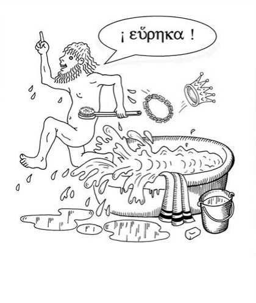
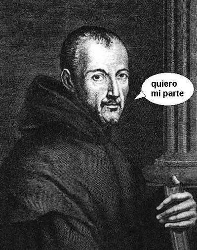

We nerds have always been around. Antiquity had several, like
[Euclid](http://www.biografiasyvidas.com/biografia/e/euclides.htm),
who instead of joining his friends for a stroll around the Lighthouse
(the place to be in Alexandria), preferred to stay in solving geometry
theorems.

Or [Archimedes](http://www.biografiasyvidas.com/biografia/a/arquimedes.htm),
a geek who went running naked through the streets shouting **Eureka**!
when he discovered the principle that let triremes float (though the
principle for sinking them had already been discovered by the Romans).

Other sources say he was running happily because with that discovery he
had won some **venture capital** put up by the King of Syracuse.

The Middle Ages were dominated by more fundamentalist nerds who, unable
to argue about which Linux distribution was superior, filled the forums
arguing about how many angels fit on the head of a pin.

Things got better in the Renaissance, and that era certainly had several
famous nerds and geeks, but I want to jump a little further ahead, to
tell you about a nerd who invented a sport for dorks that is still
played today.

I mean [Marin Mersenne](http://es.wikipedia.org/wiki/Marin_Mersenne), a contemporary of
that philosopher, half geek, half gigolo, [René Descartes](http://es.wikipedia.org/wiki/René_Descartes), and a friend of Étienne Pascal, father of the first **emo** of all time: [Blaise Pascal](http://es.wikipedia.org/wiki/Blaise_Pascal).

In those days, since they didn't have Facebook, these characters wrote
each other letters discussing the favorite subject of many geeks (to
this day), **number theory**.

Apparently Mersenne didn't do as well with the opposite sex as his
friends Descartes and Pascal, so he became a monk and joined the Order
of Minims. Back then it was a way to get a scholarship; if Mersenne
were alive today he would surely be a university academic preaching the
virtues of free software.

One day Mersenne set about studying a certain class of numbers, which
had actually been discovered by Euclid (the dork from the beginning of
this story), but since history is rather cruel, these numbers are known
as **Mersenne numbers**.

These numbers have the boring form: 2 n-1, but they get interesting
when they are also prime numbers (every geek knows what a prime number
is, but if you're one of those who think they're a geek because they
own an iPhone, or because they write a blog, it would be a good idea to
visit Wikipedia and find out what these [prime
numbers](http://es.wikipedia.org/wiki/N%C3%BAmero_primo) are, so you
can follow the rest and not miss the fun).

Well, finding out which are the Mersenne primes became an intellectual
challenge over the last few centuries, and lately it can turn out to be
quite profitable.

Because it turns out [there is a prize](http://replay.web.archive.org/20081121154453/http://www.eff.org/awards/coop)
offering 100,000 dollars to the first one to find a prime number with
more than 10 million digits, and most likely the forty-sixth Mersenne
number (the 46th) will have this property.

But finding Mersenne primes isn't easy. In fact when Mersenne died only
7 Mersenne primes were known, and the eighth was discovered by Euler,
almost 200 years later.

So far 44 have been found, and the last 10 were discovered through a
distributed computing project
called [GIMPS](http://www.mersenne.org/) (the Great Internet Mersenne
Prime Search).

These days geeks no longer look for prime numbers on a blackboard, or
with pencil and paper, but with the computer (let's be honest, we geeks
look for everything with the computer, even a girlfriend). And now,
thanks to the internet, we can put to use the idle time of thousands of
computers on the net.

GIMPS is a project where you sign up, install a little program on your
computer, and it connects to a central server. While you aren't using
your computer, the program devotes itself to computing possible
Mersenne prime candidates.

That is how a group of geeks have added their
[names to the history of mathematics](http://es.wikipedia.org/wiki/N%C3%BAmero_primo_de_Mersenne),
because they lent their CPU to find a number.

It was recently [announced](http://www.theregister.co.uk/2008/08/29/45th_mersenne_prime_discovered_maybe/)
that the possible candidate for the 45th Mersenne number may have been
found, but we'll have to wait until the first half of September to
confirm it, and to see whether it manages to break the barrier set by
the EFF's prize.

So you still have time. If you're interested in collecting a share of
those 100,000 dollars, and entering the mathematics hall of fame, you
can join the [GIMPS](http://www.mersenne.org/) project.

## Update:

It's now confirmed that we have found the forty-fifth Mersenne number.
Cheers!

But the forty-sixth Mersenne number was found as well, so the GIMPS
guys are going to cash their 100,000-dollar check. How about that?

More details at [mersenne.org](http://www.mersenne.org/prime.htm)
