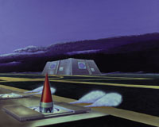
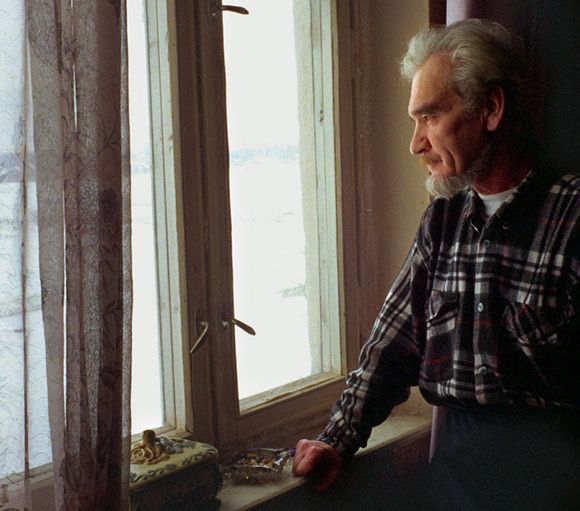

It was September 26, 1983. Lieutenant Colonel Stanislav Petrov was on
duty at the secret bunker outside Moscow that monitored the Soviet
satellite early-warning system, when the alarms went off shortly after
midnight. One of the satellites was reporting that the United States had
launched five ballistic missiles at Russia.

Tensions between the two countries were running high. The alarm
coincided with the start of some provocative NATO military exercises,
and came barely three weeks after the Russians had shot down a South
Korean civilian airliner that had strayed into Soviet airspace.

Petrov's instructions were clear: if he detected missiles headed for the
Soviet Union, he was to press the button that launched the
counteroffensive.

> "It was indeed just like in the movies," says Petrov, a red button
> blinking, waiting to be pressed, except that "in the movies, Hollywood
> specialists and directors can stretch a little situation into half an
> hour. In our case, from the time I made the decision to when it was
> all over, it was five minutes max."

But **he decided to do nothing. He had a hunch that something was
wrong**. And he was right: months later, **it was determined that the
signals were the result of a system failure**.

The start button, the one Commander Petrov was expected to press, would
have set off an irreversible chain reaction in a system designed to
launch a counterattack with no human intervention.

> *"The main computer wouldn't ask me [what to do] — it was made so
> that it wouldn't even ask. It was specially constructed in such a way
> that no one could affect the system's operations."*

The only thing Petrov could do was analyze the available information and
decide whether the alarm was false, or give the computer the go-ahead,
following a directive he himself had written.

**So why didn't Petrov press the button?**

Two ideas came to his mind:

> "I just couldn't believe that just like that, all of a sudden, someone
> would hurl five missiles at us. Five missiles wouldn't wipe us out.
> The U.S. had not five, but a thousand missiles in battle readiness. It
> didn't look like a scenario military intelligence had ever
> considered."

The second thought in Petrov's mind, one he always kept in view whenever
he was on shift, was this:

> "I imagined if I'd assume the responsibility for unleashing the third
> World War — and I said, no, I wouldn't."

We owe Petrov our thanks for what he did; he is an unsung hero of our
time. But above all he shows us that **we cannot blindly believe "what
the system says"**.

In the end, we are capable of thinking, and of making decisions that
computers, however sophisticated they are and however well programmed,
still cannot make for us.
