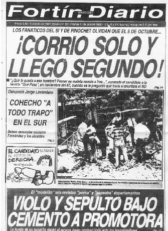

It was [**October** 5, 1988](http://news.bbc.co.uk/hi/spanish/latin_america/newsid_7646000/7646154.stm),
twenty years ago! Thousands of young people my age took part, one way or
another, in that great historic moment. Some of us, like me, just by
showing up at the polls and voting NO.

But there was technological activism back then too. This is the story of
a group of computer geeks fighting with what they knew how to do, with
computers and technology, to make sure that plebiscite was not
manipulated by the dictatorship. The story as told
by [MAZ](http://blog.maz.cl/)
and [REM](http://www.dcc8090.cl/dcc8090/index.php/REM/), two hackers
fighting for the return of democracy, two of my best friends.

It is the morning of **October** 5:

> **MAZ**: We've gone 30 hours without sleep ... I can't feel my mouth
> anymore from the stink of cigarettes and coffee ... How are my folks
> and my sisters doing? ... We finished installing the last FAX machine
> last night in the living room of somebody's apartment downtown, with
> the whole family there, coordinating with the building's doorman, who
> luckily is on our side, making sure he lets in the tally runners on
> motorcycles and bicycles who will bring the results from the polling
> places, so we can send the results on to the collection centers ... We
> had a bug in the program that counts the table tallies and we finished
> fixing it last night ... My head hurts ... Luckily the local network
> has been working fine ...

> We have to be careful not to kick the network's coax ... There's no
> time for backups, but just in case they took away a set of 5 1/4"
> diskettes with the sources and the databases ...
>
> You never know ... What time is my turn to go vote? Who's taking me?
> ... We're having trouble with the FAX operators ... Damn it ... It's
> dead easy ... You put the paper in, dial the number and press the
> green button ... Why the hell isn't that working? ... The modems have
> held up, thank goodness, but we have to use them sparingly because
> they caught on that we were moving data and the other day they took
> down some of our phone lines ... But those were the test ones ... We're
> only now using the official numbers for the first time ...

> We have to use the modems just as much as strictly necessary ... But we
> can send the **files** to the remote sites and that's what matters ...
> The table openings are coming in ... They're being set up early ...
> Tell the campaign command ... Concepción is slow, have them send more
> poll watchers ... Or is it a problem with getting the information
> out? They had to move a collection center at the last minute because
> the neighbors across the street caught on and ratted them out ...

> What's going on? Is it the tables that aren't being set up, or do we
> have problems with the data flow? ... We have to run the
> opening-count processes ... On TV they're showing cartoons ... Any
> word from the Central Command? We're sore because they have Unix and
> money, and we have plain PCs and Clipper applications, but never mind
> ...

Our protagonists are members of the backup group for the vote count, a
secret group created in case the central group, the one everybody knows
about, was somehow neutralized by the government.

According to REM's account:

> For people who have read about the plebiscite, there were two counting
> lines, line N and line O. We didn't exist; we were the backup in case
> the military decided to disregard the results. Our only defense was to
> go unnoticed. We were the clandestine ones, so very few people could
> know we existed, let alone where we operated. In fact we only found
> out at the last minute where our computing center was going to be.
> There we spent several intense hours that **October** 5 and 6. There I
> spent my birthday, locked in.

> One of my clearest memories is when we started getting problems from
> the collection centers. There were tables that couldn't be entered
> because the system rejected them. Our system was based on collection
> centers running a system written in Clipper, and they were the ones
> sending us the information. There was no way to change the programs,
> we had to find a solution fast, but first we had to pin down the
> problem. After a while we realized that the men's tables and the
> women's tables were swapped, and we got in touch with the central
> command, who were the ones that had generated the databases we were
> using. They had the error too and had already detected the problem,
> fixed it, and forgotten about us. For them it was easy, their system
> was one Unix machine where they centralized everything. We couldn't
> do that, so we had to look for an alternative solution, which we
> found after some good arguments. Remember how good the two of us were
> at fighting whenever we argued over some piece of development? The
> rest always looked at us with that all-hell-is-about-to-break-loose
> face, and in the end we'd reach an agreement and go on being as good
> friends as ever.

During the morning they are taken to vote, in shifts, and always
accompanied by someone. They have to vote as fast as possible and come
back, with little time to reflect on how important the event is. All of
us who voted for the first time that day felt what MAZ describes:

> **MAZ**: ... I'm 22 years old and this is the first public vote I'm
> going to take part in ... Now I realize I've never voted in public
> life, though I've been lucky enough to vote many times at the
> University ... But this is different ... Electing a delegate or a
> Student Union President is not the same as this real line, where I
> stand with dozens of people who are my neighbors ... I'll never get to
> know them all ... I'm scared of tearing my ballot and getting it wrong
> ... One little line, just one little line ... The campaign spots on TV
> said it over and over ... Take care of your vote ... Just one little
> line ... How many votes are going to be lost to people who, after so
> long, are going to take their ballot and express what they haven't
> been able to say or do for so long? ... One little line ... Nothing
> more than that ... Did I vote right? Am I sure?...

Time to go back: 

> **MAZ:** .. What strikes me most is the silence of Santiago ... Very
> different from the previous days, when I had to walk past the marches
> of one side and the other without being able to wear a pin for the
> NO...

> We came back from downtown after fixing the FAX ... It was a minor
> thing but the trip made it look hairy ... Besides, we had to drive
> fast ... There was nobody in the streets and they were starting to
> close off downtown ... We were scared, plenty scared ... We got back to
> our place very fast ... I've never found a company meeting room so
> cozy ... It's starting to get dark, but while many people at home start
> listening to the news and the TV starts giving partial results, for
> us the work is only beginning ..

> . We've already received results from many places .... Our first
> counts have the YES winning, and dismay starts to creep in ... But the
> old foxes tell us ... Don't fool yourselves ... The first tables are
> the most conservative, for many reasons we didn't want to hear ... The
> numbers were telling us other things and the priority was to receive,
> process, count, add ... And send out whatever results we had ... There
> was no time to think ... Just look at numbers and process **files**
> ... But new results started coming in ... In many places the NO was
> starting to climb and to win ... The trend was reversing ... We saw
> Cardemil, the undersecretary of the interior, give the first count,
> and in his speech he called the YES victory an "irrevocable trend"
> with a ridiculous number of tables ... "They're going to wipe us out,"
> I think to myself, and I know several people around me feel the same,
> but we have to keep going ... At 7:30 p.m. we had more than 25% of the
> count ... And the numbers were giving us different results .

And the tension starts to build

> MAZ: We thought the NO victory was going to be overwhelming ... I was
> expecting over 70% ... But when we started receiving results and we
> barely got above 50%, we were winning ... but lukewarmly. Where did
> we fail? What didn't we see? Why isn't what we did and denounced for
> so many years showing up in our country? What have we done wrong?...
> Never mind ... We have to process ... We have to keep going ... And we
> have to send what we have so others can analyze it and preserve it
> ... "Guys, they've closed off downtown ... There's a high chance
> they'll blow up the Central Command next to the Diego Portales
> building ... Only the international press coverage is protecting it"
> ... The other lines are weaker ... "Get ready, because we may be the
> only alternative left" ..

It was REM's birthday that very day. In the end, friendship matters more
than any political revolution. I'm not wrong about that; these young men
think so too:

> REM: The other thing I remember is that during that day and that
> night there was no time for anything but work. We had to crank out
> report after report and send all our counts to "the pool." What the
> hell was the famous pool? I've never been 100% sure. Some say it was
> an embassy, others that it was the church. The fact is it was
> "something" where all our results ended up. Anyway, the thing is that
> at some point you stopped everybody and told them it was my birthday
> and they sang to me and there were hugs and a lot of emotion and...
> and everybody went back to their own thing... everybody, me included,
> had our minds elsewhere...

> MAZ: ... Happy Birthday, dear friend ... We sang you happy birthday,
> but really we were more worried about our **files**, about the TV and
> about the night moving on ... We've remembered that birthday all these
> years over a drink, fewer times than I'd like, but every time I hear
> something about the '88 plebiscite, my main memory is the hug we gave
> each other for your birthday ...

> REM: That year I practically didn't celebrate my birthday. In fact I
> wasn't with my family and I was with very few friends, but the gift I
> got was the best one I could have received. Maybe it wasn't meant for
> me, but I claimed it as mine the very instant I learned that
> officially we had won.

So after that small celebration came the whirlwind of finishing the
count, and waiting for the result:

> MAZ..around 1 a.m. they gave another count on TV ... Cardemil started
> reading the numbers ... First we were surprised that the percentage of
> tables counted was high, very high ... And our stomachs started to
> tighten ... We all stood in front of the television, in silence,
> packed together, almost without moving ... When he gave the official
> figures, we didn't quite understand, because we didn't believe what
> we were hearing ... Maybe, being used to permanent lies, we weren't
> prepared to hear a truth ... But it was true ... They were officially
> acknowledging that we had won ... By a little ... Maybe a point or
> less than what we had counted, but that hardly mattered ... We started
> jumping in front of the TV and hugging each other ... Somebody brought
> a couple of bottles of champagne and we all showered in it ... And we
> hugged, my friend, a big one, the kind that lasts a lifetime ... And I
> started crying like a little kid ... We won, buddy, we won ... And I
> kept crying while we kept greeting each other, jumping ... And the
> order came: Stop everything, close up shop, we're going out to
> celebrate, damn it ... And that's what we did. I remember we got to
> Plaza Italia around 3 in the morning ... Thousands of people ... Tens
> of thousands of people ... My body had nothing left, but with a warm
> heart and a permanent smile there's no such thing as tiredness ... In
> cars, on foot, with flags, confetti, whistles, champagne ... But what
> struck me most ... So many smiles, everybody was smiling ... I gave
> hundreds of hugs to people I didn't know ... I climbed onto cars ... I
> waved a flag in front of the Diego Portales with everything I had ...
> And we went to the Command, to meet up with everyone ... What a
> beautiful photo from that night ... My copy is kept among my favorite
> memories ... What a beautiful photo, buddy ... Then, in the morning, I
> went to the University ... It was a party ... And in the afternoon, to
> Avenida Grecia ... From there, a few blocks' walk to my house, say hi
> to my parents ... And sleep, sleep ...

That day many of us celebrated. We were happy: the end of the
dictatorship, joy had arrived.\
With time we realized it wasn't entirely so, but that is another story.
Historical processes are not as simple as people would like, and a state
of absolute happiness is not attainable. What matters is what remains,
in this case friendship, and the example that young people, even the
most techie ones, are capable of great things.

### Sources

The accounts of [MAZ](/docs/CartaMAZ.pdf) and [REM](/docs/RespuestaREM.doc).
