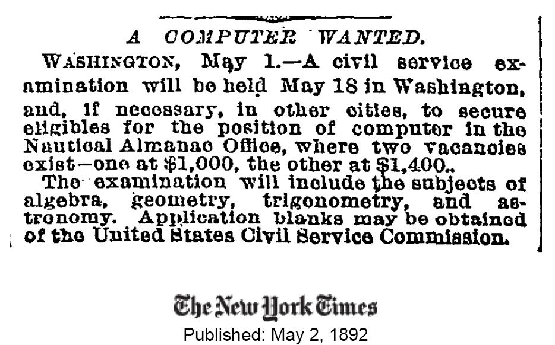

What does the cloud let us do that we couldn't do before?

Nicholas Carr [wonders](http://www.roughtype.com/archives/2008/11/the_new_economi.php) whether we might be missing something in this [debate over the cloud computing business](/en/blog/lnds/2008/10/27/the-cloud-computing-business-debate-i/), and the example he gives is a very good one:

> In late 2007, the New York Times faced a challenge. It wanted to make available over the web its entire archive of articles, 11 million in all, dating back to 1851. It had already scanned all the articles, producing a huge, four-terabyte pile of images in TIFF format. [...] the Times needed to translate that four-terabyte pile of TIFFs into more web-friendly PDF files.
> 
> That's not a particularly complicated computing chore, but it's a large computing chore, requiring a whole lot of computer processing time.
> 
> Fortunately, a software programmer at the Times, Derek Gottfrid, had been playing around with Amazon Web Services for a number of months, and he realized that Amazon's new computing utility, Elastic Compute Cloud (EC2), might offer a solution. [...] he hacked together some code for EC2 that would, as he later described in a [blog post](http://open.blogs.nytimes.com/2007/11/01/self-service-prorated-super-computing-fun/), "pull all the parts that make up an article out of S3, generate a PDF from them and store the PDF back in S3." He then rented 100 virtual computers through EC2 and ran the data through them. In less than 24 hours, he had his 11 million PDFs [...]
> 
> The total cost for the computing job? Gottfrid told me that the entire EC2 bill came to $240. [...]
>
> If it wasn't for the cloud, Gottfrid told me, the Times may well have abandoned the effort.

And there it is: you can now browse [the New York Times archive](http://spiderbites.nytimes.com/) going back to 1851. Not all the articles are free, but it is still impressive, like [this ad from May 1892](http://query.nytimes.com/mem/archive-free/pdf?_r=1&res=9F07E0D81438E233A25751C0A9639C94639ED7CF) seeking a computer.

And here lies the answer to [Patricio's comment](/en/blog/lnds/2008/11/02/web-2-0-and-cloud-computing/#comments): the real business of cloud computing is not in the cloud, but in what you can do with the cloud.
