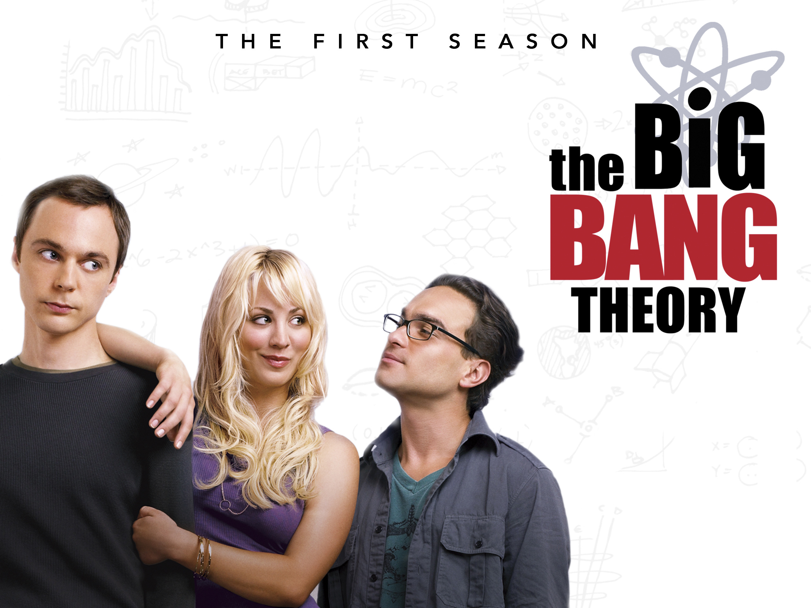
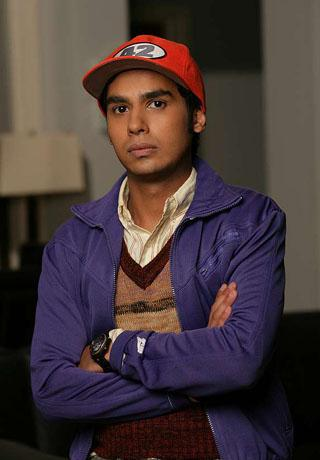
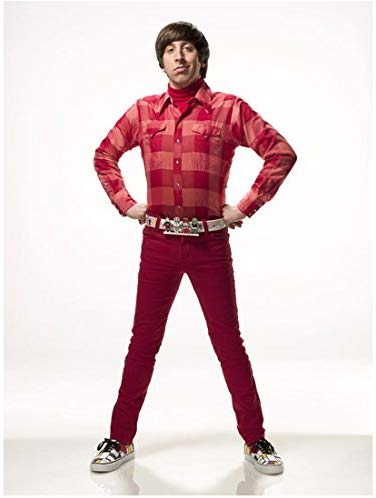
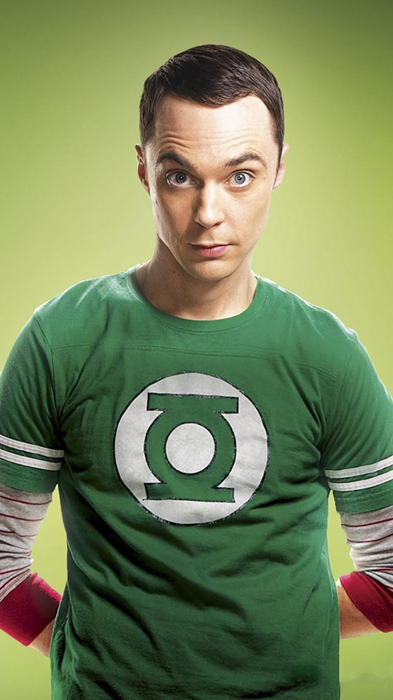
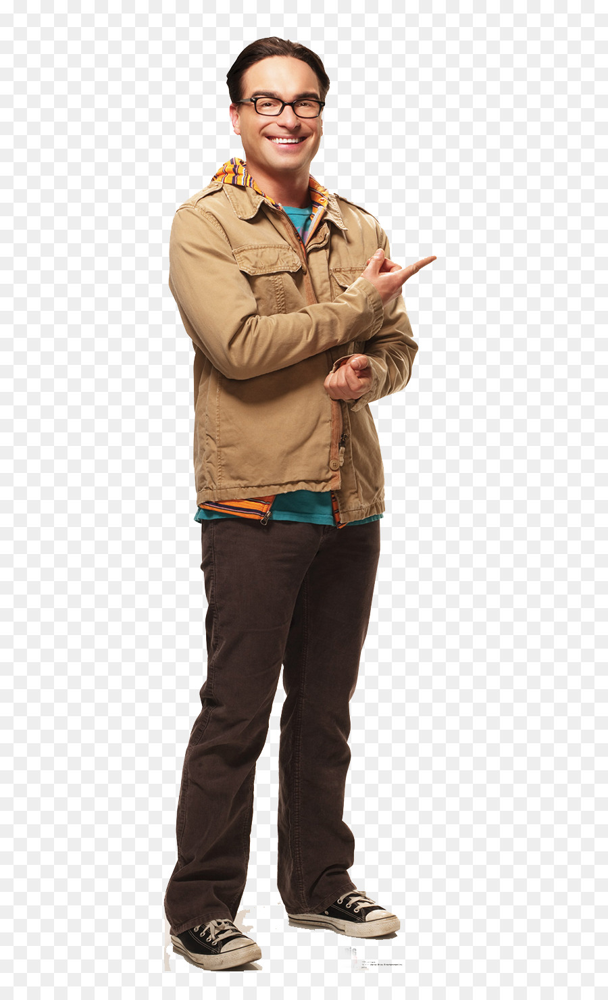

Imagine for a moment that these four geeks are all IT people. Which one would you hire?

OK, the characters of [The Big Bang Theory](http://en.wikipedia.org/wiki/The_Big_Bang_Theory) are caricatures, because nobody is that geeky, right?

But fine, let's play along. The idea of this post is to be a kind of illustrated guide to [my previous post](/en/blog/lnds/2008/11/30/beware-of-the-self-absorbed/).  
  
Let's look at the first candidate: Rajesh Koothrappali.

There is a reason for me to identify with Rajesh, and it's fairly obvious to regular readers of this blog: the number 42 on his cap. The first time I saw him wear it I couldn't help smiling. I assume everybody gets the joke of that cap, right?

Rajesh's big problem is his inability to talk to women, something I fortunately got over a long time ago, and without having to resort to alcohol.

Rajesh is the closest in this bunch [to the self-absorbed type I talked about before](/en/blog/lnds/2008/11/30/beware-of-the-self-absorbed/), which I already explained is not good. I wouldn't recommend hiring a person who has trouble communicating to that extreme.

The second applicant is Howard Wolowitz.  
This character doesn't have a PhD like the other applicants. I don't find that a bad thing. On the contrary, I don't like people who have spent so much of their lives studying, but that's my criterion, you don't have to listen to me on this.

Wolowitz has the opposite problem from Rajesh: he thinks he's a ladies' man, and he is what we'd call in good Chilean "pasado a la punta" with women, way out of line. Which is tricky. I have worked with several Wolowitzes, and although at first we all laugh at their clumsy flirting with the women who visit the office, they end up being somewhat pathetic, and a complication if there are also women on the team, who end up uncomfortable.

Sheldon Cooper, the smartest of the group.

In a sense I identify with a lot of this character's arrogance, but he also amuses me a great deal. He's the one who makes me laugh the most.

I have seen and occasionally worked with a Sheldon Cooper, but it hasn't been a pleasant experience.

I also admit there are times when I've turned pedantic, or too "literal", just like Sheldon.

In the end this kind of person generates a lot of tension in the team.  
I don't think working with unpleasant geniuses is worth it. It wears you down.

My wife's favorite, Leonard Hofstadter.

Probably the best candidate, the most balanced of this bunch.

He's a nerd, but aware of his limitations. It's not that he wants to give up being who he is, or stop doing the things he enjoys most, but he has an additional motivation: his romantic interest in Penny.

Love is a very strong motivator. A person in love, with a partner, even with a family, tends to be more reliable and balanced. I'm not telling you to hire only married people, but it's an interesting indicator to consider.

In the end, I think Leonard's advantage over Sheldon is that Leonard is more sociable, a more open person. He isn't an oyster, like Rajesh, and he doesn't have Wolowitz's tactless behavior, but most important of all, he is as smart as Sheldon, without the arrogance. You need a more centered person.

I would only add to Leonard a bit more self-confidence (something Sheldon has to spare), but that's where the boss's job comes in, what goes by the term [coaching](http://es.wikipedia.org/wiki/Coaching), a matter as important as hiring. But that's a topic for another post.

