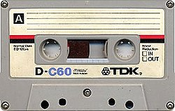

From COPYRIGHT to COPY & PASTE (*)

By Eduardo Rodriguez:

There is great concern in the media industry today because the Internet has become a platform for copying content: books, music, movies, and so on. A large part of the problem, in my opinion, is that the industry has not recognized that the world changed, and that businesses have to adapt to this new scenario.

Until a few years ago, the media delivered all kinds of content for us to consume without our being able to keep a copy of that material. Except for print media, which left us a copy of what was published (of varying quality, depending on the type of paper), the rest of the media, such as radio, TV and film, gave us an intangible reproduction.

That's how it was until technology changed...

The change began with the arrival of the cassette, the photocopy and the camera. Any self-respecting fortysomething must remember, with a smile on their lips, those worn-out cassettes holding hours of songs captured off the radio; and those eternal waits with the pause button held down, waiting for the precise moment when the song you were after began; or the magazine clippings that decorated their bedroom. Or the spiral-bound photocopies of that book that was so important at the time, which today rests immaculate, next to several kilos of dust, in a corner of our bookshelf.

And then came the Internet...

And the arrival of the Internet also brought the possibility of copying media almost professionally. DVD, mp3, avi, jpeg, iso, you name it! Everything can be copied. Is it protected? Crack! Does it have a key? Crack! Everything can be copied.

And what's wrong with copying? Well, it depends on who you ask. There are opinions for every taste. But let's stick to reality and leave opinions for the end: the reality is that today a lot gets copied over the Internet. Practically nothing resists copying, from TV shows to computer games, by way of books and images. In Chile, a senator copied a bill word for word from the Internet, spelling mistakes included, and then signed it as his own.

Now, if the reader thinks about it, the Internet is in essence a network for copying information. I write an email, I press send, and the email is copied to the recipient's mailbox. I open a web page, and I copy the content to my computer so my browser can display it. I turn on my computer and my data gets copied to other computers so I can stay connected to the network. I press a key, and that letter gets copied into the messenger of the person I'm chatting with.

Copying is inherent to the Internet. And you get used to it. Or rather, you lose your fear of copying.

And here is where the trouble begins for the media industry, which reacts by hiring a battalion of lawyers to go after those who break the law.

Have they succeeded so far? Nope. Copying gallops along at a steady pace.

Why not change the way we look at the problem, then? Because let's be honest, what is the problem? A group of companies (the industry) is not receiving the income it "should" be getting from a commercial transaction that isn't taking place. That's the problem. Nobody is killing music, or the authors. The ones actually losing money are the big companies.

If instead of buying a computer game I copy it from the Internet, the company that produces it misses out on a certain amount of money. But what would happen if the industry developed that same game knowing -- and accepting -- that it will be copied, but charged the player for something else? (as it does today when it charges for playing online, for example?)

Isn't it time for the media industry to take in the fact that copying is going to continue, and to look for intelligent ways of doing business?

The opportunities exist for those who know how to seize them.

(*) This article belongs to Eduardo Rodriguez, whom I thank for his permission to publish it on my blog, and with this article I inaugurate the Guest Villains section.  
The images were added by me (Eduardo Díaz) and were taken from [stock.xchng](http://www.sxc.hu/index.phtml).

