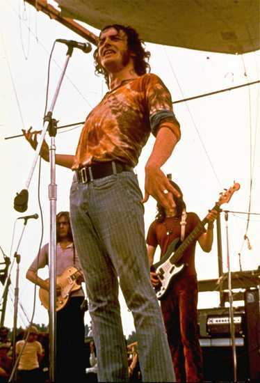
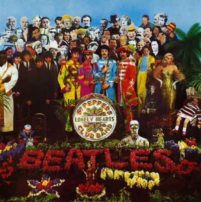

I think the first time I heard this song it was Joe Cocker's version,
the one you can see in this [video on Youtube](http://www.youtube.com/watch?v=6FMq0iDX1yE).

The song is by the Beatles, by Lennon and McCartney of course, and
originally it's sung by Ringo Starr. Still, for many people, me
included, Cocker's version is the better one, but that's a matter of
taste.

Cocker's version is an innovation, with several changes from the
original: a 6/8 time signature, a different key, a longer instrumental
introduction, and several different chords. Despite these changes, it
is still a different version of the Beatles' original work; it isn't
considered a new creation. In popular music this is called a cover. A
cover is something allowed in popular music, and it shouldn't be
confused with plagiarism (in fact, some have tried to defend their
plagiarism after the fact by arguing that they were really just doing a
version, or a cover).

It occurs to me that this idea of the cover is a good way to explain
what happens with Open Source or Free Software (\*) to someone who
doesn't understand these matters, especially if they work for the
SCD (Chile's music copyright society) :wink:

"OpenOffice is a cover of Microsoft Office," metaphorically speaking.

Of course, in music, to cover a song you have to ask permission from
whoever owns the rights to it. That's the problem with metaphors, as
Dr. House would say: they're never entirely adequate.

Because in software you can duplicate the behavior without touching the
original author's intellectual property. It's enough to replicate the
external functionality (as long as it isn't patented) and to show that
the code behind this new functionality is not the same as the original.

We have [commented before](/en/blog/lnds/2007/01/26/software-plagiarism/) on the
(im)possibility of plagiarism in software. I've insisted that being
able to duplicate the functionality of software has always been
considered legitimate, which is why software patents are so criticized
in our industry: among other things, they limit our possibilities to
innovate.

I like the name of that song, "with a little help from my friends,"
because it has a lot to do with how open source, or free software, gets
developed.

When we talk about free software projects, only the ones that manage to
form a community to support them are the ones that survive and succeed.

That is, in my opinion, the great disruptive innovation of FLOSS. But
it's an innovation of a different kind: free software changes the way
technology is made, but not the technology itself. I grant that this is
debatable, but I don't want to get into that [ideological discussion]()
or the ethical one about free software, which I find boring by now.

What I'm interested in exploring today is what happens with the
technological innovation that FLOSS generates.

My point is this: free software is like Cocker's version, an
innovation, a magnificent one for some, that can even surpass the
original. But the original creation, the disruptive innovation, doesn't
come from FLOSS, because FLOSS is, so far at least, a reactive
development, a response to creation that comes from elsewhere, mainly
proprietary software (or
[privativo](http://www.rae2.es/privativo), to be grammatically
correct in Spanish).

I think the great disruptive developments of FLOSS have happened in the
field of programming languages (Perl, Python, PHP), but all the rest
has been, in general, taking ideas that were developed in the
proprietary world, with closed code. In fact, those developments are
reactions to the fact that those disruptive developments have their
code closed. That's why these open source projects are born, and their
main motivation: copying the functionality of a truly innovative
project.

This is [my wooden leg](/en/blog/lnds/2009/01/13/a-wooden-leg-on-the-fire/) to
throw on the fire for today :wink:

By the way, this is a first argument, a somewhat superficial one if you
like, because there's much more to develop, sources to cite, statistics
to show. I have at least one more reason to argue why FLOSS doesn't
generate much disruptive innovation (according to some, it doesn't
innovate at all, but that's not my position), but I plan to develop
that later on.

As I said yesterday, I'd like to use blogs to discuss this topic. I
think discussions, in the end, should enlighten all of us. We'll never
agree completely, but at least we'll learn something along the way, all
with the help of our friends ;).

(\*) My apologies in advance to the purists: in this piece I'm going to
use the terms open source, free software and FLOSS almost
interchangeably. I'm fully aware of the difference; I've written open
code and have normally chosen to license it under the GPL (free
software). But let's not get into a Richard Stallman-style discussion of
distinctions. I'll try not to abuse the swapping of terms.
