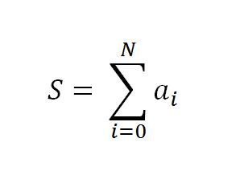

My friend [Pepe Flores](http://www.newtenberg.com/560/article-68138.html) once said "journalists
are born scientists who had their wings clipped by fifth-grade
math" (\*). That line deserves deeper thought, because you really have
to ask what goes on in fifth grade that so many talents are lost,
drifting over to the dark side :wink:.

Jokes aside, something seems to happen in our education that leaves a
lot of people scared of math for life. I agree with Pepe, and I've heard
others say it too, that fifth grade is a critical point. Which is a
shame, because mathematics is an important part of our culture.

Apart from the obvious changes kids start going through at that age, the
main problem in my opinion lies in how math is taught.

Something seems to happen from fifth grade on that makes people start
hating math. It stops being mysterious and fun and becomes tedious,
laborious, and no longer sparks any interest. I think age 10 is
critical, because if you lose interest in math at that point, it's hard
to get it back.

[Steve Yegge](http://steve-yegge.blogspot.com/) writes, in his now
famous essay, [Math For Programmers](http://steve-yegge.blogspot.com/2006/03/math-for-programmers.html):

> 1.  Math is a lot easier to pick up after you know how to program. In
>     fact, if you're a halfway decent programmer, you'll find it's
>     almost a snap.
> 2.  They teach math all wrong in school. Way, WAY wrong. If you teach
>     yourself math the right way, you'll learn faster, remember it
>     longer, and it'll be much more valuable to you as a programmer.
> 3.  Knowing even a little of the right kinds of math can enable you do
>     write some pretty interesting programs that would otherwise be too
>     hard. In other words, math is something you can pick up a little
>     at a time, whenever you have free time.
> 4.  Nobody knows all of math, not even the best mathematicians. The
>     field is constantly expanding, as people invent new formalisms to
>     solve their own problems. And with any given math problem, just
>     like in programming, there's more than one way to do it. You can
>     pick the one you like best.
> 5.  Math is... ummm, please don't tell anyone I said this; I'll never
>     get invited to another party as long as I live. But math,
>     well... I'd better whisper this, so listen up: (it's actually
>     kinda fun.)

Yegge's joke is a very good one, because a lot of people really do
believe math is boring, and it would never occur to them to talk about
it at a social gathering.

So much so that our society has the bad habit of calling "humanist"
anyone who practices a branch of knowledge entirely free of any trace
of numbers or mathematics. As if thinking scientifically, rigorously
and on a mathematical basis turned you into an alien, or, as I was once
told, a robot.

I believe math can be made more fun, and the key is in what Yegge says,
and what great experts in education such as [Seymour Papert](http://es.wikipedia.org/wiki/Seymour_Papert) and [Alan Kay](http://es.wikipedia.org/wiki/Alan_Kay) hinted at before him.

> To teach math better, you would first have to teach programming.

Here is a program: up to fourth grade, teach the concepts of number,
basic arithmetic, and how to use a calculator properly to solve
problems. After that, teach programming, and through programming teach
everything else.

If you know how to program, you won't be intimidated by a symbol like
this one:

because you'll recognize that the huge sigma stands for the sum of a
series of numbers, and for a programmer that translates into a simple,
harmless loop:

> suma = 0; for (int i = 0; i \<= N; i++)\
> suma += a\[i\];

A programmer knows what functions are, and it will be trivial to teach
them concepts like function composition, or the chain rule (which is
how you differentiate a composition of functions).

Not to mention geometry, which becomes a game thanks to languages like
[LOGO](http://logothings.wikispaces.com/) or
[SQUEAK](http://www.squeak.org/).

Finally, programming is a lot of fun, and rewarding.

I've seen journalists, lawyers, sociologists and preschool teachers
programming. People who confess that math isn't their thing are capable
of writing fairly complex programs.

Why don't we use that as a tool to teach math to our children?

I'm sure that introducing SQUEAK or LOGO to kids of 10 and up would be a
far greater and more effective contribution than any attempt to invent
supposedly new technologies for education (or TECs, as our education
geniuses [so pathetically call
them](/en/blog/lnds/2009/01/30/tec/)).

In math, at least, educational technologies have existed for at least
50 years. They're called programming languages.

(\*) For my part, I maintain that everything you need to be a
journalist you've finished learning by fourth grade.
