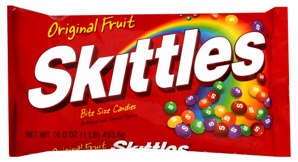

Go visit the Skittles website, [www.skittles.com](http://www.skittles.com/). This famous candy brand has pulled its own content from its site and replaced it with the content its consumers generate on the internet: on YouTube, Facebook, Twitter, Flickr and Wikipedia.

If you go to the product description you'll see that it shows the Wikipedia content! (it's a copy, not a redirect).

In the [words of David Berkowitz](http://www.mediapost.com/publications/?fa=Articles.showArticle&art_aid=101402):

> This is the message Skittles is sending: what consumers say about the brand is more important than what the brand has to say to consumers.

I find it remarkable. I don't know what you think.  
"Crowd marketing"?

There's one interesting detail: the Skittles website averages 15,000 visits a month, but its Facebook page has more than 600,000 fans.
