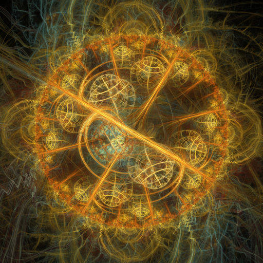
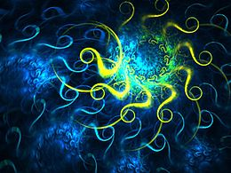
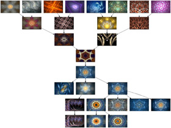
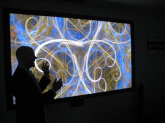
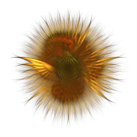

[Scott Draves](http://www.scottdraves.com/) is an artist, the best kind of artist there is, because [Scott Draves](http://draves.org/blog/) is a programmer.

Here is a sample of his art:



The images and videos in this post are art generated by Scott Draves's work. They are "the product of an evolutionary algorithm running in a cyborg mind made up of more than 60,000 computers and people".



In 1990 Draves presented, in his [doctoral thesis](http://draves.org/cmu-research/diss/main.html), an efficient metaprogramming mechanism that makes it possible to create computer graphics through an ad hoc programming language. That was a first step toward more sophisticated projects, like the [Flame](http://flam3.com/) algorithm, which you've probably seen in a media player visualizer, or his most ambitious project, the dreams of the electric sheep, which we can see in this video, or moving painting:

The dreams are the output of a genetic algorithm that runs inside a screensaver, which volunteers [download](http://electricsheep.org/index.cgi?&menu=download) onto their personal computers.

Each computer holds a flock of electric sheep, that is, a set of basic instructions, or genes, that start to evolve inside the computer's memory.

The result of this evolution, each individual sheep, is a sequence of images displayed on the screen. Every volunteer taking part in the project picks the sheep they like best and sends them to a central server.

For example, this image, which reminds me a lot of a Roberto Matta painting, is [frame 16 of electric sheep 135118](http://sheepserver.net/v2d6/cgi/frame.cgi?id=135118&frame=16):


And its [genes](http://sheepserver.net/v2d6/cgi/frame?id=135118&frame=16&genes=1), that is, the sequence of instructions that generates this sheep, begin with the following:

```
<get gen="202" id="135118" type="0" prog="flame" args="bits=32 jpeg=90" frame="16">
<flame time="15" size="1280 960" center="0.015578 -0.0123601" scale="816.091" rotate="0" oversample="2" filter="1" quality="500" batches="50" temporal_samples="60" background="0 0 0" brightness="22.6548" gamma="4" vibrancy="1" estimator_radius="5" estimator_minimum="0" estimator_curve="0.6">  
<xform weight="0.927541" color="0" symmetry="0.865818" spherical="0.96202" handkerchief="0.00220148" waves="0.0357786" coefs="-0.532789 -0.0319816 0.0503067 -0.486301 -0.0328148 -0.108921"/>  
<xform weight="0.059799" color="1" symmetry="0" handkerchief="0.00220148" hyperbolic="0.192404" bent="0.153923" waves="0.0357786" coefs="-0.5599 -1.46024 1.0615 -0.924253 -2.80326 3.72258"/>
```
  


Each participant can design their own sheep. All of the Electric Sheep code is open source.

Each sheep has offspring and breeds with others, forming different evolutionary paths that lead to different sequences of images.



All these images come together on a server and build up into a long sequence of moving images, a dream.

The name Electric Sheep is a reference to Philip K. Dick's famous novel, "Do Androids Dream of Electric Sheep?".

Out of this, Scott Draves has created an exhibition called [Dreams in High Fidelity](http://hifidreams.com/), an installation of the dreams on high-definition (HD) screens, and he has shown his work at various museums and events. His work is on permanent display on the website of the [MOMA ](http://www.moma.org/)(Museum of Modern Art, in New York).



  
Scott Draves worked in research and development at DreamWorks (his work is credited in Shrek 2), and he currently works at Google on the Google Maps team.



His work is still going, of course, and it's a lovely example of how the power of crowdsourcing and the cloud can be used to make art.


All images are the work of Scott Draves, under a Creative Commons license, taken from the sites [draves.org](http://draves.org/),[electricsheep.org](http://electricsheep.org/), [hifdreams.com](http://hifidreams.com/), and [scottdraves.com](http://www.scottdraves.com/)
