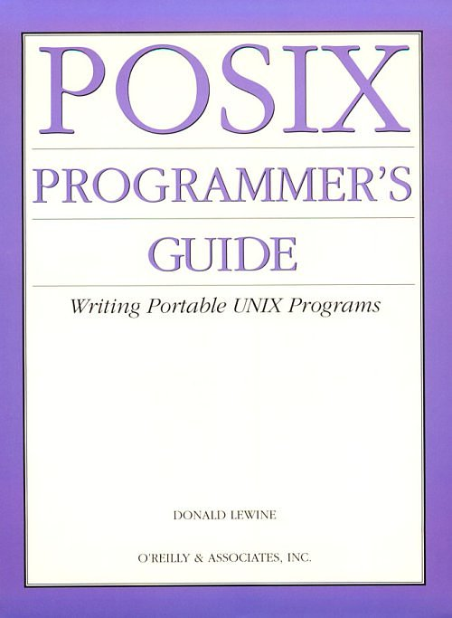
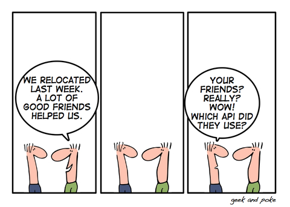

Christofer Hoff
[asks](http://rationalsecurity.typepad.com/blog/2009/02/im-sorry-but-did-someone-redefine-open-and-interoperable-and-not-tell-me.html)
whether someone has redefined the terms "open" and "interoperable"
without telling him, prompted by the following statement:

> Singing the vcloud API standard song is very astute. It reassures all
> people already on board and climbing on board the VMware bandwagon
> that VMware is open and not looking to lock them in. Even if Microsoft
> doesn\'t join in this standardisation effort with a whole heart, it
> doesn\'t matter so long as VMware gets enough critical mass.

How can you claim that using VMware's API means not locking yourself
into VMware as a vendor (\*)!

> Standards are great, especially when they\'re yours
> -- Cristofer Hoff

[Hoff again](http://rationalsecurity.typepad.com/blog/2009/02/im-sorry-but-did-someone-redefine-open-and-interoperable-and-not-tell-me.html):

> When a vendor like VMware crafts an architecture, creates a technology
> platform, defines an API, gets providers to subscribe to offering it as
> a service and does so with the full knowledge that it REQUIRES their
> platform to really function, and THEN calls it "open" and
> "interoperable," because an API exists, it is intellectually dishonest
> and about as transparent as saran wrap to call that a "standard" to
> imply it is available regardless of platform.

That's one case. Right now, while the cloud industry is taking shape,
which is nothing more than putting into practice old ideas that never
had the right support to be implemented, it's clear there are plenty of
players intent on becoming the main monopolist of this business.

So what a company like VMware does is sell us a red pill of openness and
interoperability, when what it actually hands us is a blue pill, and
what it wants is to establish itself as the main monopolist of this new
business.

I think VMware wants to be the
[CISCO](http://es.wikipedia.org/wiki/Cisco) of the cloud: in the end,
all the infrastructure rests on it, and everyone else ends up trapped in
its "open standard".

What is an API?

APIs are not open standards, and they are not part of the principles of
open source. APIs are not technologically neutral. Because APIs are
tools, nothing more.

Take the case of the open standard IEEE 1003, known as
[POSIX](http://es.wikipedia.org/wiki/POSIX) (a name suggested by Richard
Stallman).

POSIX is a standard that defines an API, along with a set of utilities
and user interfaces, for any software that wants to be compatible with
Unix.

The first version was published in 1988. It was one of the great efforts
to arrive at a unified way of interacting with the different Unix
variants competing at the time. Commercially, every operating system
that implemented POSIX came to be called an open operating system.

One of the interesting things is that even Microsoft [Windows can be
configured to be POSIX
compatible](http://technet.microsoft.com/en-us/library/cc779522.aspx).

Hmm, you'll be thinking, if Windows is POSIX compatible, then, Eduardo,
are you suggesting that Microsoft Windows is an open operating system?

That's my point. What does it mean to be open? What are we talking
about?

POSIX is an open standard because it comes out of a neutral body, the
IEEE, which brings every player in the industry at that moment to the
table, and later on third parties, like Microsoft, join the standard or
decide to adapt it to their system. Adopting an open standard is a good
thing, but, on the other hand, it doesn't make your product open.

Then again, many vendors of closed, proprietary code hand out, or
publish, APIs. The famous Windows API is the classic example. It's the
same thing that's happening with VMware's API.

Thanks to the Windows API, published in the 80s and 90s, we programmers
could build applications for Windows 3.11, NT and XP. Microsoft
guaranteed a certain level of API compatibility from one version to the
next. But it could, arbitrarily of course, remove certain functionality
from the API, because they are the ones who control the Windows API.

This generated a lot of controversy. In fact, Microsoft has always been
criticized because products like Office have access to undocumented
parts of this API, which amounts to unfair competition against other
vendors of Windows applications.

As you can see, the fact that a service or application vendor publishes
an API doesn't guarantee it will keep maintaining it. On the contrary,
it can improve its own position and limit application development,
because it will publish whatever suits it and hold back the pieces of
functionality that let it build a better service itself.

Having the service, or access to the Facebook API, or Twitter's, is
good, and it allows a rich ecosystem of applications to develop, but
they are limited by the flexibility, or the willingness, of the API
provider to offer certain resources.

([image source](http://geekandpoke.typepad.com/geekandpoke/2008/05/the-new-social.html))

For example, we have a [big security hole in Twitter](/en/blog/lnds/2009/01/07/what-do-you-need-my-twitter-password-for/),
a product of the way its API is designed, and the company has been slow
to fix the problem, even though solutions have existed for a while:
OAuth.

The OAuth case is interesting. It is an open API that was born to solve
a problem in one service, Twitter, but that can be applied to any other
service. Because it comes out of a neutral institution, it makes sure
nobody tries to close it or restrict it later. But when Twitter adopts
OAuth, it will have to modify its current API to work properly, and in
the process close the security problems it has today. Doing that will
force many third-party services to be rewritten to adapt to the new
standard. That's expensive.

Publishing an API isn't easy, because you always leave something out,
and then come the backward compatibility problems, the security holes
that have to be closed, and so on.

We now have a proliferation of APIs, but that doesn't make the services
that publish APIs any more open.
The [New York Times APIs](http://developer.nytimes.com/docs) are great, but they are proprietary. They could change at any moment, or stop being
published.

Whoever publishes an API faces a dilemma.

Standards are great, especially when they're yours, because you can
change them, or restrict them, at any moment.
But in some cases it's easier to control the standard than in others.

On the web, if you publish an API, you have to accept that when you're
successful, you will eventually have to give up control of your API.

Maybe for that very reason, the creator of a service should think it
over.

Standards emerge when an established tool becomes so vital to the
community that it can no longer stay under the control of whoever first
created it. For the provider, an open API means giving up its former
monopoly, giving up the control it once had over the information, or
over its service.
That's why [God doesn't want standards](/en/blog/lnds/2008/03/20/god-doesnt-want-standards/)
:smile:

Openness comes about gradually, not because people publish their APIs;
it's a consequence of that. But whoever publishes an API isn't
necessarily thinking about the principles of openness as open source
understands them. Plenty of them publish their APIs and control them
with an iron grip, and when the pressure comes from customers who want
to control the API themselves, they decide to back out, or freeze the
API, stop supporting it, or simply reinvent the rules of the game
(Microsoft .NET comes to mind).

So let's not confuse causes with consequences.

Open source was born because having the APIs isn't enough. Open source
is a more radical stance than standardization, which talks about
interoperability and interfaces; open source demands knowing the
implementation. Because the user needs more power than what you give
him with the API.

[I've always said](/en/blog/lnds/2005/10/15/the-google-way/)
that what matters is defining the interfaces and the service levels, and
that you don't need to know the implementation, as open source or, more
radically, free software dictates. It makes no difference how an API is
implemented, whether with proprietary software or with open source.

The [proliferation of APIs does not mean the triumph of open
source](/en/blog/lnds/2009/03/20/an-api-is-not-open-source/),
or anything of the kind. Unless we're talking about something else,
which is why I ask again: what are we talking about, then? Like Hoff, I
wonder whether someone changed the definition of these terms and nobody
told us.

(\*) In the sense of vendor lock-in.
