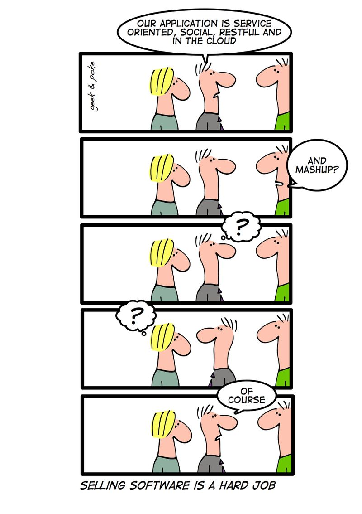
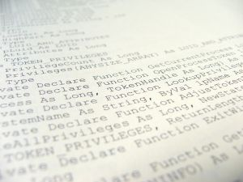
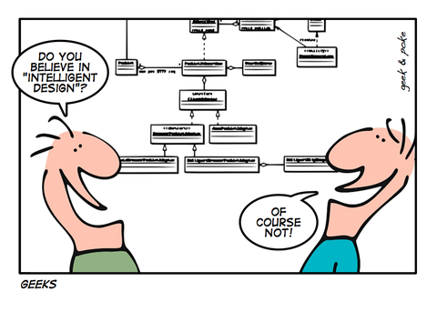
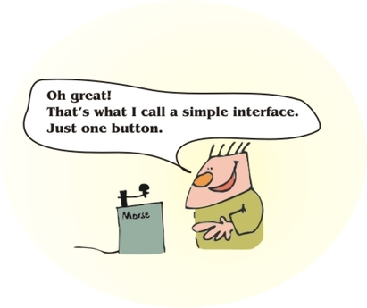
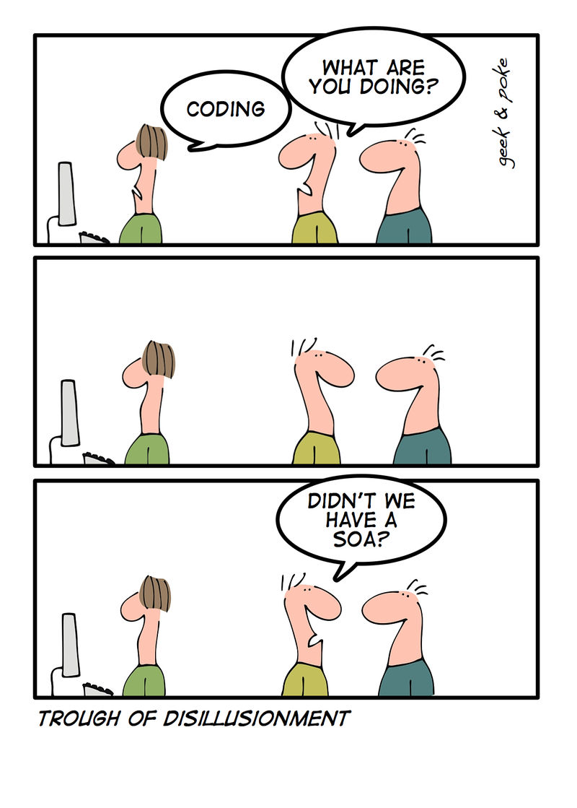

OK, we've talked about APIs, about [what they are not](/en/blog/lnds/2009/03/22/what-are-we-talking-about/), but not
much about what they really are, and how much they matter in software
development.

And so nobody can say all we do is criticize, let's contribute a few
ideas on how to write an API.

Before going on, I should say that for me REST interfaces, or APIs in
the Web 2.0 sense, that is, the APIs that let you build mashups, for
example, are not strictly an API, but that distinction is mostly
semantic.

It doesn't matter much, though. What follows applies to the more
traditional APIs, and also to public APIs in the context of cloud
applications.

The GUI is for the user, the API is for the programmer.

Just as we care about the user interface when we design an application,
so that it is "usable", in the same way, if we want third parties to be
able to extend the system's functionality, or to have access to its
services, then we have to provide an interface for programmers, too.

If you practice that esoteric art, the feng shui of information
architecture, I think you'll understand the importance of the previous
point. A good user interface is one that makes it easy for the user to
interact with the system. In the same way, a good API is one that makes
the programmer's job easy.

So when we design an API we have to put ourselves in the programmer's
shoes. The person who wants to use our API to extend what our
application does, or who wants to take advantage of our application's
services, but by integrating them into their own application or
service.

What are the design principles of a good API?

The required reference these days is [this presentation by
Joshua Bloch](http://lcsd05.cs.tamu.edu/slides/keynote.pdf), a Google engineer, who gives us some very good design principles for
programming interfaces.

What follows is more or less a summary of his talk, with a bit of my
own thrown in.

Are you sure you want to design an API?

Before starting, keep in mind that it's very important to design our
APIs well, for the following reasons:

-   APIs end up being among the company's most important assets.
-   Customers will invest heavily, whether buying your API, writing code
    for it or learning to use it.
-   Over time, the cost of walking away from an API can become
    prohibitive.
-   Successful APIs capture customers
-   A bad API results in an overloaded external support team
-   Public APIs are forever, so you only get one chance to get them
    right.
-   APIs end up becoming one of the company's great liabilities.

I'm not trying to scare you; publishing an API is a decision that has
to be thought through.

The characteristics of a good API

Bloch sums up the characteristics of a good API very well:

-   It should be easy to learn
-   It should be easy to use, even without documentation
-   It should be hard to misuse
-   Code that uses it should be easy to read and maintain
-   It should be sufficiently powerful to satisfy the requirements
-   Easy to extend
-   Appropriate to the audience

The process of designing an API

How do we go about designing an API?

First, as always, you have to gather the requirements, always with a
healthy degree of skepticism ;). Remember that there may always be
better solutions. This is where it's important to work out good use
cases.

Second, write a specification, a very short one if possible; one page
is ideal. It's good to show this specification to as many people as
possible. Keeping the specification short makes it easy to modify after
the feedback from the people reviewing it. It's important to build up
confidence in the specification, and at this point it's good to write
some code that uses the API and to develop test cases. It's important to
be as agile as you can here.

Third, you have to be clear about expectations. You can't please
everyone, and for that same reason you have to accept that your API will
very likely end up displeasing everyone equally. You're certain to make
mistakes, and only the years will end up erasing them, so you should
assume your API will evolve.

General principles of a good API

1.  An API should do one thing, and do it well. The functionality of an
    API should be easy to explain.
2.  An API should be as small as possible, but no smaller
3.  Implementation should not impact the API. Implementation details
    confuse the API's user and, of course, take away the freedom to
    change the implementation. Be careful about overspecifying the
    behavior of an API's methods. Any parameter that is set to tune the
    performance of an API is suspect.
4.  Minimize the accessibility of everything, which is another way of
    stating the old principle of information hiding. Remember Parnas:
    high cohesion, but low coupling.
5.  Names matter; the API is a little language. Names should be largely
    self-explanatory. It's important to be consistent: the same words
    should be used throughout the API.
6.  Documentation matters. As Parnas says, reuse requires good design
    and good documentation.
7.  Consider the performance consequences of API design decisions. Good
    design usually coincides with good performance.
8.  APIs must coexist peacefully with the platform. It's good to obey
    the platform's naming conventions. It's also advisable to mimic the
    conventions of the languages we implement the API in (with the
    exception of PHP, of course).

Other things to consider:

-   Don't violate the principle of least astonishment. The user of an
    API should not be surprised by its behavior.
-   Fail fast. We've [talked about this before](/en/blog/lnds/2010/05/27/stop-the-clock-squash-the-bug/):
    bad news is best delivered early, that is, report errors as soon as
    they occur.
-   Careful with overloading. Take care when overloading a method name
    and, above all, avoid ambiguities.
-   If you're not a programmer, ask a programmer for help designing a
    public API. Remember that APIs are interfaces for them, and they are
    not designed the same way as user interfaces.
-   API design should not be a one-person job. Although the
    specifications and the ideas may come from one person, it's good to
    get advice from others and to test with a broad base of users.

The cartoons are courtesy of [Geek and Poke](http://geekandpoke.typepad.com/).
