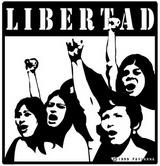

Today [FLISOL ](http://2009.flisol.cl/)is taking place at several locations around Chile. I like this event, and I think it embodies the social spirit that [should matter in the development of computing](/en/blog/lnds/2009/04/22/computing-as-a-social-science/).

I've used free software and open source software for years. Recently we rolled out a mission-critical service at my job using nothing but open source products.

I have no qualms about using open software, and none about using proprietary software either (or "privativo", as it should be called in Spanish to be grammatically correct).

What bothers me at these events is when they try to sell us a wrong idea: that using free software is ethical, while using closed (proprietary) software is not. Which is of course false, and part of a certain loaded ideology that has nothing to do with the nature of software. Technology isn't what is called to be ethical; people are. You are not tainted for using proprietary software. I think that is an obnoxious view, and we should banish it from our discussions.

Open software has many merits, but ethics is not one of them. And to explain my point, here is a recycled and improved excerpt of something [I wrote in February 2006](/en/blog/lnds/2006/02/06/freedom/):

## Freedom

Are we humans free?

The question matters, because it defines the limits of ethics. Aristotle asks it, and says we are free only up to a point. Some sterner types, like Spinoza, argue that since we are part of the essence of God, freedom lies in accepting his will, which means that deep down we cannot be free in the everyday sense of the word.

I believe we are free, because we can choose. But what I want is one thing, and what I can do is another. What I choose is one thing, and what happens to me is another.

In [the words of my brother Ricardo](http://www.ricardodiaz.org/archives/2006/02/libertad_absolu.html):

> ...freedom in everyday life cannot be

> absolute. Every time I decide to do something, "have ice cream", I stop choosing or doing other things, for example "having tea". Some smart guy could tell me "but you can have tea with ice cream". True, but that is already a third option, which excludes the simple act of having just ice cream. Every free act, in being carried out, excludes other free acts.

> We are not free, not with absolute freedom, because we are not absolute beings. And holding to absolute freedom is an option that may well belong on the plane of the ideal, but not of lived experience.

I am free to drive down the highway as fast as I want, or to stay up all night and drive without paying attention to road conditions, but that will bring consequences, [as it did for me](/en/blog/lnds/2006/01/29/accident/).

It's true, there is no absolute freedom, because we are not absolute. If we were, we would be gods and could run the world as we pleased.

But how boring would that be, don't you think?

We are free, but we have limits, and they are external to us. I can choose to read Ricardo's post, and once I've read it I can choose to answer him.

When you choose, you have to face the consequences of that decision.

Because freedom comes with a backpack, and it's called **RESPONSIBILITY**.

## Freedom and software

Every software license sets a framework for how the software may be used. For example, this site is under a Creative Commons attribution license, which says you can distribute this content, you can even create derivative works and make money off what I write, but you must credit me as the author of the original texts.

The same goes for software: you can put whatever license you want on it. Apple restricts the use of much of its software, which cannot be applied in medicine or military technology. It currently even imposes restrictions on the software that can run on its hardware, such as the prior certification process for iPhone applications, which lets it veto the development of applications for its devices. There are other cases, like not allowing its software to be used to control nuclear plants.

A developer has the right to put his ethical vision into the license of the software he creates. If a programmer thinks it's wrong for his software to be used in pornography, or to promote racial hatred, then he should look for a license that forbids it.

The original GPL license is based on certain principles laid out in Richard Stallman's idea of free software.

  * The freedom to run the program, for any purpose (freedom 0).
  * The freedom to study how the program works, and adapt it to your needs (freedom 1). Access to the source code is a precondition for this.
  * The freedom to redistribute copies so you can help your neighbor (freedom 2).
  * The freedom to improve the program, and release your improvements to the public, so that the whole community benefits (freedom 3). Access to the source code is a precondition for this.

According to this philosophy, you can build software to control intercontinental ballistic missiles of mass destruction as long as the program can be studied, that is, its source code must be accessible (even to the enemy ;).

You'd think the military would never do that, but freedom 0 doesn't prevent it. What's more, there is GPL software for the military industry. [RedHawk Linux](http://www.spacewar.com/reports/Concurrents_Redhawk_Linux_Selected_For_THAAD_Missile_Defense_Program.html) is the most striking example, used in the development of fighter aircraft, and even the [NSA ](http://www.nsa.gov/selinux/)has developed a version of Linux adapted to the security needs of the United States.

I don't like Linux being used for that. In fact, it is ridiculous to argue about whether GPL software should restrict the use of DRM when it is ethically far more questionable that free software is used to develop bombers that will kill thousands of children.

I don't like Linux being used for that. In fact, it is ridiculous to argue about whether GPL software should restrict the use of DRM when it is ethically far more questionable that free software is used to develop bombers that will kill thousands of children.

It seems that in the GPL the other side of freedom, responsibility, goes unquestioned. That is, it doesn't define an ethical framework, which is a framework for how I use freedom.

Although Stallman [tries to sell](http://vimeo.com/4152803) the idea that all of this is ethical and good for society, the truth is that he uses stale dualist arguments, leading his listeners to confuse ethics with morality, with "a certain morality", through a discourse that poses false dilemmas. He is a Manichean who holds that whoever develops proprietary software is a bad guy who is only trying to deliberately harm society. It's a message that catches on strongly among the young, but it doesn't really have much substance, and has very little to do with ethics. As Nietzsche said, "it is only a sound, not the truth".

The GPL seeks absolute freedom for software, but imposes no ethical responsibility of any kind on it, except perhaps that you must share your source code with your neighbor.

So the correct thing to say is that [free software is an ideology](/en/blog/lnds/2006/01/27/free-software-as-ideology/), not an ethics. If there were ethics in free software, it would define the responsibilities that come with following this philosophy.

There is nothing wrong with it being an ideology. What's wrong is that they want to sell it as the only ethical way to develop software, or have us believe it is the only ethical, correct vision to guide the profession of developing software.
