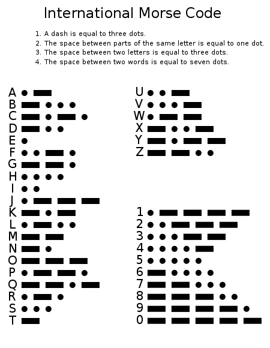

This is the second challenge I'm publishing. Let's hope it gets more participation than [the previous one](/en/blog/lnds/2008/08/04/zig-zag-a-challenge/) (just one answer).

Today is the anniversary of Samuel Morse's birth, so the challenge has 2 parts.

The first part is the simplest: write a function that takes a string of dots and dashes and prints the corresponding letters.

If the function is called CodigoMorse(), then the result of

> CodigoMorse("<del>.. .</del> <del>. .</del> - .-- .-. .- .-.. . .. .- <del>....</del>.. ...---..-.-..-.-..") = "La naturaleza del software".

The second part is to build a program that plays sounds representing Morse code.

The idea is that the program takes a sentence and emits beeps through the computer's speaker representing the dots and dashes.

Keep in mind that Morse code is a rhythmic system, with the following rules: if the dot is the basic unit, then a dash lasts as long as 3 dots, between symbols there is a pause lasting 1 dot, and between words there is a pause of 7 dots.

You can write the program in whatever language you like. Leave a link to the program's source code in the comments.

Here is a table of Morse code, taken from Wikipedia:

