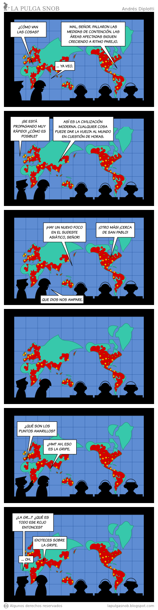

I have to say something about Guido Girardi, the Chilean senator. This
time his math didn't fail him. [What he
said](http://www.terra.cl/actualidad/index.cfm?id_cat=302&id_reg=1169984&titulo_url=Girardi_advierte_que_gripe_porcina_dejaria_facilmente_100_mil_muertos_en_Chile)
is logical, and I quote:

> "it is key that we have five million doses for at least five million
> people, because this influenza, if it is that contagious, can easily
> infect two or three million people in Chile, and if it kills five
> percent, in the event that it affects two million, we could easily
> have 100 thousand dead".

If the mortality rate of swine flu is 5%, and 2,000,000 people get
infected, then 100,000 people will die. Simple arithmetic, numbers
don't lie.

Good for Girardi, he knows how to multiply.

None of this means his reasoning is correct.

The problem is the premise he starts from. Where did Girardi get the
idea that 2,000,000 Chileans are going to be infected? Why do we need
five million antivirals? (because there is no vaccine yet).

Just like the other time this character warned us about 
[the terrible danger of dioxins](/en/blog/lnds/2008/07/31/pigs-and-dioxins/), I did a
little digging and found some interesting things, my main source being
the World Health Organization (WHO) itself.

The case of bird flu

First, let's look at the case of bird flu, which produces a more severe
flu than what has been observed so far in Mexico, according to Ximena
Aguilera, an expert at the Pan American Health Organization (La
Segunda, April 28, p. 4).

Bird flu emerged in 1997 and reached its peak in 2005, the year in
which PPD deputies Sanchez, Acorsi and Girardi
[demanded that the patent on the antiviral](http://diario.elmercurio.cl/detalle/index.asp?id=%7Bfd386e26-6f10-404b-be11-29b70b0732d8%7D) [TAMIFLU](http://diario.elmercurio.cl/detalle/index.asp?id=%7Bfd386e26-6f10-404b-be11-29b70b0732d8%7D)
be lifted in order to supply the doses needed to protect us from this
tremendous threat (a ridiculous request, because at the time TAMIFLU
had no patent in Chile :).

Well, here is the table of bird flu cases worldwide
([taken from the WHO
itself](http://www.who.int/csr/disease/avian_influenza/country/cases_table_2009_04_23/en/index.html)):

> Cumulative Number of Confirmed Human Cases of Avian Influenza A/(H5N1)
> Reported to WHO 23 April **2009**

> Country 2003 2004 2005 2006 2007 2008 **2009**
>
> Total cases deaths cases deaths
>
> Azerbaijan 0 0 0 0 0 0 8 5 0 0 0 0 0 0 8 5
>
> Bangladesh 0 0 0 0 0 0 0 0 0 0 1 0 0 0 1 0
>
> Cambodia 0 0 0 0 4 4 2 2 1 1 1 0 0 0 8 7
>
> China 1 1 0 0 8 5 13 8 5 3 4 4 7 4 38 25
>
> Djibouti 0 0 0 0 0 0 1 0 0 0 0 0 0 0 1 0
>
> Egypt 0 0 0 0 0 0 18 10 25 9 8 4 16 0 67 23
>
> Indonesia 0 0 0 0 20 13 55 45 42 37 24 20 0 0 141 115
>
> Iraq 0 0 0 0 0 0 3 2 0 0 0 0 0 0 3 2
>
> Lao People's Democratic Republic 0 0 0 0 0 0 0 0 2 2 0 0 0 0 2 2
>
> Myanmar 0 0 0 0 0 0 0 0 1 0 0 0 0 0 1 0
>
> Nigeria 0 0 0 0 0 0 0 0 1 1 0 0 0 0 1 1
>
> Pakistan 0 0 0 0 0 0 0 0 3 1 0 0 0 0 3 1
>
> Thailand 0 0 17 12 5 2 3 3 0 0 0 0 0 0 25 17
>
> Turkey 0 0 0 0 0 0 12 4 0 0 0 0 0 0 12 4
>
> Viet Nam 3 3 29 20 61 19 0 0 8 5 6 5 3 3 110 55
>
> Total 4 4 46 32 98 43 115 79 88 59 44 33 26 7 421 257 Total number of
> cases includes number of deaths. WHO reports only laboratory-confirmed
> cases.\
> All dates refer to onset of illness.

Let's see..., how many cases in Chile? Zero, 0, none, nothing.

In 6 years, 421 cases, with 257 deaths, in the whole world! (well, not
the whole world, 15 countries)

Where are the 10 million cases that were predicted in 2005?

Let's calculate the incidence.

In the case of Indonesia, with a population of 193 million (as of 1994),
that gives us an incidence of 5 cases per 10,000,000 inhabitants!!!

By the way, the incidence of bird flu in Chile is 0, the same as in the
USA, which bought millions of treatments for a disease that never
showed up in that country.

Do you know what the incidence of the current swine flu would be, the
way things are going so far? 15 cases per 10,000,000 inhabitants.

If these figures held, if this incidence could be projected onto our
reality (not a very rigorous thing to do, but are we really that
different from Mexico?), then Chile would have 22 cases and, given the
5% mortality rate, 1 death from this disease.

> 22 infected and one death (LNDS)
>
> vs.
>
> 2 million infected and 100,000 dead (Girardi)

Who do you want to bet on, my sloppy calculation or Girardi's math?

How things come to light

It turns out that the drug TAMIFLU, the one more doses are being
requested of, the same one Girardi wanted stripped of its patent in
2005, is produced by the pharmaceutical company Roche, using a patent
developed by [GILEAD Sciences Inc](http://www.gilead.com/), a patent
that will remain in force until 2016.

An interesting fact: GILEAD was founded by, among others, [Donald
Rumsfeld](http://en.wikipedia.org/wiki/Donald_Rumsfeld), who was a
member of the board until he took office as secretary of defense in the
younger Bush's administration.

There is a controversial episode: the Bush administration's decision,
in November 2005, to spend more than 1 billion dollars buying Tamiflu
to prepare for the imminent arrival of the coming bird flu epidemic. In
2005 it was estimated that bird flu would affect 10,000,000 people
worldwide.
\[[1](http://en.wikipedia.org/wiki/Gilead_Sciences)\]
\[[2](http://www.worldnetdaily.com/news/article.asp?ARTICLE_ID=47725)\]

You can come up with all the conspiracy theories you like. What catches
my attention is that after treating 41 cases (40% of the cases reported
in Vietnam so far), Ngyen Tuong Van, the doctor in charge of the ICU at
the Center for Tropical Diseases in Hanoi, Vietnam, concluded that
TAMIFLU is useless as a treatment for bird flu!
\[[2](http://www.worldnetdaily.com/news/article.asp?ARTICLE_ID=47725)\]

In March **2009** the WHO published 
[a study](http://www.who.int/csr/disease/influenza/H1N1webupdate20090318%20ed_ns.pdf)
of the degree of resistance of the current mutations of the H1N1 virus
to oseltamivir (Tamiflu), split into two groups of countries and
different periods.

In the first group, mostly southern hemisphere countries, Chile among
them, the virus's resistance to oseltamivir was 44% (13% in Chile),
measured in the April-September 2008 period.

In the second group, with northern hemisphere countries, the virus's
resistance to oseltamivir was 95%! That was in the last quarter of 2008
through January **2009**.

And swine flu?

One thing needs clearing up: pigs have had this flu for a long time. It
is nothing new; in fact it is an endemic disease among pigs in the
United States. There have been pig-to-human infections in the past.

You don't get swine flu from eating pork, which is why the WHO decided
to stop calling this new variant of influenza swine flu.

It is an unusual combination of genes from the swine flu virus and the
human flu virus, a mutation of the Influenza A virus, subtype H1N1.

So let's leave Porky and his friends alone, and focus on this variant
of human influenza.

Is this new disease that terrible?

Influenza kills some 300,000 people a year.

For this new flu, caused by a variation of the A H1N1 virus, 365 cases
had been reported as of May 1, in 13 countries (none in Chile), with 10
deaths, 1 in the USA and 9 in Mexico, [according to the
WHO](http://www.who.int/csr/don/2009_05_01a/en/index.html).

The thing is, an outbreak of A H1N1 caused the famous [Spanish
flu](http://es.wikipedia.org/wiki/Gripe_espa%C3%B1ola) of
1918-1919.

There are many interesting things, and some murky ones, about this
famous Spanish flu.

-   The flu did not originate in Spain. It got the name because Spain
    did not take part in the war and therefore did not censor the news
    about this flu; it was the country where the pandemic was most
    widely reported at the time.
-   It is believed to have originated in Kansas, in the barracks of
    soldiers getting ready to go fight in Europe.
-   Because of wartime censorship, nobody really knows how many people
    died. Some say 2 to 5% of the population of the time died, and the
    death toll estimates range from 20 million to 100 million. It is
    even claimed that more people died of this disease than in the
    First World War.
-   How many people did it affect? Nobody knows that either; the
    figures range from 25% to 50% of the world's population (some 2
    billion people at the time).
-   Between 2004 and 2005, using frozen tissue from people who had the
    disease, the A H1N1 virus that caused the Spanish flu was recreated
    in vitro. It is kept in a biosafety laboratory at the CDC in
    Atlanta.

However, the scientists who have studied this new outbreak in Mexico
say that this time it does not have the virulence of the Spanish flu.

Dr. Nancy Cox, "flu chief", has said the good news is that "we do not
see the markers for virulence that were seen in the 1918 virus".
\[[3](http://today.msnbc.msn.com/id/30398682)\]

On the other hand, the outbreak has not shown the geometric spread that
was initially expected, which is good.

So, should we be this worried, this alarmed?

I don't think so.

Maybe [there is a conspiracy behind
thi](http://agenciadin.com.ar/0280409.htm)s, aimed at selling millions
of doses of medication, or maybe it's the same as always: instead of
conspiracies, what is really behind it is stupid behavior by the people
who have to make the decisions.

[Cartoon taken from La Pulga Snob](http://lapulgasnob.blogspot.com/2009/05/epidemia.html).
