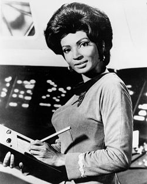
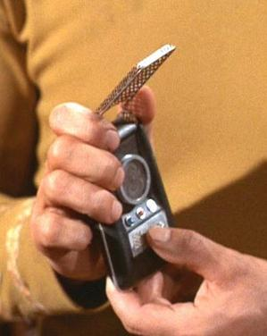
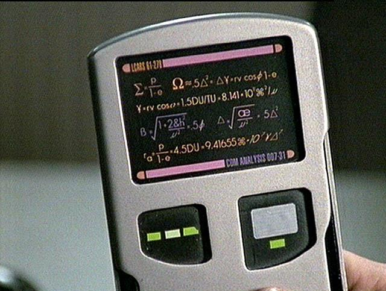
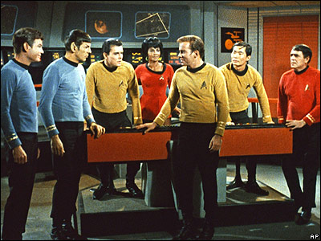

[Whoopi Goldberg](http://en.wikipedia.org/wiki/Whoopi_Goldberg) says she identified with the character of Uhura in Star Trek. She recalls telling her family: _"I just saw a black woman on television; and she ain't no maid!"_

Nichelle Nichols, the actress who played Uhura, had decided to leave the show after the first season, but it was Martin Luther King himself who asked her not to, because she represented a positive role model for black women. NASA itself asked her to take part in campaigns to encourage African Americans to join the agency.

Uhura comes from the Swahili word uhuru, which means freedom. I'm a die-hard Trekkie, and although I didn't go as far as naming one of my daughters Uhura, one of them is called Francisca, which carries the same concept, the most important value for me.

I don't remember when I learned these things about Uhura. I have a couple of books about the show, and I've watched it and keep watching it often.

Some people say they never watched Star Trek because they didn't understand it. Fine, that can happen when you're little, but it's no excuse for not watching it now (the original series and the ones that followed, not just the J.J. Abrams movie.

I think those of us who watched Star Trek in the 70s learned quite a bit, about a positive future for humanity, where Earth has left behind greed and the differences between races and nations.

And on top of that we came out prepared to understand today's technological world.

Look at the photo of Uhura. What is she holding in her arms? Isn't that a [Tablet PC](http://es.wikipedia.org/wiki/Tablet_PC)? In 1967?

And what do you say about this:

When I got my first cell phone, it was a Nokia that flipped open and was the same size as Captain Kirk's communicator.

And what are Palms, BlackBerries or iPhones if not a kind of PADD, like this one:

There are many examples of technology probably inspired by this show:

  

  * Teleconferencing
  * Cell phones
  * Bluetooth earpieces
  * Touch screens
  * Flat screens
  * Medical sensors
  * The tablet PC
  * Laptops
  * Scanners
  * Voice interfaces for computers
  * The universal translator (Google language tools)
  * Google itself works like Spock's computer
  * Email, of course (and multimedia)
  * Giant plasma or LCD screens
  * Automatic doors
  * Nanotechnology (in medicine)
  * The Internet!
  * And of course we can't forget its contributions to fashion, like [capri pants](http://es.wikipedia.org/wiki/Pantalones_capri), according to my wife ;)

  

So why not take the time to watch Star Trek? It will probably inspire you to some new technology, or help you understand the world you're living in.

What other technologies do you think were inspired by Star Trek?
