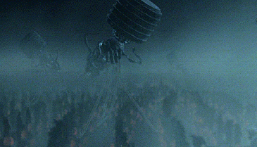

This is the introduction to a series of articles I want to write about
an interesting, and important, dilemma we face. What follows is an
excerpt from a text whose author I will reveal in the second article of
this series.

> The new Luddite challenge
>
> First let us postulate that the computer scientists succeed in
> developing intelligent machines that can do all things better than
> human beings can do them. In that case presumably all work will be
> done by vast, highly organized systems of machines and no human effort
> will be necessary. Either of two cases might occur. The machines might
> be permitted to make all of their own decisions without human
> oversight, or else human control over the machines might be retained.

> \[...\] What we do suggest is that the human race might easily permit
> itself to drift into a position of such dependence on the machines
> that it would have no practical choice but to accept all of the
> machines' decisions. \[...\]

> On the other hand it is possible that human control over the machines
> may be retained. \[...\] These engineered human beings may be happy in
> such a society, but they will most certainly not be free. They will
> have been reduced to the status of domestic animals.

For the record, I am no [Luddite](https://es.wikipedia.org/wiki/Ludismo),
quite the opposite, but this text unsettled me when I read it for the
first time.

I hope this text is introductory enough and gives you an idea of what
we are going to discuss in the coming articles.
