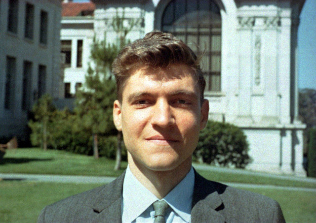
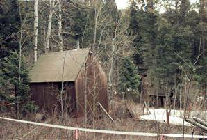
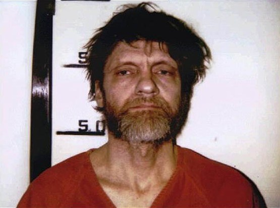

On April 24, 1995, the New York Times received a letter from the
terrorist known as the Unabomber, stating that he would "desist from
terrorism" if that paper or the Washington Post published his
manifesto, "Industrial Society and Its Future".

Up to that point, the FBI had not identified the Unabomber. This
terrorist began his attacks in 1978. Over that period he sent 16 bombs
to universities and airlines, and that modus operandi gave rise to the
name that made him famous ("UNiversity and Airline BOMber").

The decision to publish the Unabomber Manifesto was not an easy one,
but it allowed his brother David to identify him, and led to his arrest
in April 1996.

Theodore Kaczynski was a brilliant mathematician, a Harvard graduate.
He earned his PhD at the University of Michigan, specializing in
complex analysis, with a brilliant thesis that solved a hard problem in
that field. He later became an assistant professor at the University of
California, Berkeley.

At the age of 26, Kaczynski decided to quit teaching and withdrew into
a solitary life.

This photograph, taken in 1968, shows the young Ted Kaczynski, 28 years
old, assistant professor at Berkeley:

In the northern summer of 1969, Kaczynski decided to abandon urban
life, bought a plot of land in the woods of Montana, and built his own
cabin. He learned survival skills and set out to live a self-sufficient
life, with very little money, no electricity and no running water.

From that period he regrets three things: his inability to build a
hunting crossbow, never managing to make his own deerskin moccasins,
and never managing to make fire without matches.[^1]

His dream of a self-sufficient life was frustrated when he found that
industrial society ended up invading his space, ruining one of his
favorite spots to build a road.

That is when he started reading sociology and political philosophy,
especially the work of the [Christian anarchist philosopher Jacques Ellul](http://flag.blackened.net/daver/anarchism/ellul/index.html).

He reached the conclusion that it is impossible to reform industrial
society, and that the only way to achieve change is through violence.
On the possibility of a peaceful reform of industrial society he says:

> "I don't think it can be done. In part because of the human tendency,
> for most people, there are exceptions, to take the path of least
> resistance. They'll take the easy way out, and giving up your car,
> your television set, your electricity, is not the path of least
> resistance for most people. As I see it, I don't think there is any
> controlled or planned way in which we can dismantle the industrial
> system. I think that the only way we will get rid of it is if it
> breaks down and collapses."[^1]

Kaczynski sent his first bomb in 1978. Addressed to a professor of
materials engineering, it was found at the University of Illinois at
Chicago. The device was opened by a campus guard, who became the first
of the 26 victims of the Unabomber's attacks. The final toll was 3 dead
and 23 injured.

One incident, however, could have been much worse. In 1979, one of the
bombs, placed aboard American Airlines flight 444, bound for Chicago,
started smoking, which forced an emergency landing. Fortunately the
bomb failed; otherwise it could have destroyed the plane in mid-flight,
killing 78 people.

In September 1995, the New York Times and the Washington Post published
the Unabomber's manifesto, hoping to identify the person behind the
text and stop the attacks.

The FBI was truly lost in its search for this killer. A 1980 profile
described the Unabomber as a man of above-average intelligence, with an
education. By 1993 they were working on the hypothesis that he was a
mere airplane mechanic.

His brother David gradually approached the police after he recognized
the text of the manifesto as his brother's work. This led to
Kaczynski's arrest in April 1996. The photograph shows him at the
moment he is booked by the police, after his arrest at his cabin in
Montana:

Compare the images of the young Kaczynski, from 1968, and of the
Unabomber of 1996.

What drives a young, intelligent man, a scientific promise, a
mathematical genius, to this state?

Certainly, solitude is a cruel mistress, and a very bad counselor.

Is Kaczynski crazy?

He is not a serial killer; [he is better described as a mass
murderer](http://www.salon.com/news/1997/11/14news.html), who
fortunately acted alone. He was diagnosed with paranoid schizophrenia,
although he was found fit to stand trial. Even so, at times his
manifesto shows a sharpness that is frightening, because it sounds like
a reasonable, valid position.

They say that madmen, after all, have the virtue of speaking truths.

Bill Joy, founder of Sun Microsystems, published in Wired magazine, in
2000, an interesting article, [Why the future doesn't need
us](http://www.wired.com/wired/archive/8.04/joy_pr.html).

In this article Joy quotes a fragment of the manifesto, titled 
"[The new Luddite challenge](/en/blog/lnds/2009/05/22/the-new-luddite-challenge/)"
(which I published earlier).

Joy writes that although Kaczynski's actions were "murderous and, in my
view, criminally insane", and "as difficult as it is for me to
acknowledge, I saw some merit in the reasoning in this single passage.
I felt compelled to confront it".

Kaczynski's ideas, laid out in his manifesto, have inspired the
neo-Luddites and anarcho-primitivism, along with other extreme
environmentalist groups.

I don't know how much of Kaczynski is present in anti-establishment
groups, but it is clear that you hear a lot of the anti-technology
arguments in many of these groups and movements.

Like Joy, I feel compelled to confront this thinking, and to do that it
is important to understand it. That is the point of this series of
articles, where we will keep exploring the possible threats of
technological development.

Maybe it is naive of me to ask these things, but after hearing [the
news of a young anarchist who died, victim of an explosive device he
was carrying in his backpack](http://www.cooperativa.cl/joven-fallecido-en-explosion-era-buscado-por-bombazos/prontus_nots/2009-05-22/121823.html),
I can't help but worry.

How many Kaczynskis are there in our society?

How many young people start out with a hopeful vision and end up
turning into monsters, despite their high ideals?

I keep looking at the two images of Kaczynski, and I keep
worrying\...

[^1]: [Interview with
Kaczynski](http://www.insurgentdesire.org.uk/tedk.htm), taken from the
English green anarchist site, insurgent desire.
