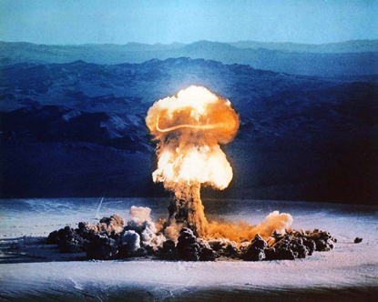

We have already seen [one position](/en/blog/lnds/2009/05/22/the-new-luddite-challenge/), at one of the extremes, on what to do about the threats technology poses to our society.

In 2006 I wrote this article, which I have decided to touch up and adapt to my current series on the challenges technology imposes on us. I think it is appropriate to publish it now, as a sort of bridge toward the other extreme proposal on what to do in these scenarios where technology may overtake us.

Doomsday machines

I read with astonishment a post by my brother about a chain letter that [announces the end of the world for June 6 of this year (6/6/6)](http://www.ricardodiaz.org/archives/2006/04/fin.html) [^1].

Apart from being an interesting numerical coincidence, what reasons are there to think the world must end?

## The end, courtesy of technology

The truth is that the end of the world has been announced many times, and not only by religious fanatics.

Apocalyptic visions usually announce all kinds of cataclysms but, as you would expect, other causes for the end of the world have been added lately, many of them a consequence of our abuse of technology:

  * The end of the world through the use of biochemical weapons
  * All-out nuclear war
  * Nuclear plants exploding
  * [A super machine that creates a vortex](http://www.lnds.net/2008/09/buuum.html), or a black hole
  * Global warming and a new ice age
  * The rise of artificial intelligences that destroy their creator

This last "threat" is the one I want to explore now, because it has to do with subjects I know better.

## The fear of artificial intelligence

The fear of the machines rising up has been discussed in blockbusters like The Terminator and The Matrix, and more elegantly in "2001: A Space Odyssey".

  
When people talk about this vision of the machine that rises against its creator, many compare it to Mary Shelley's [Frankenstein](http://www.literature.org/authors/shelley-mary/frankenstein/). It's not really the same thing, since the "creature" is a human brought back to life (well, a reanimated human body, built from parts of many corpses).

In The Matrix we don't know what the "machines" are like. We see squid-shaped robots, but they are just "suits" to house artificial intelligences. The artificial intelligences live in the matrix, a virtual world, which has a physical substrate (hardware), powered by the biochemical energy of millions of human beings.

In The Terminator the idea is similar: an artificial intelligence emerges from a military network (Skynet), and this intelligence decides to destroy mankind. To do so it uses robots, known as terminators, but again, the AIs are somewhere else.

John Connor knows he must destroy Skynet before it forms, because access to Skynet is probably impossible. Neo heads for a sort of core of the Matrix, because he knows that even if they kill all the squid robots, those aren't the problem.

Dan Simmons's brilliant science fiction saga Hyperion shows us a war between the AIs and people, with an interesting twist: the AIs have decided to sacrifice themselves to create more evolved AIs (would we be capable of sacrificing ourselves for the species that succeeds us?).

In all these cases the unseen enemies are artificial intelligences that live, float, so to speak, in a network or physical substrate. They are programs, algorithms, heuristics, in a way, but with the ability to learn and to manipulate their environment in order to protect themselves, for example by building robots.

The robots are not the dangerous ones; they are tools. The artificial intelligences are the ones in command, and the dangerous ones.

But by their nature, AIs are slippery. In 2001, HAL is eliminated because he has an easily accessible physical substrate. But in The Matrix and The Terminator that isn't possible, and the heroes of those sagas must try to keep them from emerging, in the case of The Terminator, or attack the core where they reside, as in The Matrix.

John Connor's strategy, however, is smarter than Neo's, because John Connor wants to keep Skynet from ever existing. But that produces an interesting paradox: if John Connor destroys Skynet, he will cease to exist. In the case of The Matrix, we know that Neo cannot destroy the AIs, that the struggle is eternal and will repeat forever, because Neo is in a way a mechanism of the matrix itself for reorganizing itself.

Maybe that is why The Matrix disappoints so much as a trilogy. We were expecting a more exciting outcome, but they actually lead us to a letdown of an ending in which the AIs win. But it is also clear to us that, in a way, the matrix still depends on free humans, an elite perhaps, living in Zion.

We have seen that only in 2001 does the hero manage to eliminate the AI threat. HAL fails because he is unable to protect himself.

## Artificial life

The current thinking is that before building an AI we must build lower levels of intelligence. These rudiments of artificial intelligence are already available, [even within reach of any of us](/en/blog/lnds/2009/03/14/the-dream-of-electric-sheep/). These rudiments make up the "instincts" of AIs.   
Without those basic instincts that allow the AI to develop, it will not be possible for it to become conscious.

An artificial intelligence should

  1. Preserve itself
  2. Reproduce
  3. Evolve

These three basic requirements are the foundation of the so-called [strong thesis of artificial lif](http://vidaartificial.com/index.php?title=Vida_Artificial)e. In essence it says that a life is an operational model, and if it satisfies the three operations mentioned, then the physical substrate of that life doesn't matter.

Satisfying these three needs is what would justify the AIs' hostility toward us. Indeed, if we make their preservation precarious, if they have to compete with us for resources, or if we are in the way of their evolution, the AIs may turn against their creators.

Where will artificial intelligence emerge?

The interesting question is whether artificial intelligences can develop outside their physical substrate, or before having one. That is, [can AIs emerge inside the network?](/en/blog/lnds/2008/12/30/what-if-artificial-intelligences-were-already-emerging/).

In The Terminator, the first thing to develop is Skynet, a computer network, which starts taking control of the factories needed to build the weapons and the terminator robots.

So, besides worrying about the industrial world and the threats of machines, which are mainly environmental threats, it is interesting to focus on understanding the threats posed by information technology, that is, the threat of a hostile AI developing.

Consider the following fragment:

> "You know what's cheap in the 21st century? Computer time. You know what's expensive? Human judgment. The two are not interchangeable. Humans are good at understanding things, computers are good at counting things, but humans suck at counting, and computers suck at understanding."  
  

> "You know about genetic algorithms? Take any problem and generate 10 billion random computer programs and set them to solving the problem. Take the 10% that do best, use random variants of them and run them another 10 billion times. Repeat that 10 billion more times, come back in a day or two, and you'll discover that the computer has "evolved" a strange, bizarre answer that no human would ever have come up with."
>
> "No human is going to manage to write the code for an Artificial Intelligence (AI). Intelligence is an emergent property of evolutionary factors, not of central planning. It's anarchy, not Stalinism. Get it?"[^2].
   
What if the rise of artificial intelligence is inevitable, and that means we have to start accepting that we will have to deal with beings potentially superior to us?

There is an extreme proposal that tells us what we should do in that case and that, unlike what the neo-Luddites and those who call for destroying or abandoning technology propose, takes a radically opposite path. That is the one we will explore in the next post.

[^1]: The first part of this post was written in April 2006, under the title [Doomsday machines](/en/blog/lnds/2006/04/16/the-doomsday-machines/).

[^2]: Cory Doctorow, "Pester Power", short story published in Communications of the ACM, December 2008.
