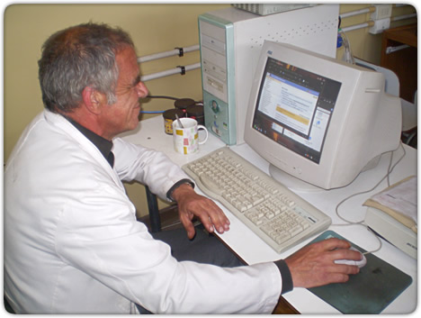

There are people you never get to meet, but whom you learn about because you had the chance to [read their story, and their contribution](http://www.elfrancotirador.cl/2007/11/27/la-verdadera-escuela-del-futuro-usa-linux/), and that manages to leave a deep impression on you.

  

That is the case of Carlos Carreño Lemee, a teacher at the Liceo Balmaceda, a public high school in Concepción, who did beautiful work building the computer lab for his school. I am not going to tell you his story, since Christian [tells it very well](http://www.elfrancotirador.cl/2007/11/27/la-verdadera-escuela-del-futuro-usa-linux/); I invite you to read it.

  

Sadly, Professor Carreño has left us. I wish other teachers would follow his example.

  

By the way, Professor Carreño was someone who understood the value of free software very well, without falling into fanaticism, and with the ability to recognize the right path in adopting technology, as this little piece of his thinking shows:

  

> "I have nothing against Microsoft. In fact I think Windows has some very good features, but if we keep using proprietary software we will always be just users and nothing more. Chile was once a leader in education and culture. With free software that is what we encourage: **development**. And that is what people should have, the right to choose."

  

  

Photo [from El Francotirador](http://www.elfrancotirador.cl/2009/06/04/un-dia-triste-fallece-el-profesor-carlos-carreno-lemee/)

  

