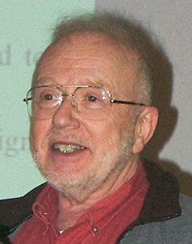

In 1985 Ronald Reagan proposed the Strategic Defense
Initiative, [SDI](https://en.wikipedia.org/wiki/Strategic_Defense_Initiative),
which came to be known as Star Wars, after
the George Lucas movies.

Essentially, SDI consisted of a shield made up of a network of
satellites to detect missile launches and a series of anti-missile
weapons, with high-energy lasers, in charge of destroying
those missiles in space before they reached American
territory (all of it over our heads, of course).

At the time [David Lorge
Parnas](http://en.wikipedia.org/wiki/David_Parnas), a major pioneer
of the field of software engineering and a professor at the University of
Victoria in British Columbia, was a consultant with access to military
secrets at the Office of Naval Research in Washington. He was one
of the nine scientists called by the SDI central office to
take part in the "Panel on Computing in Support of Battle
Management".

In a letter of resignation from the panel, accompanied by 17 memoranda, Parnas
declared that it would never be possible to realistically test the vast
array of computers responsible for linking and controlling the systems
of sensors, weapons, guidance and aiming systems, plus the
battle stations.

According to Parnas this was even harder to achieve by following the
traditional methods of software development, in which "bugs" and
errors are only detected in the day-to-day use of the systems. "I believe
it is our duty, as scientists and engineers, to reply that we have
no technological magic that will accomplish that. The President
and the public should know that," was part of what he said.

Professor Parnas wrote that he was sure other experts
would disagree with him, but that many would see this program as the
"pot of gold" for funding research projects, and others as
an interesting intellectual challenge. That, of course, is not the ethical
path, and Parnas was very clear about it, even though the arguments he used to defend
his position were strictly technical. That is why Parnas
became one of the people I admire most in my profession.

You can read his article "[Software Aspects of Strategic
Defense](http://klabs.org/richcontent/software_content/papers/parnas_acm_85.pdf)",
published in the December 1985 issue of CACM.

> "My conclusions are not based on political or policy judgments. Unlike
> many other academic critics of the SDI effort, I have not, in the past,
> objected to defense efforts or defense-sponsored research. I have been
> deeply involved in such research and have consulted extensively on
> defense projects. My conclusions are based on more than 20 years of
> research on software engineering, including more than 8 years of work
> on real-time software used in military aircraft. They are based on
> familiarity with both operational military software and computer
> science research. My conclusions are based on characteristics peculiar
> to this particular effort, not objections to weapons development in
> general."

The article contains the memoranda that accompanied his letter of resignation,
and is divided into 8 parts:

> 1.  The fundamental technological differences between software
>     engineering and other areas of engineering and why software is
>     unreliable.
> 2.  The properties of the proposed SDI software that make it
>     unattainable.
> 3.  Why the techniques commonly used to build military software are
>     inadequate for this job.
> 4.  The nature of research in software engineering, and why the
>     improvements that it can effect will not be sufficient to allow
>     construction of a truly reliable strategic defense system.
> 5.  Why he does not expect research in artificial intelligence to
>     help in building reliable military software.
> 6.  Why he does not expect research in automatic programming to bring
>     about the substantial improvements that are needed.
> 7.  Why program verification (mathematical proofs of correctness)
>     cannot give us a reliable strategic defense battle-management
>     system.
> 8.  Why military funding of research in software and other aspects of
>     computing science is inefficient and ineffective.

The article, or series of articles, is a real lesson in
software engineering.

Parnas avoids technical jargon, so you do not need to be a
programmer to read it.

But the most important thing is that Parnas gave an important lesson in
ethics, because he believes that ethical people should work on
projects they think have unethical aspects. This
way they might be able to have some influence on keeping things ethical, and they also
have an obligation to inform themselves of the risks and
benefits of such projects[^1].

His stance made him the first person to receive the
Norbert Wiener Award for Social and Professional Responsibility, given by
[CPSR](http://cpsr.org/), Computer Professionals for Social
Responsibility.

Norbert Wiener, the father of cybernetics, wrote the following text,
quoted by Terry Winograd at the ceremony where the award was presented to
Parnas:

> "Any machine constructed for the purpose of making decisions, if it
> does not possess the power of learning will be completely
> literal-minded. Woe to us if we let it decide our conduct, unless we
> have previously examined the laws of its action and know fully that
> its conduct will be carried out on principles acceptable to us!

On the other hand, the machine like the djinee, which can learn and can
make decisions on the basis of its learning, will in no way be obliged to make
such decisions as we should have made, or will be
acceptable to us. For the man who is
not aware of this, to throw the problem of his responsibility
on the machine, whether it can learn or not, is to cast his
responsibility to the winds, and to find it coming back seated
on the whirlwind."[^2]

Is software the genie in the bottle? Are we responsible enough
to control it?

I invite you to [read Parnas](http://klabs.org/richcontent/software_content/papers/parnas_acm_85.pdf).

[^1]: [Ask Parnas](http://courses.cs.vt.edu/~cs3604/lib/Ethics/parnas.html).

[^2]: Compare this text by Wiener with what Kaczynski argues
([the challenge of the new Luddite](/en/blog/lnds/2009/05/22/the-new-luddite-challenge/))
about letting machines make their own decisions.

