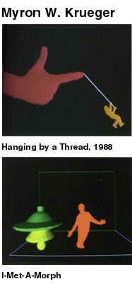

A thousand years ago I saw a demo of augmented reality in which a young woman interacted with a dog on a screen. In fact, I own a 1990 book called **Artificial Reality II,** written by [Myron W. Krueger](http://en.wikipedia.org/wiki/Myron_W._Krueger), who coined the term to name the immersive experience in an interactive environment (to set it apart from virtual reality).

That book shows, and explains the workings of, things like these:

Well, that is now one step away from no longer being research and settling into our living rooms, thanks to Microsoft's [Project Natal](http://www.xbox.com/en-US/live/projectnatal/).

You have surely seen this video already, and if not, I invite you to watch it:
