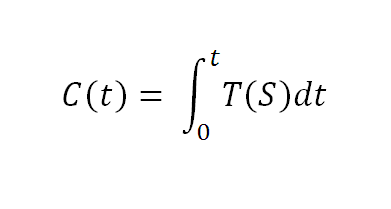

Culture (C), at a given instant t, is the integral of technology (T) applied to society (S):

With all due respect, this equation is what [Kevin Kelly doesn't get](http://www.kk.org/newrules/blog/2009/06/technology-has-become-our-cult.php).

Thanks to @cadaunante we have [a translation of what Kelly says](http://abbagliati.blogspot.com/2009/06/la-tecnologia-se-ha-convertido-en.html):

> "Technology has become our culture,...
> ...our culture technology.  
>  
> Technology is no longer outside, no longer alien, no longer at the periphery. It is at the center of our lives. "Technology is the campfire around which we gather," says musician/artist Laurie Anderson. For many decades high tech was marginal in presence. Then suddenly--blink--it is everywhere and all-important."
>   

I say it isn't so. It is not that technology has become our culture; on the contrary, culture has always been the result of applying technology to society (understood as a human group with some degree of organization).

Isn't a campfire Paleolithic high tech?

There are thousands of examples. My favorite: language, which is nothing more than one of the first information technologies.

Think of the birth control pill. Isn't that a technology that radically changed the culture of the late 20th century?

We are technological beings. Our culture is nothing more than the sum of all the continuous technological changes that we apply to ourselves. That's why it is an integral over time!

The rest of what Kelly says strikes me as more interesting:

> "But if success follows a biological model, so does failure. A cautionary tale: One day, along the beach, tiny red algae suddenly blooms into a vast red tide. A few weeks later, just when the red mat seems indelible, it vanishes. Lemmings boom, then disappear as suddenly. The same biological forces that multiply populations can decimate them. The same forces that feed on one another to amplify network presences creating powerful standards overnight can also work in reverse to unravel them in a blink. The same forces that converge to build up organizations in so biological a fashion can also converge to tear them down. One can expect that when Microsoft's fortunes falter, their profits will plunge in a curve inversely symmetrical to their success. All the self-reinforcing reasons to join a network's success run in reverse when the success turns to failure and everyone wants to flee.

It's true, biology has strange phenomena we cannot explain, like the one with the lemmings (which, by the way, do not commit mass suicide as the myth has it).

But the truth is we still don't know much about the forces that produce these biological phenomena.  

What is interesting in what Kelly says is the claim that the network effect is reversible, that it acts symmetrically but in the opposite direction. [Microsoft has benefited a great deal from the network effect]/2008/01/bob-metcalfe-es-uno-de.html), and if Kelly is right, the giant may come crashing down because of that very same effect.

All of biology rests on the central idea of Darwin's evolution.

In evolution there is no success, and there are no failures. Evolution is not progress, it is adaptation. If organisms adapt to changes, they survive, they evolve, they are different. They are neither better nor worse; they are fit for the new conditions.

Think of IBM. Twenty-five years ago it was like Microsoft. The forces that had made it the most important company in computing worked to push it out of its niche. The new kid on the block, that new specimen, Microsoft, which took advantage of the environmental conditions, ended up pushing IBM out of an entire niche. But IBM reacted, it adapted, to the point that it found a way to attack its old enemy: it is one of the main financial backers of open source. Microsoft has adapted before; the question is whether it will manage to do so in time.

Many people believe that open source, free software, or free culture are the right path, the proper thing, even the ethical path; that they are progress, in short.

I don't believe that. Free culture is the network effect, running in the opposite direction to the one that took companies like Microsoft to success, to becoming the dominant species, the king of the ecological niche.

It is not the right path, and it is not the wrong path either. It is just an evolutionary leap, a new stage, an adaptation to a new reality, which of course will bring inevitable cultural changes.

Technology has been the great driver of the idea of "free culture". Isn't that one more proof that my equation holds?

:wink:
