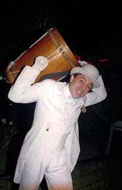

If you remember the early days of the Chilean comedian [Bombo Fica](http://www.facebook.com/pages/BOMBO-FICA/31802343888), he would walk
on stage with a bombo legüero, a traditional bass drum, supposedly to give a
lecture on the instrument, and he would end up talking about anything
else, all of it funny, of course. A guy dressed in white,
lecturing on the properties of the bombo legüero. That was funny!
Or at least I thought so.

That is what happens to me with this blog. The original intention was supposedly to talk about
the "nature of software", and the truth is I ended up writing
about a whole lot of other things.

I'm not complaining. On the contrary, I like having a blog and writing about
whatever I feel like.

You know what they say, [a blog is like a box of
chocolates](http://www.santamaradona.org/blog/0302/138):

> For those who still don't understand how this weblog thing works,
> let me try to explain: imagine that the author of a weblog is like Forrest
> Gump (You saw Forrest Gump, right?). And the reader is like one of those
> characters who sat down next to him on the bench while he launched into
> diatribes about chocolate and life.
>
> Like Forrest, weblog authors write about anything.
> Some write about computing (not at s+m), others about politics
> (not at s+m), others about sports (at s+m, more or less), others about the
> new economy that is no longer so new (not at s+m), others about
> national and international current affairs (not at s+m), others about sex (not at
> s+m, for religious reasons and also because we find it a bit
> contradictory), others about differential topology and boundary
> value problems (of course not at s+m), and others about
> anarchist leanings (despite what you may hear around, not at
> s+m). And also as in Forrest, the listeners don't get much screen time
> until they have their own blog.

The fact is that this blog is about to turn 4. That's 835 entries,
which, spread over 208 weeks, gives us\... 4 posts a week!

Where do I find the time? [That's easy](/en/blog/lnds/2008/06/03/where-do-people-find-the-time/),
and it's easier now that I no longer watch television and have cancelled
the cable subscription. I simply follow [Jeff Atwood's advice](http://www.codinghorror.com/blog/archives/000983.html):

> find a posting schedule you can live with, and stick to it for a year.
> Probably several years. Okay, so maybe that one step is really not
> quite so easy as I made it out to be. But everyone has to start
> somewhere, and the sooner the better.

Four posts a week, and we have reached four years almost without
noticing. Thanks to my few but faithful readers, "it's good to
be read" :wink:       

Of course we are going to celebrate this anniversary, and on August 1,
when la naturaleza del software turns four, I'll tell you
what we will be doing during the month to celebrate.
