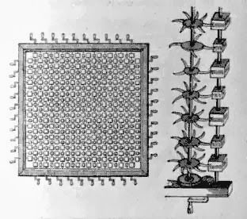

In the third part of [Gulliver's
Travels](http://es.wikisource.org/wiki/Los_viajes_de_Gulliver), 
"*A Voyage to Laputa, Balnibarbi, Luggnagg, Glubbdubdrib and Japan*.",
Jonathan Swift describes the extraordinary flying island of Laputa and the
continent of Balnibarbi, which lies under its rule.

The flying island was home to the ruling class, nobles who spent their time
lost in mathematical or musical speculations. Bored, and
despised by the inhabitants of Laputa, Gulliver decides to go down and
see the continent of Balnibarbi and its metropolis, Lagado, guided by
the lord Munodi.

This is part of the account of that visit. I am aware that people no
longer read texts of more than 140 characters, but even so, I invite you to read
this fragment carefully:

> This lord Munodi was a person of the first rank, and had been some
> years governor of Lagado; but, by a cabal of ministers, was discharged
> for insufficiency. However, the king treated him with tenderness, as a
> well-meaning man, but of a low contemptible understanding.
> \[\...\] He said, “if I would go with him to his country-house, about
> twenty miles distant, where his estate lay, there would be more
> leisure for this kind of conversation.” I told his excellency “that I
> was entirely at his disposal;” and accordingly we set out next morning.

> During our journey he made me observe the several methods used by
> farmers in managing their lands, which to me were wholly
> unaccountable; for, except in some very few places, I could not
> discover one ear of corn or blade of grass. But, in three hours
> travelling, the scene was wholly altered; we came into a most
> beautiful country; farmers’ houses, at small distances, neatly built;
> the fields enclosed, containing vineyards, corn-grounds, and meadows.
> Neither do I remember to have seen a more delightful prospect. His
> excellency observed my countenance to clear up; he told me, with a
> sigh, “that there his estate began, and would continue the same, till
> we should come to his house: that his countrymen ridiculed and
> despised him, for managing his affairs no better, and for setting so
> ill an example to the kingdom; which, however, was followed by very
> few, such as were old, and wilful, and weak like himself.”

> We came at length to the house, which was indeed a noble structure,
> built according to the best rules of ancient architecture. The
> fountains, gardens, walks, avenues, and groves, were all disposed with
> exact judgment and taste. I gave due praises to every thing I saw,
> whereof his excellency took not the least notice till after supper;
> when, there being no third companion, he told me with a very
> melancholy air “that he doubted he must throw down his houses in town
> and country, to rebuild them after the present mode; destroy all his
> plantations, and cast others into such a form as modern usage
> required, and give the same directions to all his tenants, unless he
> would submit to incur the censure of pride, singularity, affectation,
> ignorance, caprice, and perhaps increase his majesty’s displeasure;
> that the admiration I appeared to be under would cease or diminish,
> when he had informed me of some particulars which, probably, I never
> heard of at court, the people there being too much taken up in their
> own speculations, to have regard to what passed here below.”

> The sum of his discourse was to this effect:

> “That about forty years ago, certain persons went up to Laputa, either
> upon business or diversion, and, after five months continuance, came
> back with a very little smattering in mathematics, but full of
> volatile spirits acquired in that airy region:

> that these persons, upon their return, began to dislike the management
> of every thing below, and fell into schemes of putting all arts,
> sciences, languages, and mechanics, upon a new foot.

> To this end, they procured a royal patent for erecting an academy of
> projectors in Lagado; and the humour prevailed so strongly among the
> people, that there is not a town of any consequence in the kingdom
> without such an academy. In these colleges the professors contrive new
> rules and methods of agriculture and building, and new instruments,
> and tools for all trades and manufactures; whereby, as they undertake,
> one man shall do the work of ten; a palace may be built in a week, of
> materials so durable as to last for ever without repairing. All the
> fruits of the earth shall come to maturity at whatever season we think
> fit to choose, and increase a hundred fold more than they do at
> present; with innumerable other happy proposals.

> The only inconvenience is, that none of these projects are yet brought
> to perfection; and in the mean time, the whole country lies miserably
> waste, the houses in ruins, and the people without food or clothes.

> By all which, instead of being discouraged, they are fifty times more
> violently bent upon prosecuting their schemes, driven equally on by
> hope and despair: that as for himself, being not of an enterprising
> spirit, he was content to go on in the old forms, to live in the
> houses his ancestors had built, and act as they did, in every part of
> life, without innovation: that some few other persons of quality and
> gentry had done the same, but were looked on with an eye of contempt
> and ill-will, as enemies to art, ignorant, and ill common-wealth’s
> men, preferring their own ease and sloth before the general
> improvement of their country.”
>
> ([part III, chapter 4, of Gulliver's
> Travels](http://es.wikisource.org/wiki/Los_viajes_de_Gulliver:_Parte_III,_Cap%C3%ADtulo_IV))

It seems to me that a lot of what gets done from "the academy"
proceeds the way Gulliver tells us in this passage.

That superficial interest in technology and science, which is really
devoid of imagination, practical sense and any connection to reality, is
what always contaminates universities and the whole academic
circle.

The worst part is that it spreads to the whole of society, where those who have not
been through the academy feel ignorant if they do not follow the dictates
of the doctors and academics, who have never done anything practical of value
in their lives.

It is all nothing but sterile fashion, where academic speculations
about whether or not it is advisable to use free software, or about that pipe dream,
 [technological neutrality](http://www.mop.cl/noticias/200907/090731_bitar.htm), have
replaced common sense, which tells us that [what matters is getting
things done](/en/blog/lnds/2008/08/03/the-ceramics-lesson/), rather
than arguing about the best way to do them.

I do not believe anything good can come out of the academy, at least the way
it works today, because, knowing how it operates, it does not do so very
differently from [The Grand Academy of Lagado](http://es.wikisource.org/wiki/Los_viajes_de_Gulliver:_Parte_III,_Cap%C3%ADtulo_V):

> This academy is not an entire single building, but a continuation of
> several houses on both sides of a street, which growing waste, was
> purchased and applied to that use. I was received very kindly by the
> warden, and went for many days to the academy. Every room has in it
> one or more projectors; and I believe I could not be in fewer than
> five hundred rooms.

> The first man I saw was of a meagre aspect, with sooty hands and face,
> his hair and beard long, ragged, and singed in several places. His
> clothes, shirt, and skin, were all of the same colour. He had been
> eight years upon a project for extracting sunbeams out of cucumbers,
> which were to be put in phials hermetically sealed, and let out to
> warm the air in raw inclement summers.

>
> He told me, he did not doubt, that, in eight years more, he should be
> able to supply the governor’s gardens with sunshine, at a reasonable
> rate; but he complained that his stock was low, and entreated me “to
> give him something as an encouragement to ingenuity, especially since
> this had been a very dear season for cucumbers.” I made him a small
> present, *for my lord had furnished me with money on purpose, because
> he knew \*\*their practice of begging from all who go to see
> them.\*\**

> We crossed a walk to the other part of the academy, where, as I have
> already said, the projectors in speculative learning resided.

> The first professor I saw, was in a very large room, with forty pupils
> about him. After salutation, observing me to look earnestly upon a
> frame, which took up the greatest part of both the length and breadth
> of the room, he said, “Perhaps I might wonder to see him employed in a
> project for improving speculative knowledge, by practical and
> mechanical operations. But the world would soon be sensible of its
> usefulness; and he flattered himself, that a more noble, exalted
> thought never sprang in any other man’s head. Every one knew how
> laborious the usual method is of attaining to arts and sciences;
> whereas, by his contrivance, the most ignorant person, at a reasonable
> charge, and with a little bodily labour, might write books in
> philosophy, poetry, politics, laws, mathematics, and theology, without
> the least assistance from genius or study.”

> I was at the mathematical school, where the master taught his pupils
> after a method scarce imaginable to us in Europe. The proposition, and
> demonstration, were fairly written on a thin wafer, with ink composed
> of a cephalic tincture. This, the student was to swallow upon a
> fasting stomach, and for three days following, eat nothing but bread
> and water. As the wafer digested, the tincture mounted to his brain,
> bearing the proposition along with it. But the success has not
> hitherto been answerable, partly by some error in the _quantum_ or
> composition, and partly by the perverseness of lads, to whom this
> bolus is so nauseous, that they generally steal aside, and discharge
> it upwards, before it can operate; neither have they been yet
> persuaded to use so long an abstinence, as the prescription requires.

Gulliver's Travels is available online,
in [English](http://www.gutenberg.org/etext/829) (the original language), and
in [Spanish](http://es.wikisource.org/wiki/Los_viajes_de_Gulliver).
