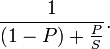
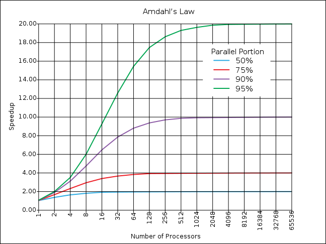

How do we increase the performance of our systems?

The answer starts with defining how we measure the performance of our
systems in the first place. We have already seen that a bad definition
of the performance measure can lead us into deep errors of judgment
([remember the problem with kilometers per liter of gasoline?](/en/blog/lnds/2009/08/23/numerical-deceptions/)).

Something similar happens with the performance gains of our computing
systems now that multicore processors are available. For a while now we
have been told that the trick to improving the performance of our
systems is to increase the number of processors and embrace parallelism
in the design of the software we build.

If we have a problem we can parallelize, how much does its performance
improve when we add more processors? In other words, if we solved a
problem with 1 CPU in time T, then with a dual-core CPU should we solve
it in T/2?

 

We know that's not how it goes. All of us with access to multicore
computers have noticed that things don't really improve that much.

Sure, a lot of our software still runs sequentially. But how much does
a process gain in general if we increase the number of cores? Is there
a limit to our ability to parallelize, or does parallel processing
promise a bright future of permanent progress in our computing power?

The answer will surprise you, and it was worked out by [Gene
Amdahl](http://en.wikipedia.org/wiki/Gene_Amdahl) in 1967.

## **Amdahl's law**

In 1967 Amdahl offered the following observation: "the improvement
obtained in the performance of a system by altering one of its
components is limited by the fraction of time that component is used".

In simple terms: "**it is the algorithm that decides the speedup, not
the number of processors**"[^1].

If a proportion P of a system's total time can be parallelized, and
that part can be sped up by a factor S, then the total improvement
obtained will be: 1 / ((1-P)+P/S) [^2].

It is easy to see that as S tends to infinity, the improvement tends to 1/(1-P).

For example, suppose we have a problem where 30% of the algorithm can
be parallelized while the remaining 70% stays sequential. Amdahl's law
says that by parallelizing the program to the maximum, the new version
will be 1/(1 -0.30) = 1.4285 times faster than the non-parallelized
version.

Amdahl's law follows a pattern of diminishing returns. If we plot the
law we get this:

Note that this law only considers the effect of adding more processors.
If we also factor in access to the data bus, synchronization and other
things, the effect is bigger.

## The false hope of Moore's law

For years many software developers have rested on the comforting
promise of [Moore's law](https://es.wikipedia.org/wiki/Ley_de_Moore), which says that
roughly every 18 months the number of transistors in an integrated
circuit doubles.

A hope expressed in the form of a myth, according to Alan
Kay[^3]: "The myth that no matter what your processing architecture is,
Moore's law will take care of everything".

If processors increase their capacity every 18 months, then their
speed doubles too, right?

But processor speed depends on the frequency of the internal clock they
use. The trouble is that raising the clock speed brings complex
technical problems (higher speed means more heat dissipation, and data
synchronization is lost). To get around these problems,
microprocessor designers decided to adopt other strategies. The
development of multicore processors is a consequence of these technical
limitations.

The idea is that you can get better performance by parallelizing tasks,
without having to raise the processor's clock speed. That way processor
makers can keep riding Moore's law, building processors with more
processing capacity every 18 months.

The problem is that we software developers used to take advantage of
faster processors to make up for the performance problems of our
algorithms or designs.

With clock frequencies staying almost the same over time, we can no
longer expect help from Moore's law. The hope collapses.

The proposal coming from the hardware side is simple: **parallelize**.

As if it were that easy!

Amdahl's law tells us that no matter how many processors (or cores) we
have, the gain is limited by the part of the algorithm that cannot be
parallelized.

This gives us another perspective
on [the supposed multicore crisis](/en/blog/lnds/2008/11/20/is-software-development-in-crisis-because-of-multicore/)

We now have more processors, but as we have seen, having more cores in
our processors has a limit.

There is a great deal of research going on into how to use the multiple
cores these new processors give us, and behind it are economic, business
motivations. Companies like Intel are funding research programs to
exploit the new parallelization capabilities we have.

But as we have seen, the real gains are somewhere else:
creating better algorithms.

The challenge, as always, is on the software side, not the hardware side.

The discussion continues in:

[The problem with parallelizing 2](/en/blog/lnds/2009/09/23/the-problem-with-parallelizing-2/)

[The problem with parallelizing 3](/en/blog/lnds/2009/09/28/the-problem-with-parallelizing-3/)

## References:

[^1]: Wikipedia: [Amdahl's law](https://es.wikipedia.org/wiki/Ley_de_Amdahl).

[^2]: [Derivation of Amdahl's law](https://jpscarpa.googlepages.com/leydeamdahl).

[^3]: [A conversation with Alan Kay](https://queue.acm.org/detail.cfm?id=1039523).
