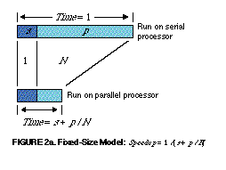
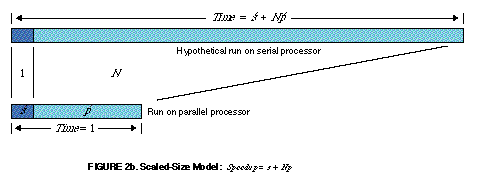

In one hour a car has covered half the distance between two cities
that are 120 km apart. No matter how fast the car drives the rest of
the way, its average speed will always be below 120 km/h (only at
infinite speed could it reach 120 km/h).

That example helps to understand Amdahl's law, which I
[presented earlier](/en/blog/lnds/2009/09/13/the-problem-with-parallelizing/).

But suppose a car has already been traveling for a while at less than
120 km/h. Given enough time and distance to travel, the car's average
speed can eventually reach 120 km/h, no matter how slowly it has been
going.

   

This other example is more or less what [Gustafson's
law](https://es.wikipedia.org/wiki/Ley_de_Gustafson) says.

In 1988 John Gustafson questioned the validity of Amdahl's argument. At
the time this researcher was using supercomputers at the high-energy
laboratories of [Sandia Labs](https://www.sandia.gov/), and he found
that the times he measured did not match what Amdahl's law predicted.

According to the formula we saw before, the speedup is given by
Speedup = 1 / (s + p / N), where s is the time spent in the serial part,
p is the time 1 processor takes on the parallel part of the problem,
and N is the number of processors.

Gustafson noticed that for a value of s between 0.4% and 0.8% he got
speedups of 1020 or 1016, using a hypercube with 1024 processors. If
you do the math you'll see that this doesn't fit what Amdahl's law
predicts (for s = 0.4% the speedup is = 1 / (0.004 + 0.996/1024)
= 201.099).

Gustafson realized that Amdahl assumes the parallelizable part p is
independent of N, that is, of the number of processors. According to
Gustafson that is almost never the case; in practice *the size of the
problem scales with the number of processors*.

Gustafson proposed a different law for problems in which the parallel
part p\' depends linearly on the number of processors N.

Scaled Speedup = *N* + (1 - *N* ) *s*\'

Gustafson published his result in  
[Communications of the ACM](https://en.wikipedia.org/wiki/Communications_of_the_ACM) in 1988;
you can read the
article [here](https://www.scl.ameslab.gov/Publications/Gus/AmdahlsLaw/Amdahls.html).

The following figures sum up Gustafson's argument (keep the car
argument in mind to follow it better):

Figure 2a assumes a model where the parallel part is independent of
the number of processors (fixed-size model).

Figure 2b assumes that the parallelizable part (p\') of the problem
scales with the number of processors (linearly): if I have 2
processors, the parallelizable part runs twice as fast.

With Gustafson's argument Amdahl's law seemed dethroned, and the
advocates of massively parallel processing could breathe easy: the
speedup is proportional to the number of processors.

Think about this. Suppose you have a process that is trivially
parallelizable. Such a problem is not hard to imagine: for example,
multiplying every element of an NxM matrix A by a constant value, say
2.

A\[i,j\] = A\[i,j\] \* 2

In this case s = 0, p = 1, and it is clear that the speedup is N,
whichever formula we use, Gustafson's or Amdahl's.

But outside these \"[embarrassingly
parallel](http://www.cs.mu.oz.au/498/notes/node40.html)\" problems, the
other problems that follow the behavior of Gustafson's law are those
that exhibit scalable parallelism (trivially parallelizable problems
are scalable in parallel).

Many of the problems that best fit Gustafson's law can be parallelized
automatically, and there are compilers that can detect data
dependencies and generate highly parallelizable code.

These problems come up a lot in physics, or in mathematical
calculations on matrices and vectors.

But the interesting thing is that Gustafson's law and Amdahl's law are
actually related. In fact, Gustafson's law is another way of looking at
Amdahl's law; they are equivalent laws. For years this was not well
understood, and it produced misinterpretations.

In the words of Yuan Shi, the researcher who discovered the equivalence
of the two laws:

> \"In 1967, Amdahl's Law was used as an argument against massively
> parallel processing. Since 1988 Gustafson's Law has been used to
> justify massively parallel processing (MPP). Interestingly, a careful
> analysis reveals that these two laws are in fact identical. The well
> publicized arguments were resulted from misunderstandings of the
> nature of both laws\".

And the nature of these laws is what we'll talk about in
[part three](/en/blog/lnds/2009/09/28/the-problem-with-parallelizing-3/).

