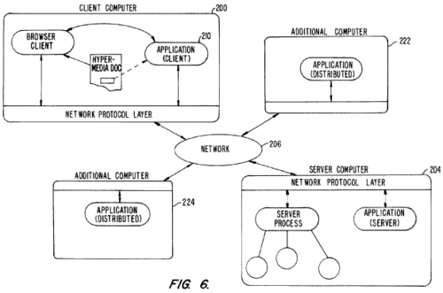
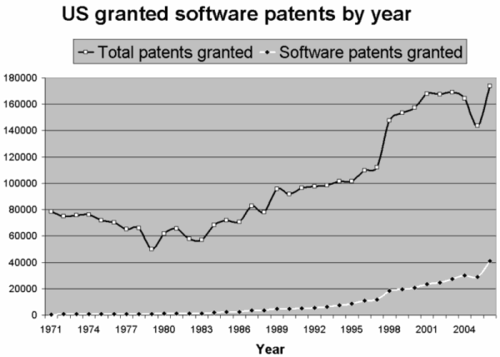

Back in 2005 I told you about [the Eolas case](/en/blog/lnds/2005/12/06/the-eolas-case/):

> Eolas stands for "Embedded Objects Linked Across Systems". But in Gaelic it means wisdom.

> The guys at [Eolas](http://www.eolas.com/) have held a [patent ](http://164.195.100.11/netacgi/nph-Parser?Sect1=PTO1&Sect2=HITOFF&d=PALL&p=1&u=/netahtml/srchnum.htm&r=1&f=G&l=50&s1='5838906'.WKU.&OS=PN/5838906&RS=PN/5838906)since 1994 that covers embedding objects in internet browsers.

> According to Eolas's [technology page](http://www.eolas.com/technology.html), the patent covers "web browsers that support popular technologies such as ActiveX components, Java applets and browser plug-ins".

> Of course, once they had the patent they went after the biggest fish, taking on Microsoft first and winning some 500 million dollars...

Eolas took four years to go after the other companies:

>  It's more or less obvious that Eolas has Macromedia (now Adobe) and Sun in its sights. Even Firefox could be affected. This is so damaging that even the W3C had decided to fight Eolas, calling for a [massive search for evidence of "prior art"](http://news.com.com/Web+patent+critics+spotlight+old+technology/2100-1028_3-5100693.html?tag=nl), all so that the United States patent office would [reconsider the patent it had granted](http://news.com.com/2100-1032_3-5106129.html). But, although we don't know where things stand, Microsoft decided that plugins definitely[will have to be explicitly activated ](http://news.com.com/Microsoft+tweaks+browser+to+avoid+liability/2100-1012_3-5980658.html)by the user.

We don't know what agreement Microsoft and Eolas reached, but now the company [announces ](http://sev.prnewswire.com/banking-financial-services/20091006/DA8775006102009-1.html) that the lawsuit involves two Eolas patents: U.S. Patent No. 5,838,906 ('906 Patent) and U.S. Patent No. 7,599,985 ('985 Patent).

  

The '906 patent was the subject of the litigation against Microsoft in 2004, which ended with a 565 million dollar result in favor of Eolas. According to Eolas, the United States Patent Office has confirmed the validity of the '906 patent in three separate proceedings, including two reexaminations, the most recent of which concluded in February **2009**.  

According to Eolas, the '985 patent is a continuation of the '906 patent, and allows websites to add fully interactive embedded applications to their online offerings through the use of plug-ins and AJAX (asynchronous JavaScript and XML) as a web development technique. The '985 patent was granted in **October** **2009**.

This time Eolas is suing, among others: Adobe, Amazon, Go Daddy, Google, Sun Microsystems Inc. (and therefore Oracle), Yahoo, and Youtube.

The diagram below is a sketch of how the '985 patent of **October** **2009** operates:

As you can see, practically the entire dynamic of Web 2.0 and Ajax is covered by this patent.

A summary of the patent describes it like this:

> A system that allows the user of a browser program on a computer connected to an open distributed hypermedia system to access and execute an embedded program object. The program object is embedded into a hypermedia document in the same way as data objects.
>
> The user can select the program object from the screen. Once selected, the program runs on the user's (client) computer, or it can run on a remote server or on additional remote computers arranged as distributed processors.
>
> After launching the program object, the user is able to interact with the object, since the invention provides the necessary interprocess communication between the application program object and the browser program.
>
>  This patent was filed in 2002.

This software patent business has many parallels with the Cold War and the threat of nuclear weapons: the powers armed themselves with patents so as to [ensure mutual destruction](http://es.wikipedia.org/wiki/Estrategia_de_las_armas_nucleares) (you know, I have this patent, but I won't sue you if you don't sue me over that other patent you have). In general the big companies keep patents in their arsenal but are afraid to use them, so as not to unleash a [patent apocalypse](http://www.codinghorror.com/blog/archives/000902.html.

But they didn't count on a little guy getting hold of a patent too. It's like Iran, or North Korea, developing nuclear weapons. Except that in the case of patents the little guy has already dropped the bombs.

  
