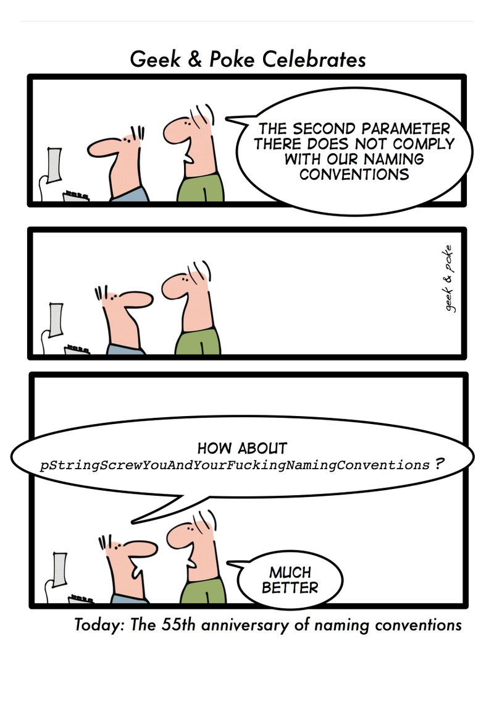

Some conventions add nothing. What matters is being consistent, and if you adopt a coding convention, sticking to it, but without overdoing it. There is no perfect convention.

Taken from [Geek and Poke](http://geekandpoke.typepad.com/geekandpoke/2009/10/geekpoke-celebrates-part-1.html)

