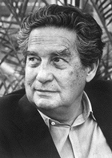
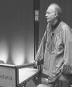

> "The revelation of our condition is, likewise, the creation of ourselves. As we have seen, that revelation can come in many forms and may even receive no verbal formulation at all. But even then it implies a creation of the very thing it reveals: man. Our original condition is, in essence, something that is always making itself"

That is how Octavio Paz opens the chapter "Inspiration" in his book "The Bow and the Lyre", and I turn

to him precisely in search of the push I need to leap the abyss, to leave the comfort of the tunnel and see whether, beyond the exit light the blank screen offers me, I can find the creative urge again and so bring to life my first article for La Naturaleza del Software. As a starting point, nothing better than the title of this blog itself, "La Naturaleza del Software" (The Nature of Software), and seeing whether the revelations of our condition are nothing but our own creations. "Programming is an art", says Donald Knuth, a phrase that flatters our ego and lets us dream of being artists, of taking on the mantle of the creator and repeating the story of Prometheus. Brian Kernighan quickly brings us back down to earth with his quote "Controlling complexity is the essence of

software". Is that what we are, the controllers of complexity? What's more, guys like Ken Thompson remind us how primitive the making of software can get: "When in doubt, use brute force". These apparent contradictions are the forces struggling over something that is always making itself: software as a creation of man and, ultimately, man himself through the use of technology.

For many, however, the view of programming as art is the expiation of the guilt of not having managed to control the complexity of the essence of software and of the problems it solves, the redemption for having applied brute force when the muses were on vacation and there was no time to wait for them to come back.

Seeing programming as a creation leads us, unconsciously, to the "creationist" approach to the nature of software: in the beginning, chaos; then six days of hard work and late nights; and at the end of the project we get that marvelous order called the universe, along with the well-earned reward of rest on the seventh day. If the universe didn't turn out so orderly, blaming the creator is disrespectful; after all, before there was only chaos. And after the seventh day? Well, we do "Software Maintenance". We control complexity, without brute force, but more brutish every day. We install the idea that a permanent order exists. Neanderthal man surely thought the same.

Unlike the craftsman, who uses his instruments and materials to serve himself, the artist seeks to transcend the language he uses; he is someone who puts himself at the service of the language or medium of expression and seeks to have it recover its original nature and go beyond it. It is in that context that programming is an art, because the nature of software is the nature of man, who transforms his environment and transcends in his possibilities. That is the meaning I give to Donald Knuth's quote, and that is where the nature of software lies.
