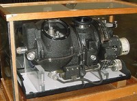
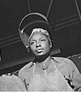

World War II is full of stories of women who went to work in the roles of the men who were off fighting. This is one of them.

In 1940 Germany was the leading country in optics, with factories like [Carl Zeiss](http://en.wikipedia.org/wiki/Carl_Zeiss_AG)in Jena and [Ernst Leitz](http://en.wikipedia.org/wiki/Ernst_Leitz) in Wetzlar. There was nothing better outside Germany, and this was crucial for developing optical instruments used, for example, in precision bombing. That is why the German army considered optics one of its strategic resources.

In 1940 the German military figured it would take the Allies a generation to train "optical craftsmen" capable of producing high-quality bombsights like theirs.

In early 1940 the United States had a prototype of a quality bombsight, the "Norden", developed by the Dutch engineer Carl Norden. The bad news was that they had no optical industry capable of producing the thousands of sights the war required.

According to [Peter Drucker](http://es.wikipedia.org/wiki/Peter_Drucker), at that time the head of General Motors' Cadillac division, Nicholas Dreystadt, took on the defense contract for mass production of the Norden bombsight. Everybody knew this job required highly skilled mechanics. During the war there was nobody to hire, let alone top-level mechanics.

This is the story in Drucker's words:

> The only labor available in Detroit was old black prostitutes. To everyone's horror, Nick Dreystadt hired 2,000 of them. "But hire their madams too," he said. "They know how to manage the women." Very few of these women could read, and the job required following long instructions. "We don't have time to teach them to read," said Nick, "and few of them would learn anyway." So he went to the workbench and built a dozen sights himself. When he knew how to do it, he took a camera and filmed the process. He mounted the film frames separately on a projector and synchronized them with a flowchart, in which a red light came on to show the operator what she had already done, a green light to tell her what she had to do next, and a yellow one to show her what she had to check before taking the next step. This is today's standard procedure for a mass assembly process; it was Dreystadt who invented it. Within a few weeks these illiterate, unskilled workers were turning out better work than the highly skilled mechanics had done before.

Sadly this story did not have a happy ending. When the war was over, Dreystadt had to face the power of the unions, and he had to lay off all the women who had worked at the Norden bombsight plant.

