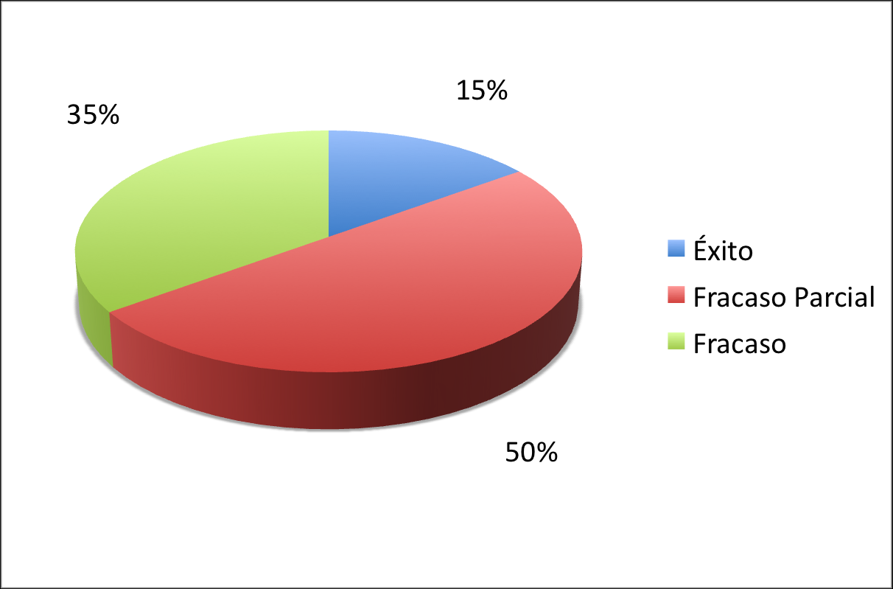

> ***Can you imagine having to add a new bedroom, and a jacuzzi in the
> bathroom, to every apartment in a 24-story building, all over a single
> weekend, and with the tenants inside?***

A few months ago I talked with a former teaching assistant in software
engineering at a traditional university. He showed me an exam in which
the students were asked to comment on the Chaos Report's claim about the
high failure rate of software projects. What kind of nonsense were you
teaching your students?! was my sarcastic comment.

I remembered that discussion because of a [recent post](http://www.alejandrobarros.com/content/view/691759/Comportamiento-de-proyectos-TI-Estan-en-deuda.html#content-top) by
Alejandro Barros, which opens by provoking us with this line:

> Can you imagine if only 32% of real estate or infrastructure projects
> were successful?

And he titles it: How IT projects behave: they owe us!

**They owe us!** Of course I don't agree, and I have several arguments, which I'm going to lay out in this post and several more.

Alejandro's post starts by mentioning the famous Chaos Report, which
we've talked about a bit in the past, but it goes further, because it
brings in other interesting figures, such as [this survey](http://www.ambysoft.com/surveys/success2007.html) and an
[article in Dr Dobbs Journal](http://www.ddj.com/architect/204200877?cid=Ambysoft).
Let's take it one piece at a time, to see whether it makes sense and whether we should acknowledge
this debt or not (I already have plenty of debts without taking on another one).

The topic is controversial, to be sure, because it lends itself to all kinds of figures, and
abuses. For example, Oracle says that
[90% of its projects are successful](http://blogs.zdnet.com/projectfailures/?p=483) (take that!).
Well, you know what House says: everybody lies!

In this post we'll deal with the Chaos Report, and leave for other
articles the analysis of the other interesting sources Alejandro
provides, to finish with a reflection on the nature of
software, and why I believe this supposed debt doesn't apply.

## **The Chaos Report**

Since 1994 the report from the [Standish Group](http://www.standishgroup.com/), the famous Chaos Report, has
become the gold standard on the quality of IT projects. Its
damning conclusion: **only 15% of IT projects
succeed**. And it shows us this pretty chart:

What a disaster! Why don't I go do something else instead\...

There are several things to say about this report: what is the definition of
success or failure? What kinds of projects are analyzed? Of what
size?

Robert Glass asks the same questions I ask myself about
this report, in his August 2006 article in Communications of the
ACM: "The Standish Report: Does It Really Describe a Software
Crisis?"

> "There has been a lot of discussion over the last few decades about something called
> "the software crisis." Those who speak of such a crisis claim
> that software projects are always over budget, behind
> schedule, and unreliable.
>
> This way of thinking about a software crisis amounts to a
> condemnation of software practice. The picture painted is that of
> a field from which no valid products can be expected.
>
> \...
>
> But it is important to step back and ask some questions about this
> crisis thinking:
>   * Does it represent reality?
>
>   * Is it supported by research findings?
>
> \[\...\] The reality is, I would assert, that we are in the middle of what
> sociologists call the information age, an age that would be
> simply impossible without a wealth of successful software
> projects. Does this suggest that the software field is really
> in crisis? Not to my way of thinking.
>
> At first glance, there are a great many publications that
> conclude this crisis really exists. Many academic studies
> claim that the software crisis is the reason behind the particular
> study they are advocating, a concept whose intent is
> to address and perhaps solve this supposed crisis.
>
> Software gurus often engage in this same advocacy, and
> use it to frame their favorite topic as the solution to the crisis.
>
> But there is an underlying problem here. Many of these academic
> papers and guru reports cite the same source for this
> concern about the crisis, a study published by the Standish
> Group more than a decade ago, a study that reports high failure
> rates, of 70% or more, and minuscule success rates, a study that
> condemned software practice by the very title they used for the
> published version of their study: The Chaos Report.
>
> So the Standish report could be considered fundamental to
> many of the claims about the crisis. What do we really know about
> this study?
>
> That question is of growing concern in the field. Several
> researchers, interested in finding the origins of this
> key information, have contacted Standish and asked them for a
> description of their research process, a summary of their latest
> findings, and in general a scholarly discussion of the validity of
> their findings. They have raised these issues because
> many research studies conducted by academics and
> industry researchers arrive at data largely
> inconsistent with the Standish results.
>
> Let me say that again. The results of objective studies do not,
> in general, support the Standish conclusions.
>
> Repeatedly, these researchers who have queried Standish have
> been rebuffed. It is apparent that Standish has not intended, at least in
> the past, to share much about where the data used for
> the Chaos Report comes from.
>
> And that, of course, calls into question the validity of their
> conclusions.
>
> But now there is a new insight into these Standish
> results. A pair of researchers, carefully combing through the original
> Standish report, discovered a key description of where
> these results might come from. The report says, in Standish's own
> words, **"We then called and mailed a
> number of confidential surveys to a random sample of top
> IT executives, asking them to share failure
> stories."**
>
> Notice the words at the end of the sentence: "...share failure
> stories." If this is, in fact, the basis of the contacts Standish
> made with its survey participants, then the findings
> of the study are obviously biased toward reports of failure.
> And how much does it matter if 70% of the projects that are the subject of
> failure stories eventually fail? Not much.
>
> There is a dramatic case of déjà vu here. In the 1980s it was popular to support
> the notion of the software crisis by citing the GAO Study, a report
> from the U.S. government's Accounting Office that reported a
> terrible failure rate among the software projects
> studied. But in that case, after it had gone on far too long,
> an alert researcher reread the GAO Study and found that it
> admitted, quite openly, that it was a study of projects
> known to be failing at the time the data was
> collected. Once that problem was identified, the GAO
> Study was quickly dropped as a citation to support the notion of a
> software crisis. Interestingly, the first Standish study
> appeared not long after.

Glass ends by wondering whether the Standish study
suffers from the same problem as the GAO Study, and the truth is we don't
know. Although the Standish Group has been asked for the information many times,
it has not been possible to get it.

There is an InfoQ interview with Jim Johnson, of Standish, where he is
asked directly about [Glass's
criticisms](http://www.infoq.com/news/Standish-Chaos-Report-Questioned) of his
work. Here is
the [link](http://www.infoq.com/articles/Interview-Johnson-Standish-CHAOS),
so you can judge for yourselves; personally I think he dodges the issue.

Personally, I think the Chaos Report should stop being taken
seriously until the legitimate doubts raised by Glass and others have been
resolved.
