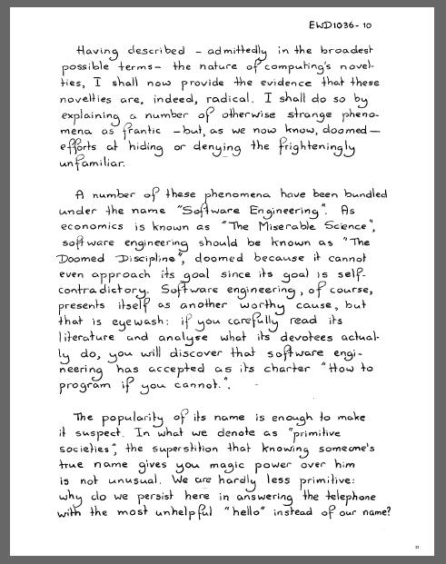

I think one of the best arguments against the notion of a
software crisis was given, indirectly, by
[Edsger W. Dijkstra](/en/blog/lnds/2012/03/03/quality-correctness-and-elegance-dijkstra-interview/),
in his 1988 talk "[ON THE CRUELTY OF REALLY TEACHING COMPUTING
SCIENCE](http://www.cs.utexas.edu/users/EWD/ewd10xx/EWD1036.PDF)"

> A number of these phenomena have been bundled under the name
> "Software Engineering". As economics is known as
> "The Miserable Science", software engineering should be
> known as **"The Doomed Discipline"**, doomed because it cannot
> even approach its goal since its goal is
> self-contradictory. Software engineering, of course, presents itself
> as another worthy cause, but that is eyewash: if you carefully read
> its literature and analyse what its devotees actually
> do, you will discover that software engineering has accepted
> as its charter **"How to program if you cannot."**.
>
> \...

> The practice is pervaded by the reassuring illusion that
> programs are just devices like any others, the only
> difference admitted being that their manufacture might require a
> new type of craftsmen, viz. programmers. From there it is only a
> small step to measuring "programmer productivity" in
> terms of "number of lines of code produced per month". This is a
> very costly measuring unit because it encourages the writing of insipid code,
> but today I am less interested in how foolish a unit it is from even
> a pure business point of view. My point today is that, if
> we wish to count lines of code, we should not regard them as "lines
> produced" but as "lines spent": the current conventional wisdom
> is so foolish as to book that count on the wrong side of the
> ledger.
>
> Besides the notion of productivity, also that of quality control
> continues to be distorted by the reassuring illusion that what works
> with other devices works with programs as well. It is now two
> decades since it was pointed out that program testing may
> convincingly demonstrate the presence of bugs, but can never
> demonstrate their absence. After quoting this well-publicized
> remark devoutly, the software engineer returns to the order of the day and
> continues to refine his testing strategies, just like the alchemist
> of yore, who continued to refine his chrysocosmic
> purifications.
>
> Unfathomed misunderstanding is further revealed by the term
> "software maintenance", as a result of which many people
> continue to believe that programs —and even programming
> languages themselves— are subject to wear and tear. Your car
> needs maintenance too, doesn't it? Famous is the story of
> the oil company that believed that its PASCAL programs did not last
> as long as its FORTRAN programs "because PASCAL was not
> maintained".
>
> In the same vein I must draw attention to the astonishing
> readiness with which the suggestion has been accepted that the pains of
> software production are largely due to a lack of
> appropriate "programming tools". (The telling
> "programmer's workbench" was soon to follow.) Again, the shallowness of
> the underlying analogy is worthy of the Middle Ages. Confrontations
> with insipid "tools" of the "algorithm-animation"
> variety has not mellowed my judgement; on the contrary, it has
> confirmed my initial suspicion that we are primarily dealing
> with yet another dimension of the snake oil business.

> [Full text in Spanish](http://www.smaldone.com.ar/documentos/ewd/sobre_la_crueldad.html)
> available on [Javier Smaldone](http://www.smaldone.com.ar/)'s site.

What still isn't understood is that software development is not like
building objects, and this fundamentally different nature is
what leads to mistakes when trying to define the success or failure of a
software development project.

