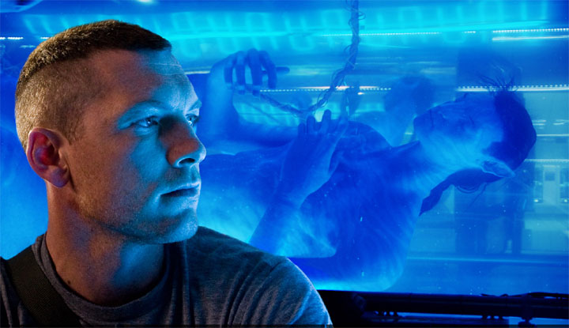

 
I had to talk about Avatar. Although I went to see it the day after it
opened, I hadn't had time to write anything about this movie;
besides, it's something I promised [my son](http://www.d3ne.net/).

Now that I can make a little time, I'm going to write a couple of things
about Avatar. I've decided to come at it from several angles, so
I'll probably write more than one article.

What follows is not film criticism. It's technology; it's my view as a
software developer of Avatar and what it proposes. These
little articles assume you've already seen Avatar, and if you haven't, go see it,
preferably in 3D.

The first part springs from an [excellent article](http://terceracultura.cl/2009/12/22/avatar-un-gendankenexperiment-inconcluso-pt-1/)
at [Tercera Cultura](http://terceracultura.cl/), which starts from an
interesting epistemological question, laid out by Remis Ramos, who
explores the problem of where Jake Sully's consciousness resides when he
"operates" the avatar, following the argument Daniel Dennett made in
his essay ["Where Am I?"](http://www.newbanner.com/SecHumSCM/WhereAmI.html).

To the point: the philosophical problem posed by Tercera Cultura is the
following:

> Jake Sully is an ex-marine who is recruited to *incarnate himself in*, or
> transfer his mind to, or temporarily remote-control an avatar,
> created from his twin brother's DNA and the DNA of the Na\'vi.
> Let's call **Yeik\'Suli** (a digital actor in the film) his
> blue incarnation, this genetic hybrid almost three meters tall.
> Let's call, respectively, **Jake** the mind of Jake Sully,
> ***Lleic*** Jake's original (paraplegic) body, and ***Yeik***
> his avatar.
>
> The premise is that when Jake gets into the machine and "connects",
> either:

    1. We assume a [dualism](http://en.wikipedia.org/wiki/Dualism_%28philosophy_of_mind%29), and say that Jake is **moved** to Yeik (as if his "soul" jumped from one Cartesian "pineal gland" to another)
    2. We assume a [functionalism](http://en.wikipedia.org/wiki/Functionalism_%28philosophy_of_mind%29) and say that Jake is **replicated** or **instantiated**in Yeik's nervous system (that is, when the process starts a snapshot of Jake's functional state is taken and implanted in Yeik's brain)
    3. We assume that Yeik has no nervous system (or that it is disabled) and that it is a device serving as a **remote control**, and Jake never "leaves" Lleic, but only controls the body, and receives the sensory stimuli back, in an unexplained sensorimotor loop
    4. We assume that Yeik has a structurally identical and compatible nervous system, and that what leaves Lleic is a **configuration** (activation values, neural connectivity, etc.) sent to Yeik, and that when Jake returns to his original body, this configuration is "updated" in Lleic's brain.

In case 1 we have to ask how it is possible for the soul to be
transferred through a piece of technological apparatus.

Case 2 makes no sense: "Why not just make a copy of Jake,
put it permanently into Yeik, and from then on let each go his own
way?"

Case 3 seems more plausible, but then "how is it possible to
make a definitive transfer? In this scenario, Jake's mind
never leaves (and cannot leave) Lleic. The only things going in and out are his
sensory inputs and his motor outputs. We have to assume, then, that
the only way to make a definitive transfer is with a brain
transplant"

And in case 4 we are really looking at case 2 again, with "the
difference that in 2 Jake (the mind) is conceived as being identical
with the functional states of Lleic's brain, and in 4 with the
physical neuronal states. What we have in both cases is an
ontological confusion, perhaps derived from an improper application of the
metaphor 'mind/brain as software/hardware'."

The two interesting questions that come up are "Where is Jake
really when he controls Yeik?" and the second is "is Jake's mind
the functioning of Lleic's nervous system, is it an abstract functional
pattern that can be replicated on other hardware (like Yeik, or a robot,
etc.), or is it a metaphysical phenomenon?"

This isn't easy to answer because the movie is confusing. It doesn't tell us
what kind of information travels from Jake's body to his
Avatar's, which would let us settle the problem; on the contrary, it drops
hints that can point anywhere, even depending on our own
belief systems.

I'm no philosopher, so I leave the problem to the experts, but\...

For Remis Ramos the movie is not spiritualist:

> For my part, my thesis is that Avatar IS NOT a
> spiritualist movie, it is a *Third Culture* movie. The key is this:
> Grace (Sigourney Weaver's character) discovers that what actually happens on
> Pandora is that the trees communicate with one another as if
> they were neurons in a nervous system. And that the Na\'vi can
> connect (literally) to this database of their species, in which
> the minds or the memories of their ancestors reside. It is not about
> irreconcilable souls and bodies, it is about **explaining through
> science what the Na\'vi live through their faith and their culture, without
> eliminating the phenomenon being explained, but integrating it with the other
> levels of explanation**. That is exactly the point. Neither
> eliminative reductionism nor epistemological relativism: the
> aim is to integrate into a coherent whole the different apparent
> aspects of reality, which deep down is only one.

I think there is something left unsaid in the movie, and it has to do
with the key Remis Ramos talks about. I suspect Cameron has something
up his sleeve, and that he is really applying [Clarke's third
law](/en/blog/lnds/2008/03/18/arthur-clarke/): "Any
sufficiently advanced technology is indistinguishable from magic".

I have the feeling, because I share [J.C.
Barroux's suspicion](http://levieuxcoq.blogspot.com/2010/02/el-sueno-de-avatar.html),
that nothing on Pandora is natural, because evolution doesn't explain that
planet's strange ecosystem. That leads me to think that
we are probably in the presence of a very advanced technology,
and that the whole planet seems to be designed (which makes
Cameron's proposal unsettling; in any case I don't think he supports an idea like
intelligent design).

If so, if we are looking at a very advanced technology, then the
definitive transfer of Jake's mind to the Avatar's body is possible.

I like to think that the idea put forward by several modern physicists,
such as [Seth Lloyd](http://www.rle.mit.edu/rleonline/People/SethLloyd.html), that
the universe is information, is correct.

In a few more years physics will probably become one more branch of
information theory, and we'll be able to give a concrete answer to the
problem posed by Dennett, and reformulated from this movie
by Ramos.

If everything is information, then the transfer of the soul seems
plausible. Or am I very wrong?

I have to thank this Tercera Cultura post, because it made me
think a lot, for showing me this interesting problem, which is
developed by the philosopher [Daniel
Dennett](http://www.edge.org/3rd_culture/bios/dennett.html). If you're
interested in these things, I suggest reading the article recommended by Remis
Ramos.

The problem of Pandora's technology is left hanging.
