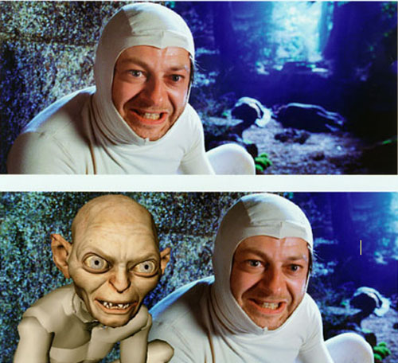
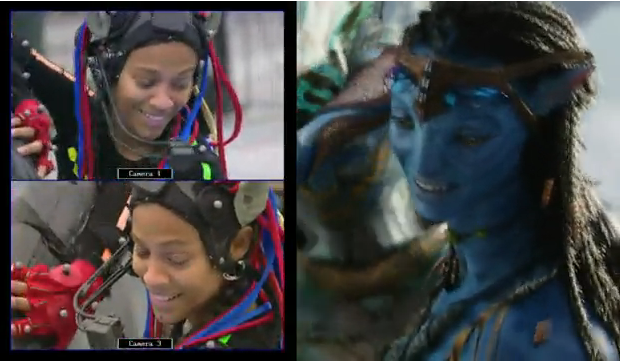

 
[Andy Serkis](http://en.wikipedia.org/wiki/Andy_Serkis) is an expert in
the art of "[performance capture](http://en.wikipedia.org/wiki/Motion_capture)" (also known as Motion Capture, or Mocap), the digital capture
of an acting performance. Not only has he helped the technicians at
[WETA](http://www.wetafx.co.nz/) develop the motion capture
technique, he took that technique to the state of the art with his
performance as Gollum in The Lord of the Rings.

So much so that several critics suggested Serkis be nominated for
an Oscar for best supporting actor for the role, and Sir Peter
Jackson (yes, he's a Sir now) backed the idea, arguing that the only
detail that set it apart from a "normal performance" was that the
makeup was applied digitally in post-production.

This is the same technique Cameron used to capture the performance of
the beautiful [Zoe Saldana](http://www.zoesaldana.com/) as Neytiri, the princess of
the Omaticaya:

I'd like to know what The Lord of the Rings would look like in 3D :smile:

I'd say the movie is a kind of manifesto from Cameron. For manifestos
to be powerful they have to be simple and straight to the
point. Cameron isn't contributing anything new to the art of cinema; he is
contributing to the technique and to the industry of cinema.

It's a technological manifesto. It's not worth analyzing the plot, or the
script, or expecting much from it. The story has been told a thousand times,
and it's full of stereotyped characters. I don't think Cameron is very
interested in making art with this movie. Hopefully he can build a
more interesting story on this technological foundation if he
decides to continue with a saga; otherwise it will be pure technological saturation, and
therefore counterproductive.

The movie's name is not innocent, and it's a key to this
manifesto. Actors can be synthetic. At the end of the movie
Jake Sully leaves his human body and transfers himself entirely into the
Avatar's body.

Is he proposing something like that for actors? Is live acting no
longer relevant to keeping people entertained? It's enough to capture
their movements, their gestures. For a while we're going to need actors,
until we have enough data to express any
feeling or emotion by picking the right heuristic.

For a while the actor will control his avatar, but the moment will come
when the actor is the avatar, when his entire consciousness is
available on our computers.

And probably, when that happens, the dream of Star Trek's
holodecks will come true, and cinema will be a fully
immersive, personal and interactive experience with actors made of pure light.
