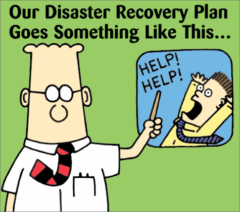

 I heard on the radio that ONEMI, Chile's national emergency office, has satellite phones in the
main cities, but that the batteries were dead, or there were
no spare batteries.

On the Juan Fernández islands [a 12-year-old girl rang a gong](http://www.google.com/hostednews/epa/article/ALeqM5iDOMz9QI_lpMpxs8xDCgXBBys_GA),
80 centimeters in diameter, to warn the island's inhabitants
that the tsunami was coming. Yes, the Juan Fernández tsunami
warning system is a gong 80 cm in diameter!

It would seem our country's disaster recovery plan is
something like this famous cartoon:

Apparently a wording problem, an almost semantic argument, persists
between the Navy and ONEMI over the use of the conditional in the
communications between these institutions about the tsunami: "there could
be a tsunami" is said to have been the phrase used.

In emergency situations language must be direct, without
ambiguity.

Besides, it's not enough to write pretty emergency plans and protocols
if they are never tested.

Ours is a seismic country, with a long coastline. It's ridiculous that we don't
have a culture of preparing for this kind of disaster.

When it comes to communications and energy infrastructure,
we clearly have big shortcomings.

Public safety has suffered from the delay in deploying
the security forces, and from the media's poor handling of information.

In this age when we are hyperconnected, with many
media outlets, and social networks that let anyone spread
information, the amount of noise can rise dangerously. Given
that, it's important that the authorities handle information better. It's
not enough to have a minister show up in front of the TV cameras. If
people use social networks, these must be covered by official
government accounts. I don't know if there is an ONEMI twitter account, but
there should be a twitter account for every ministry and for the institutions that
act in these situations. They should also have an official facebook
account. Social networks are a new communication medium
that demands attention, because they are very vulnerable to rumor and
misinformation.

Let's hope we learn from this, and manage to improve our national
disaster recovery plan.
