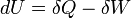

A month has now passed since the earthquake.

We keep hearing strange conspiracy theories, and prophecies of
more terrible catastrophes to come.

People look for signs. For example, that today is Saturday, just like
the day of the earthquake! How curious, some say, when in fact that
happens in almost every non-leap year: since February normally has 28
days, the days of the week line up in March, so it's normal for
March 27 and February 27 to both be Saturdays, just as it's normal that if
there was a new moon on the day of the earthquake, there's one today too, given that the
moon has a rotation and revolution cycle of 28 days.

That it's very hot, that there's a new moon, that lights were seen in the
sky.

On a mailing list I made the comment, made up of course,
that no birds were seen in the sky that day, and sure enough some people
stopped to think about it, and even stated that it had indeed been so.
I made that up, just to see how gullible people are.

If someone claims they noticed strange behavior in animals,
there will be no shortage of people saying that's how it was, when animals were probably the last thing
they paid attention to that day. They say animals sense these
things beforehand. I don't know, but if so my pets didn't get the memo,
because they acted as normal that day as ever, and afterwards they were as
scared as we were.

That's the problem with these esoteric, or pseudo-scientific,
claims: nobody stops to validate them, to even test whether they're
true. It all comes down to "it must be so because they said it on TV", or
on twitter, or because it shows up [in a video on the
internet](http://gallir.wordpress.com/2010/03/01/tres-minutos-para-una-conspiracion/).

And the same goes for other things, like this Earth Hour business. An
initiative that aims to bring relief to our long-suffering planet through the
gesture of turning off the lights for an hour.

Fine, as a gesture, maybe, but we could also go stand in front
of our rulers' houses and show them a raised middle
finger.

Because if you think this is about saving energy, the truth is
this initiative is pretty stupid, because you can only save something
that can run out. If you have money in your pocket, you can save it
to make it last longer, but energy can't be saved, since *energy
is generated*; energy is only "stored" in the form of
potential energy. Because if you remember what they supposedly taught you in
school, **energy is neither created nor destroyed, only
transformed**.

If "everybody" turns off the lights for an hour, what happens is that the
electric companies keep generating energy, but have to adjust
to the lower demand, and if nobody uses that surplus it is simply
lost, if nobody takes measures. So either the power
generators take measures to generate less for that while, or we are
wasting a lot of energy, which is real nonsense.

I know teenagers who are worried about this Earth Hour
thing, and have spent the whole day before, and the hours after,
playing PlayStation in front of a 42-inch plasma. Adults too,
who turn everything off for an hour and then go watch a movie on their
home theater, and heat up pizza or popcorn in their microwaves, and
nothing happened here, their ecological consciences squeaky clean.

The point, the impact that really matters, is reducing energy
consumption permanently. Now that is important.

Using low-energy light bulbs, replacing plasmas and old tube monitors with cheaper technologies, like LCD. Using computers for
useful things, turning off the TV and reading books, not having every light
on. That is an intelligent way to reduce energy
consumption.
